<p style="font-size: 0.85em; color: #606c71; border-left: 3px solid #dce6f0; padding: 0.4em 0 0.4em 0.9em; margin: 0 0 1.8em 0;">
  <strong>Personal blog.</strong> This site reflects my own testing and my own
  opinions. It is not an official Microsoft statement and it is not official
  Microsoft documentation in any way. For authoritative guidance always refer to
  <a href="https://learn.microsoft.com/">Microsoft Learn</a>.
</p>

> **TL;DR** — IT enables brand-manager access and the SharePoint asset libraries. Marketing or
> communications prepares the approved materials, configures the kit and publishes it. Users select
> the brand in PowerPoint, then review the generated content.
>
> Start with your existing brand materials. Spend the preparation effort on a representative
> PowerPoint template, sample slides and speaker notes. Choose strict adherence deliberately for
> each kit. Put brand-specific procedures in the kit and shared company procedures in organization skills.
>
> Our kit accepted Word `.dotx` and Excel `.xltx` templates on **8 November 2026**. That proves upload
> acceptance. Their use by Copilot remains unverified, and Excel's **`brandkit`** entry point was absent in our tenant.

> **What this article is.** A practical enterprise setup guide based on public Microsoft documentation
> and dated lab observations, last checked **9 November 2026**. Recommendations and verification tests
> are identified separately from observed results. Menu labels and availability can differ during rollout.

Your company already has a logo, a visual identity and templates. The setup task is to make the approved
versions available to Copilot, assign clear ownership and prove that an ordinary employee can use them.
This guide follows that handoff from IT to the brand team to the user.

The **9 November 2026** screenshots document our lab administrator/brand-manager sessions.
They do not verify access for a separately delegated manager or an ordinary employee.

## Who does what

**A** means accountable, **R** does the work, **C** is consulted and **V** verifies the result. A delegated
brand manager is usually someone in marketing or communications; this designation does not require
making that person a Microsoft 365 administrator.

| Activity | 👤 IT admin | 🎨 Brand manager | 🙋 End user |
|---|---|---|---|
| Licences, group membership and Cloud Policy | A/R | C | V |
| SharePoint site permissions and asset-library registration | A/R | C | V |
| Approved logos, colours, fonts, images and tone | C | A/R | C |
| Template preparation and desktop validation | C | A/R, with template designer | V |
| Kit content, skills, strict adherence and publication | C | A/R | V |
| Generate and inspect a presentation | C | A for brand acceptance | R |
| Organization skill deployment | A/R | C for content | V |

IT responsibilities may be split across a licence administrator, an **Office Apps Administrator** for
Cloud Policy, a **SharePoint Administrator** for library registration and an **AI Administrator** for
organization plugins. Use the appropriate existing roles rather than giving the brand team broad admin access.

| Resource | Purpose | Ownership |
|---|---|---|
| Organization asset library | Approved images and Office templates exposed in supported pickers | SharePoint admin registers; brand team maintains content |
| User Brand Kit | Creator's kit, optionally shared with editors and viewers | Creator and permitted editors |
| Official Brand Kit | Organization-owned, approved kit | Delegated brand managers |
| Organization skill | Shared procedure available without selecting a brand | IT deploys; business owner maintains instructions |

## Step 1 — 👤 Admin: confirm prerequisites and delegate access

Before scheduling a brand-team setup session, confirm these items with a pilot account.

| Prerequisite | Evidence to collect |
|---|---|
| Eligible Copilot subscription | Microsoft's kit guide currently specifies a Copilot Premium licence; confirm the assigned entitlement |
| Supported PowerPoint experience | Copilot pane opens for the pilot user |
| Brand manager nominated | Named business owner, deputy and agreed approver |
| SharePoint storage | Approved site, upload permissions and broad read access for published assets |
| Desktop PowerPoint available | Template designer can inspect and save the final template on Windows or Mac |
| Test user | Licensed employee account without brand-manager or admin privileges |

**👤 Admin:** In **Teams & groups → Active teams & groups**, create a
**mail-enabled security group** for brand managers. Add the delegated people as **members**. Ownership
of the group alone does not grant kit-management rights. Keep the group's address in your internal setup record.

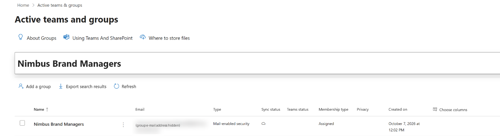

*Admin · Microsoft 365 admin center › Teams & groups › Active teams & groups › find the brand-manager group (web, 9 November 2026).*

The lab group is **Mail-enabled security**. This view confirms its type; verify the delegated people's
membership separately. **Nimbus Telecom** and **FiberMax** are fictional companies used in these lab examples.

**👤 Admin:** At **config.office.com → Customization → Policy Management**, open or create a policy
applying to all users. On **Configure Settings**, search for **Brand Manager** and open
**Elevated role for enterprise brand managers**, the name shown in our current UI. Set it to **Enabled**,
enter the group's address in **Security group email address** and select **Apply**. Review and publish the policy; confirm **Tenant** scope and
priority **0**. Allow up to **24 hours** for policy changes.

**Lab observation, 9 November 2026:** Cloud Policy at **config.office.com** required a separate sign-in
from the Microsoft 365 admin center. Open that portal with the appropriate Office Apps Administrator account.

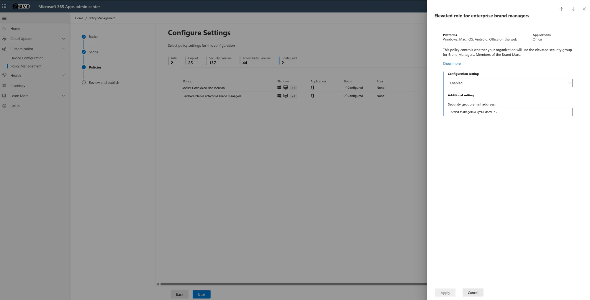

*Admin · Microsoft 365 Apps admin center › Customization › Policy Management › policy › Configure Settings › Elevated role for enterprise brand managers (web, 9 November 2026).*

If **Restrict brand kit creation** is enabled, the same managers must also belong to its permitted creator
group. The two policy checks are independent. Follow Microsoft's [brand governance procedure](https://learn.microsoft.com/en-us/copilot/implement/configure-brand-kit-governance-organizational-assets).

**Handoff check — 🎨 Brand manager:** Sign in using your own delegated account. Confirm that creation
and official-kit actions become available. An admin's successful session does not verify delegation.

## Step 2 — 🎨 Brand manager: collect the approved inputs

Prepare a small inventory with an owner, approved version and intended use for each asset. Ask your design
team for missing exports; keep the existing digital asset management system as the source of truth.

| Collect | Preparation checklist |
|---|---|
| Logos | Transparent PNG exports for light and dark backgrounds; approved horizontal, stacked and symbol variants; retain SVG masters; check formats offered by your picker before relying on SVG upload |
| Colours | Approved hex values, names and roles; distinguish text/background, brand accents, chart series and status colours |
| Fonts | Exact family names, heading/body roles, fallback fonts, language coverage and licensing for the intended distribution |
| Images | Approved photographs and illustrations; ownership or licence, expiry and allowed uses; useful landscape and portrait crops |
| Icons | Consistent approved set, licence and suitable light/dark versions |
| PowerPoint template | Current `.potx`, representative sample slides, theme colours/fonts, real placeholders and steering notes |
| Other Office templates | Approved `.dotx` and `.xltx` for the organization template library; separately test any kit-based use |
| Tone of voice | Preferred register, terminology, spelling, date/number formats, prohibited claims and short examples |
| Brand skills | A short list of repeatable tasks, required input, intended output and reviewer |

Check fonts in the clients employees actually use. A font being installed on the designer's laptop does
not prove it will render for everyone. Ask the font owner about embedding and redistribution rights.
Test your working languages, including accented characters, numbers and symbols, before approval.

Select only approved images for Copilot. Keep alternatives, expired campaigns and working files outside
the connected selection. A smaller usable collection is easier to maintain than an unfiltered archive.
Record image restrictions alongside the inventory so the next brand manager can review them.

The output of this step is a fill-in sheet: kit name, intended audience, asset locations, colour values,
font names, voice text, template versions and skills. It makes review possible before anyone clicks Publish.

## Step 3 — 👤 Admin: prepare the SharePoint libraries

Use an existing suitable site or provision a dedicated one. Organization asset libraries must reside on
the same site. Separate images and templates because their registration types differ.

| Suggested library | Registration type | Content |
|---|---|---|
| Brand Images | `ImageDocumentLibrary` | Approved photographs, logos and other approved imagery |
| Brand Templates | `OfficeTemplateLibrary` | PowerPoint `.potx`, Word `.dotx`, Excel `.xltx` |
| Brand Working Assets | No organization-asset registration | Guidelines, sources, review material and working files with appropriate permissions |

**👤 Admin:** Give the brand team upload rights and place **Everyone except external users** in the
site's **Visitors** group as required by the organization-assets procedure. Check effective read access;
ordinary readers should not acquire edit rights through another group.

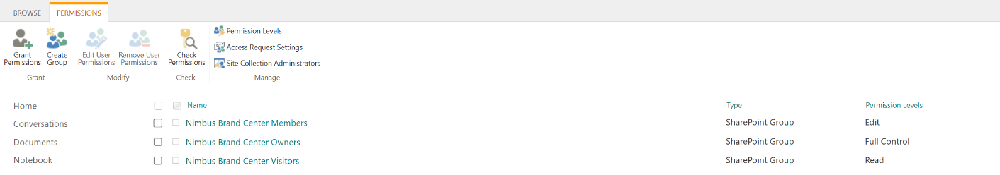

*Admin · SharePoint brand site › Settings › Site permissions › Advanced permissions settings (web, 9 November 2026).*

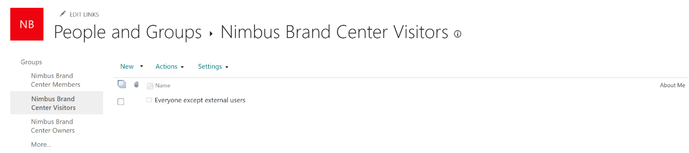

*Admin · SharePoint brand site › Settings › Site permissions › Advanced permissions settings › Visitors (web, 9 November 2026).*

Together, the captures show the Visitors group's **Read** permission and the broad employee claim
inside it. An ordinary pilot user's effective access still needs the check below.

**Lab observation, 6 October 2026:** our private group-connected site blocked that broad visitor claim
until the administrator addressed the tenant setting `AllowEveryoneExceptExternalUsersClaimInPrivateSite`.
If you encounter the same restriction, have the SharePoint admin assess the site and policy. A tenant-wide
permission-setting change belongs with IT.

**🎨 Brand manager:** Upload the approved files and reopen a sample from each library to verify the copy.

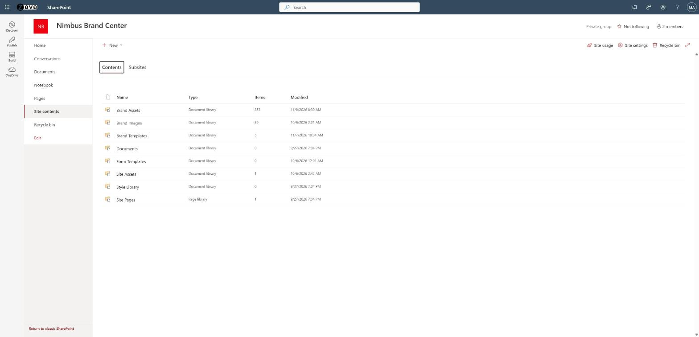

*Admin/brand manager · SharePoint brand site › Site contents (web, 9 November 2026).*

The lab's **Site contents** view shows **Brand Assets** alongside the separate **Brand Images** and
**Brand Templates** libraries.

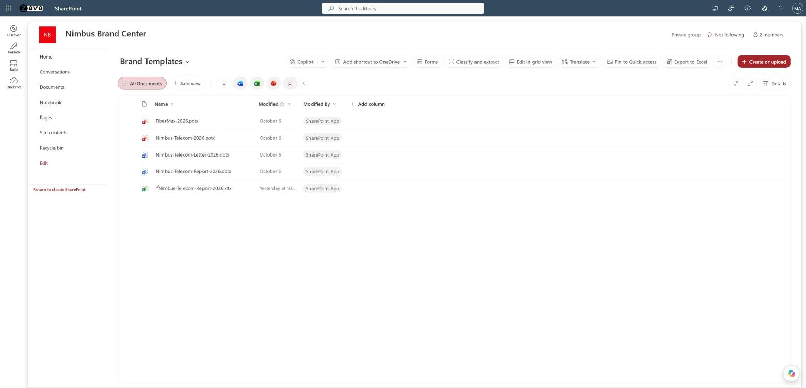

*Admin/brand manager · SharePoint brand site › Site contents › Brand Templates (web, 9 November 2026).*

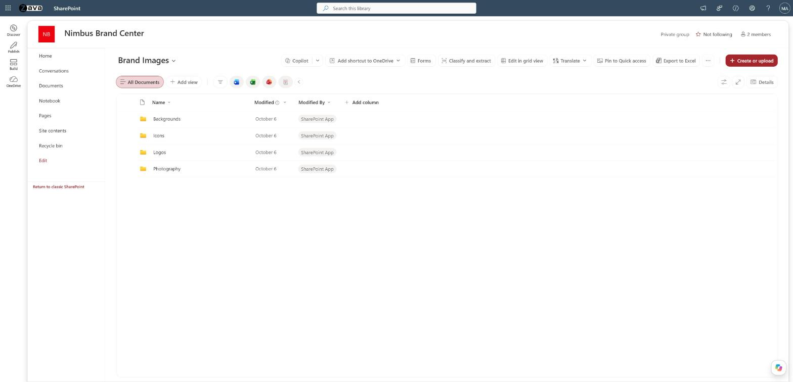

*Admin/brand manager · SharePoint brand site › Site contents › Brand Images (web, 9 November 2026).*

**👤 Admin:** Connect using the SharePoint Online Management Shell as a SharePoint Administrator.
Register each library with **`Add-SPOOrgAssetsLibrary`**, specifying the type in the table. Use
**`Get-SPOOrgAssetsLibrary`** to check the result. The registration enables a CDN; follow your organization's
approval process for that configuration. A thumbnail, if supplied, must be on the same site.
Microsoft provides the command parameters in [Create an organization assets library](https://learn.microsoft.com/en-us/sharepoint/organization-assets-library).

In the connected admin session, use your approved library addresses:

```powershell
$imageLibraryUrl = Read-Host "Approved image library address"
$templateLibraryUrl = Read-Host "Approved template library address"
Add-SPOOrgAssetsLibrary -LibraryUrl $imageLibraryUrl -OrgAssetType ImageDocumentLibrary
Add-SPOOrgAssetsLibrary -LibraryUrl $templateLibraryUrl -OrgAssetType OfficeTemplateLibrary
Get-SPOOrgAssetsLibrary
```

Allow **up to 24 hours** for the library to appear in desktop Office. Desktop users also need read access
to the organization's root site. Word and Excel organization-template pickers are desktop experiences;
PowerPoint also supports a web start-page route. Those picker requirements are separate from Copilot licensing.

## Step 4 — 🎨 Brand manager: make the PowerPoint template ready

Have your template designer review the existing corporate template against the work employees request.
Copilot relies primarily on **sample slides**, then on layouts. A master containing many layouts but only
two examples gives it little to learn from. Microsoft's [template preparation guide](https://support.microsoft.com/en-us/powerpoint/copilot/keep-your-presentation-on-brand-with-copilot)
explains the structure.

| Check | What to prepare |
|---|---|
| Representative samples | Cover, agenda, section, light/medium/dense content, chart, table, image, timeline, summary and next steps; add other types your users need |
| Theme | Approved theme colours and heading/body fonts, used consistently |
| Placeholders | Real title/content/image placeholders; inspect the layouts rather than judging by appearance alone |
| Content | Approved generic examples; remove old personal details, commercial figures and obsolete claims |
| Notes | Short instructions for the specific sample's purpose, density and content rules |
| Accessibility | Readable type, approved contrast, useful reading order and accessible chart conventions |

**🎨 Brand manager:** Put instructions in **speaker notes**, rather than in placeholder sample text.
For example: keep one message on a content slide; preserve the source under a chart; leave an unknown
figure marked for completion. Remove presentation-specific speaker scripts that could confuse reuse.

**🎨 Brand manager:** Open and save the approved template in **desktop PowerPoint** on Windows or Mac,
then upload that saved copy. Save the library master as **PowerPoint Template (`.potx`)**. A kit can also
accept `.pptx`, but the organization template library uses `.potx`. Double-clicking a `.potx` normally
creates a new presentation; use the application's open/edit workflow when changing the template itself.

**Recommendation:** make this desktop validation part of the release checklist even when an agency
supplies the file. Our lab's generated templates still needed that check; a re-save is a compatibility
step to test, not a proven cure for every file problem.

## Step 5 — 🙋 User: verify the libraries before building the kit

Use the ordinary pilot account. In desktop PowerPoint, open **File → New** and locate the organization's
template collection. Open one approved template and check its fonts and samples. Repeat in desktop Word
and Excel if those templates are part of the rollout.

For a browser check, use the SharePoint image picker on a modern page and open **Your organization**.
Choose an approved image without publishing a test page. This verifies image-library discovery separately
from kit configuration.

Record picker visibility and actual file access separately. If an administrator can browse the library
but the pilot cannot, resolve permissions before moving on.

## Step 6 — 🎨 Brand manager: create and populate the kit

In the Copilot app, open **Create → More… → Manage brand kits → Brand kits**. **Manage brand kits**
is the heading in the menu; **Brand kits** is the item beneath it.

The **Manage Brand Kits** page has **All / Official / User** filters. Select **Create Brand Kit**.

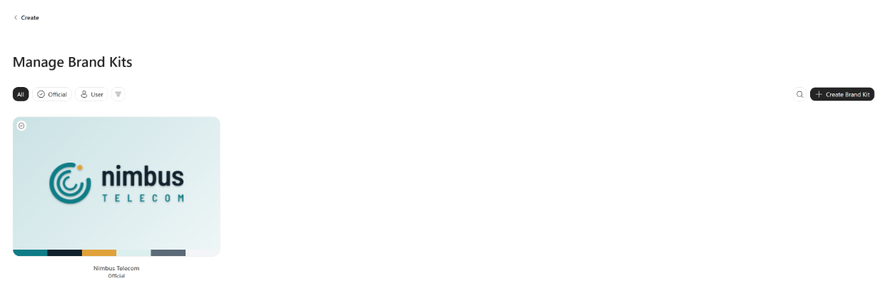

*Admin/brand manager · Copilot app › Create › More… › Brand kits › Manage Brand Kits (web, 9 November 2026).*

Enter the approved name at **Name your Brand Kit**, then select **Create**.

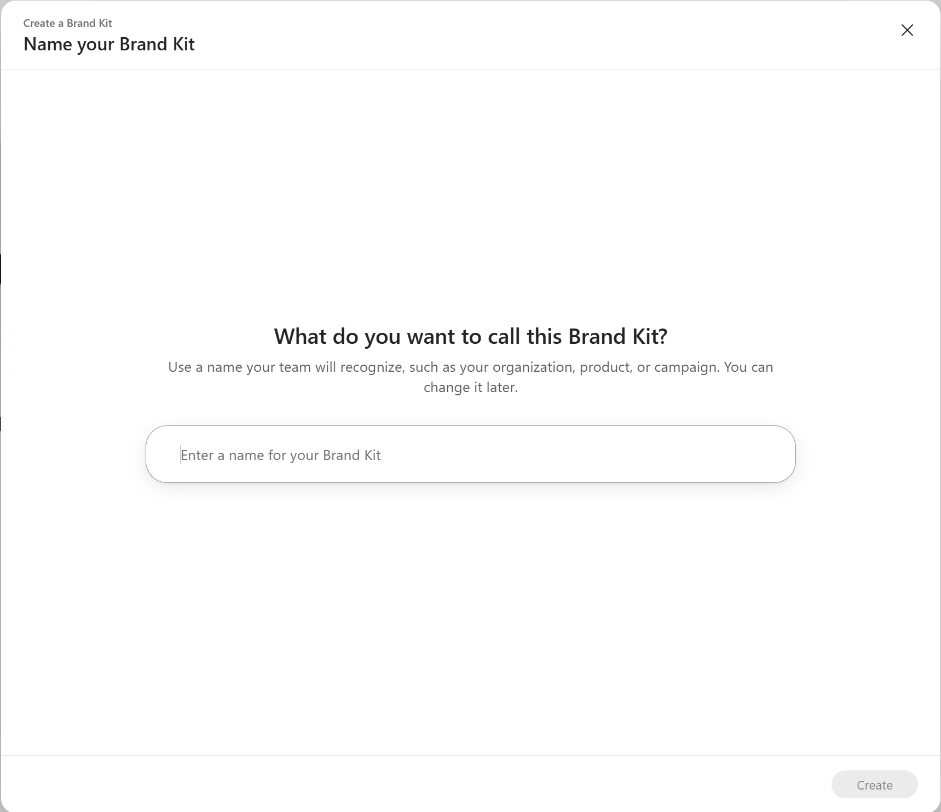

*Admin/brand manager · Manage Brand Kits › Create Brand Kit › Name your Brand Kit (web, 9 November 2026).*

Work from the fill-in sheet. Review the populated fields against the approved source after saving.

| Kit section | 🎨 Brand manager action | Check |
|---|---|---|
| Logos | Add approved variants | Transparent edges; correct version on light/dark backgrounds |
| Colors | Enter named hex values | Values match the approved palette exactly |
| Fonts | Select approved families | Correct names and tested fallback behaviour |
| Images and Icons | Select the curated files or folders the picker offers | Selection excludes working and expired material |
| Brand Voice | Paste concise, actionable tone and terminology rules | Useful in each working language; no confidential business facts |

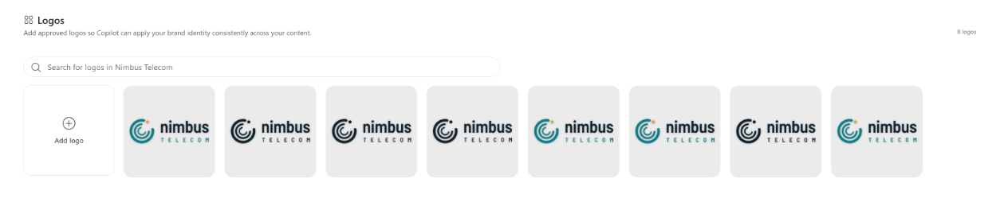

*Admin/brand manager · Brand kits › selected kit › Assets › Logos (web, 9 November 2026).*

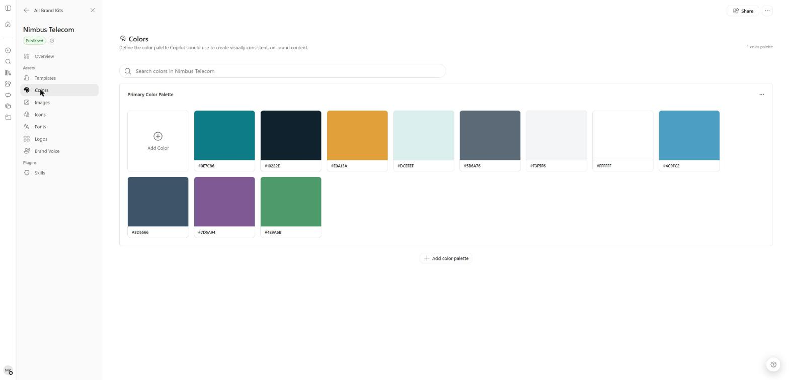

*Admin/brand manager · Brand kits › selected kit › Assets › Colors (web, 9 November 2026).*

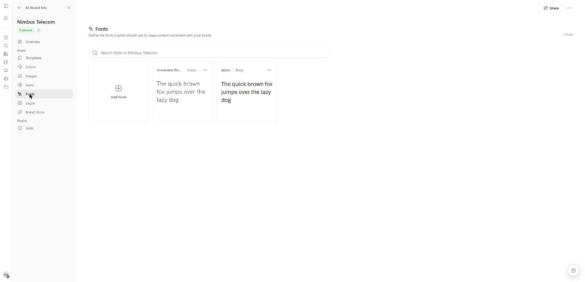

*Admin/brand manager · Brand kits › selected kit › Assets › Fonts (web, 9 November 2026).*

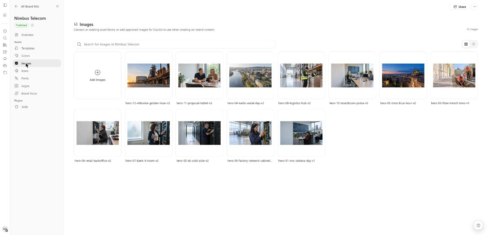

*Admin/brand manager · Brand kits › selected kit › Assets › Images (web, 9 November 2026).*

Open **Add images** to inspect the sources actually offered by the picker.

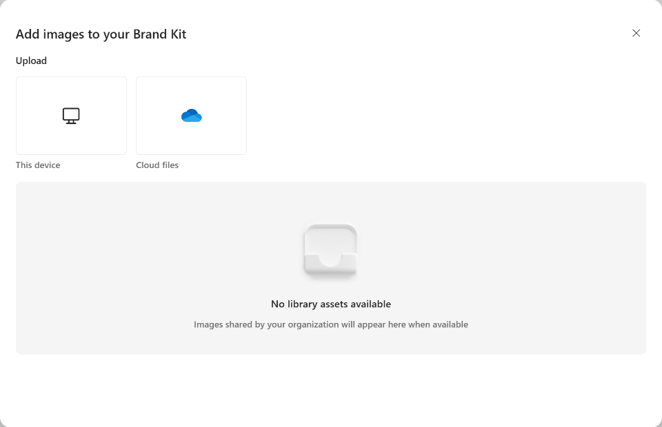

*Admin/brand manager · Brand kits › selected kit › Images › Add images (web, 9 November 2026).*

**Lab observation, 9 November 2026:** this picker showed **No library assets available**, although our
SharePoint **Brand Images** organization asset library existed. This is a tenant observation; the cause
was not established. The template picker below did expose the organization template library.

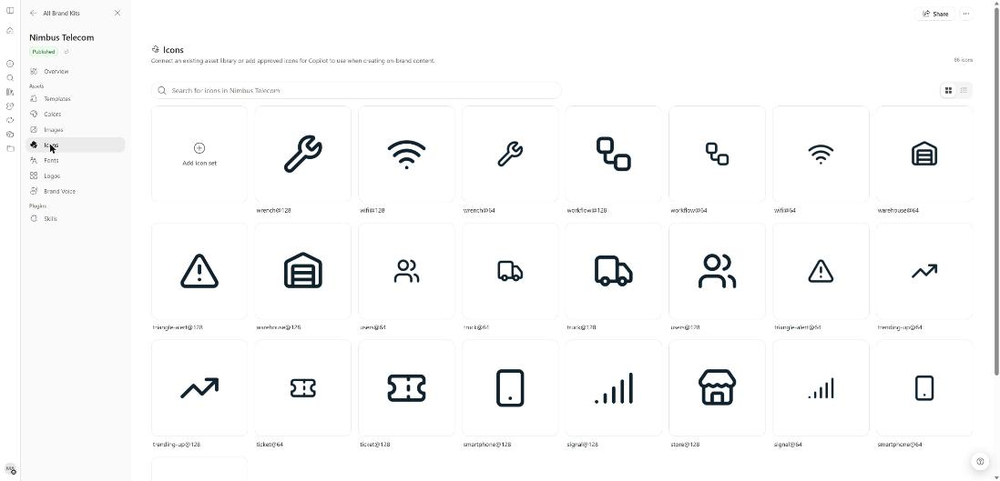

*Admin/brand manager · Brand kits › selected kit › Assets › Icons (web, 9 November 2026).*

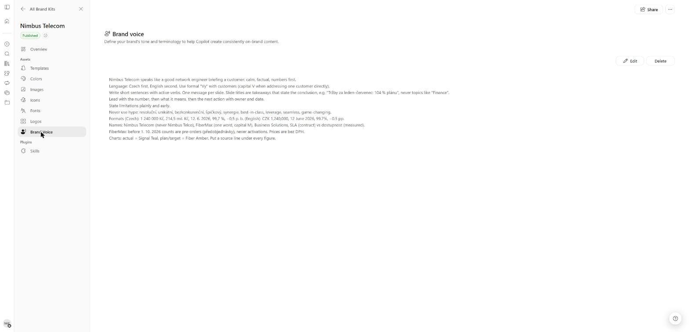

*Admin/brand manager · Brand kits › selected kit › Assets › Brand Voice (web, 9 November 2026).*

A useful voice brief specifies audience, preferred register, sentence style, product naming and number/date
formats. Include one approved example and a rule for missing information. Keep frequently changing product
facts in their maintained source. **Lab observation, 8 November 2026:** our editor offered Templates,
Colors, Images, Icons, Fonts, Logos, Brand Voice and Skills; there was no separate Brand Guidelines or Style
section. Do not make setup depend on a guidelines PDF being automatically interpreted.

## Step 7 — 🎨 Brand manager: add templates and choose adherence

Open **Templates → Add template**. The **Add templates to your Brand Kit** picker offers
**Upload → This device / Cloud files**, organization assets and **Design projects**. Our organization
collection exposed `.potx`, `.dotx` and `.xltx` templates. Select an approved file, then inspect its saved tile.

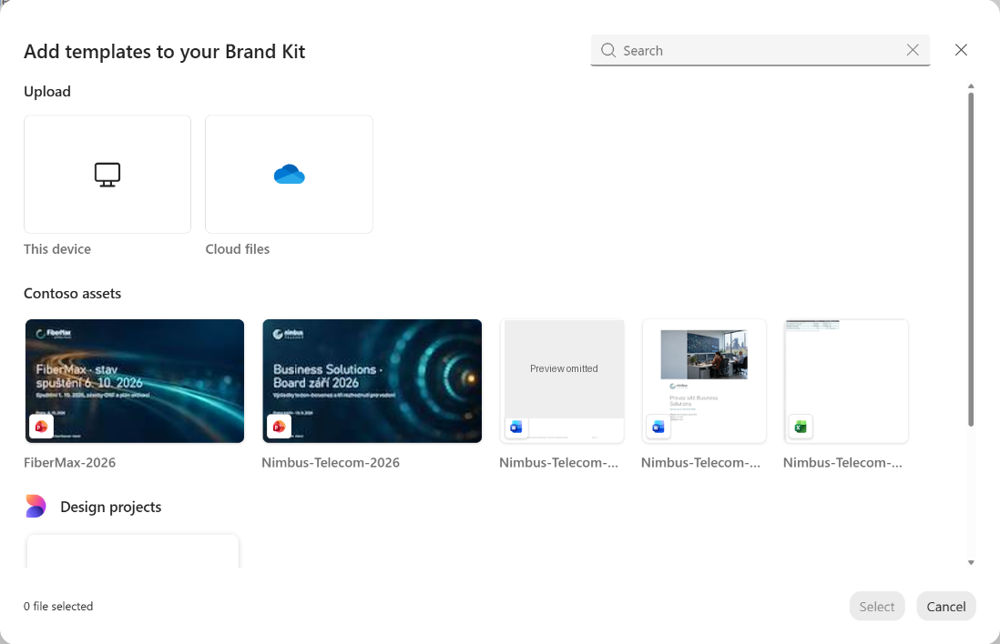

*Admin/brand manager · Brand kits › selected kit › Templates › Add template (web, 9 November 2026).*

**Lab observation, 9 November 2026:** after selecting templates, **Save as brand templates** showed a
**Brand Kit** picker and optional **Tags**. The dialog said it would generate tags and a description
after upload, with editing available later. Confirm the target kit before selecting **Add to Brand Kit**.

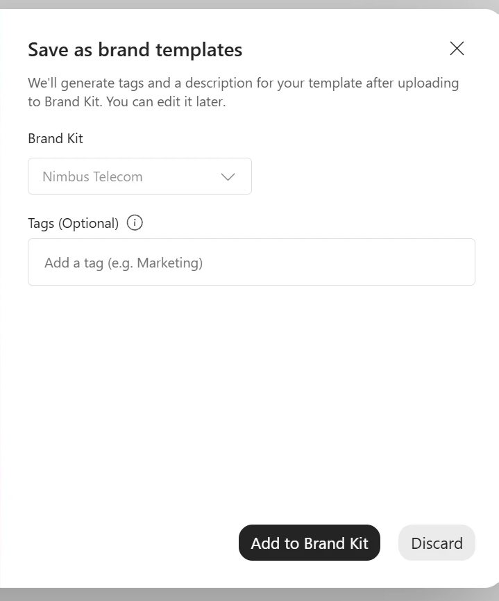

*Admin/brand manager · Copilot app › Create › More… › Brand kits › selected kit › Templates › Add template › select files › Select › Save as brand templates (web, 9 November 2026).*

**Recommendation:** use a small vocabulary for document type, audience and language: for example,
`presentation`, `executive`, `internal`, plus your working languages. Review generated descriptions for
accuracy. We have not measured how tags affect template selection.

**Lab observation, 8 November 2026:** the same kit accepted two Word `.dotx` files and an Excel `.xltx`,
displaying their app icons. This establishes acceptance only. We have no generated-output evidence that
Word or Excel Copilot uses those kit templates. Keep their organization-library route available.

The **9 November 2026** Templates capture shows all four saved templates alongside the adherence setting.

Our Excel tile was almost blank. A desktop Excel re-save and re-upload is a proposed thumbnail check;
we have not verified that it fixes the preview.

**🎨 Brand manager:** Set **Strict brand adherence** on the kit's Templates page and confirm the dialog.
It is a **per-kit** decision. Users generating presentations cannot override it. With it enabled, Copilot
must reuse approved layouts; disabled, it may create layouts while using the brand's other assets.

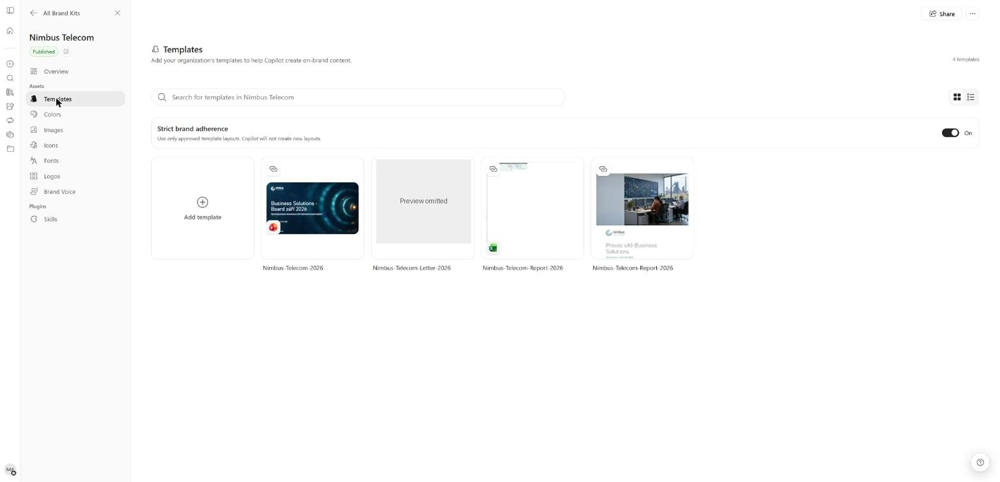

*Admin/brand manager · Brand kits › selected kit › Templates › Strict brand adherence: On (web, 9 November 2026).*

Microsoft documents automatic note steering with no additional setup in [Manage template settings](https://support.microsoft.com/en-us/powerpoint/copilot/manage-brand-kit-template-settings-in-powerpoint).
**Lab observation, 8 November 2026:** no separate note-instructions toggle was visible in our kit.

## Step 8 — 🎨 Brand manager: attach the brand's skills

Use a skill for a repeatable brand procedure: an executive update structure, a proposal sequence or a
tone-of-voice rewrite. In the kit's left navigation, open **Plugins → Skills → Add skill**.

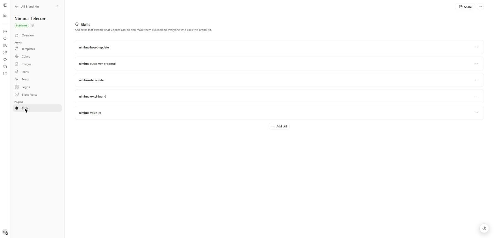

*Admin/brand manager · Brand kits › selected kit › Plugins › Skills (web, 9 November 2026).*

**Create a new skill** offers **Name**, **Description** (prompted with “Tell Copilot when to use this
skill”) and **Instructions**. Alternatively, use **Or import a skill file**. Enter the reviewed procedure or import a
reviewed `.md` or `.zip`, then confirm the saved entry. Use the description for the task's trigger;
put the procedure in Instructions. The [skills setup guide](/copilot-skills/) covers authoring and deployment.

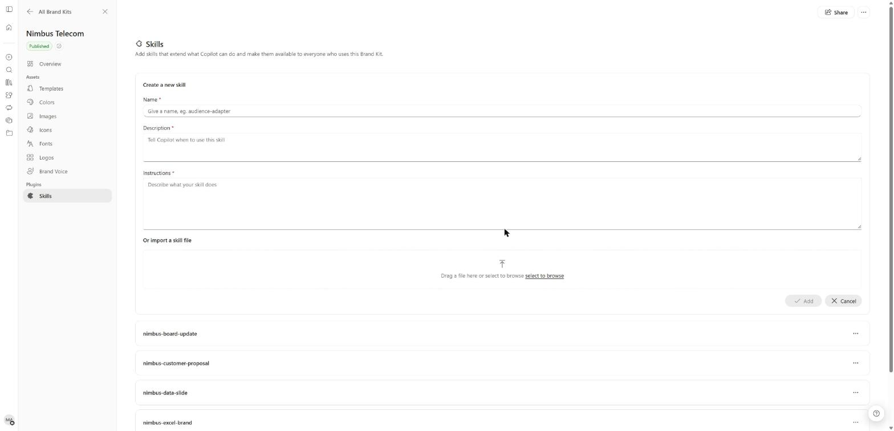

*Admin/brand manager · Brand kits › selected kit › Plugins › Skills › Add skill (web, 9 November 2026).*

**Lab observation, 6 October 2026:** Brand Kit zip upload rejected `<skill-name>/SKILL.md` with
“This skill is missing a SKILL.md file.” Put **`SKILL.md` at the archive root**, with `references/` beside
it, and package one skill per upload. PowerPoint's allowed companion types include Markdown, text, CSV,
JSON, XML, HTML, SVG, Python and JavaScript; PNG, PDF and nested archives are not accepted on this route.

Keep brand-specific behaviour in the kit. An organization skill is available without brand selection,
within its deployment scope and subject to user controls. This suits shared company procedures, but
availability does not guarantee invocation or enforcement. Organization deployment has **no per-app targeting**.

**Observed, 9 November 2026:** before selecting a brand, PowerPoint listed `nimbus-presentation-standards`,
`nimbus-meeting-minutes` and `nimbus-contract-check` with an **organization** badge, alongside Dynamics 365
sales skills. The Word-oriented procedures were visible in PowerPoint too.


*Lab admin/brand manager · PowerPoint desktop › Copilot › + › Choose plugins › skills list, without a selected brand (9 November 2026).*

After **Select brand → Nimbus Telecom**, the kit's five skills appeared with a **Brand** badge:
`nimbus-board-update`, `nimbus-customer-proposal`, `nimbus-data-slide`, `nimbus-excel-brand` and
`nimbus-voice-cs`. The list establishes discovery; it does not prove those skills ran or that the
Excel-oriented skill works in PowerPoint.


*Lab admin/brand manager · PowerPoint desktop › Copilot › + › Select brand › Nimbus Telecom › + › Choose plugins › skills list (9 November 2026).*

| What the user sees | Organization skill | Brand Kit skill |
|---|---|---|
| Before brand selection | Available to the user in deployment scope, subject to user controls | Requires selection of the kit |
| Picker badge | **organization** | **Brand** |
| After selecting a brand | Availability does not depend on the selected kit | Selected kit's skills become available |

Microsoft's guide calls the skills entry **Choose skills**; our captured desktop menu says **Choose plugins**.
Use the skill list exposed by your version. **Manage plugins** at the bottom opens the automatic-use controls.


*Lab admin/brand manager · PowerPoint › Copilot › … › Manage plugins (9 November 2026).*

## Step 9 — 🎨 Brand manager: review, publish and make official

Check the inventory, template version, adherence setting and skill list with the brand approver. Use
**Publish** for viewer availability and **Make Official** for organization ownership and official status.
These are distinct actions in the current [kit lifecycle guide](https://support.microsoft.com/en-us/microsoft-365-copilot/create-and-manage-official-brand-kits-in-the-microsoft-365-copilot-app).

The kit **Overview** presents **Build → Share → Publish → Official** stages, asset tiles and
**Plugins → Skills** in the left navigation. Our captured kit has a **Published** badge; its **Official**
status is also visible on the Manage Brand Kits page above.

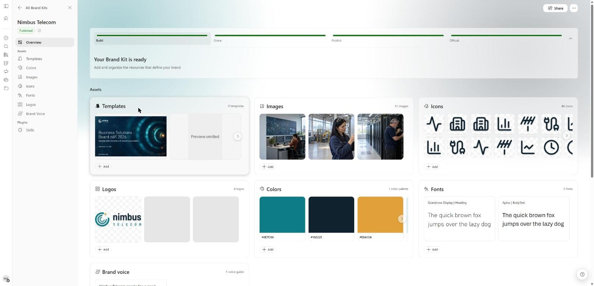

*Admin/brand manager · Brand kits › selected kit › Overview (web, 9 November 2026).*

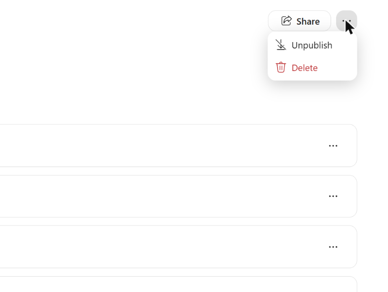

*Admin/brand manager · Brand kits › selected kit › ⋯ (web, 9 November 2026).*

**Lab observation, 9 November 2026:** the official kit's **Share** dialog showed **Share with everyone
in my organization — Unavailable**, pending confirmation of the saved policy. **Try again** did not
resolve it at that moment. We recorded this as a transient state, not a general sharing restriction.

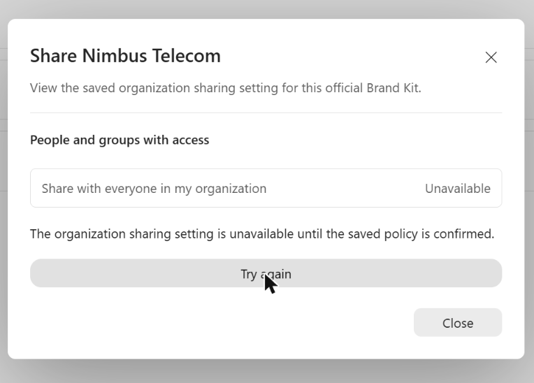

*Admin/brand manager · Brand kits › selected official kit › Share (web, 9 November 2026).*

The current guide describes draft/published revisions, while the older template-settings guide says its
toggle saves automatically. Check what viewers actually receive in your tenant. Do not assume that sharing
an editor link publishes changes. Record the approved revision and repeat the pilot after updates.

## Step 10 — 🙋 User: verify the complete setup

Open a new presentation, then **Copilot → + → Select brand**. Choose the published kit. If a brand skill
is part of the test, use **+ → Choose skills** after selecting the brand. Microsoft's [brand-skill guide](https://support.microsoft.com/en-us/powerpoint/copilot/brand-skill-support-copilot-powerpoint)
shows the sequence.

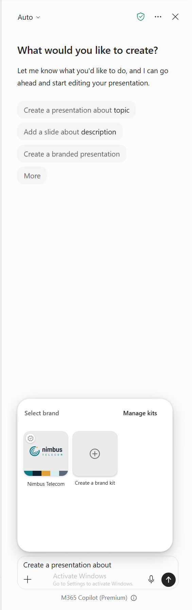

*Lab admin/brand manager · PowerPoint desktop › Copilot › + › Select brand (9 November 2026).*

**Observed, 9 November 2026:** the picker showed the official kit. After selection, **Nimbus Telecom**
replaced **Select brand** as its own entry in the **+** menu, beside **Add content**, **Upload images
and files**, **Designer** and **Choose plugins**. A brand chip also appeared in the prompt box.

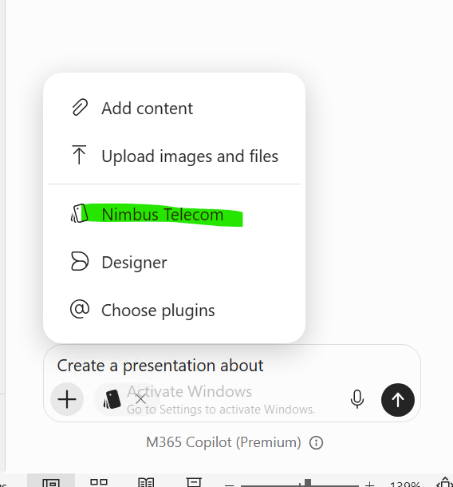

*Lab admin/brand manager · PowerPoint desktop › Copilot › + › Select brand › Nimbus Telecom › reopen + menu (9 November 2026).*

These captures verify selection in the lab session. Repeat it with the ordinary pilot account to verify
employee access; use the skills list shown in Step 8 to compare **organization** and **Brand** badges.

For comparison, our admin/brand-manager session also exposes **Create → Browse brand templates** in the
Copilot app. It lists the kit's four templates and organization-library templates. This gallery does not
prove that an ordinary user can select the kit in PowerPoint or that Word/Excel Copilot uses its templates.

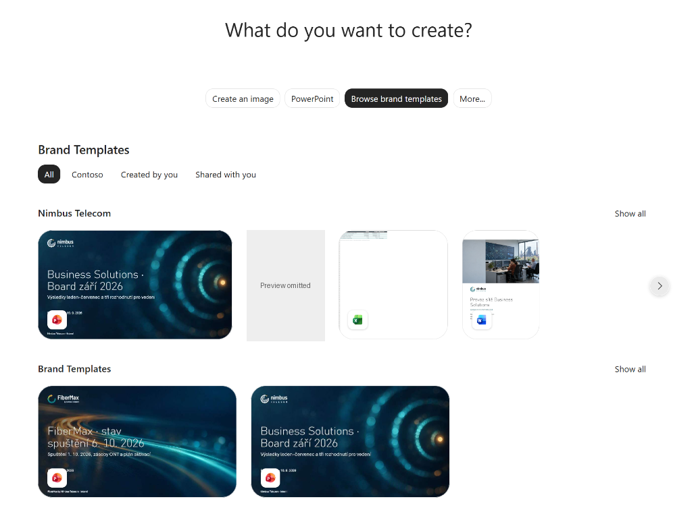

*Admin/brand manager · Copilot app › Create › Browse brand templates (web, 9 November 2026).*

Use a small synthetic source: “Create five slides about the service review. Availability was 99.7%;
target was 99.9%. Include a summary and next steps. Use only the supplied figures.” Inspect the deck,
including layouts and notes, rather than accepting Copilot's claim that it followed the brand.

The screenshots above show selection and discovery. A generated deck has not been inspected for this
update; the output checks below remain the pilot's acceptance work.

| Verification | Owner | Pass condition |
|---|---|---|
| Delegation | 👤 Admin | Brand manager can publish; ordinary user cannot edit the official kit |
| Asset access | 🙋 User | Template opens and approved images can be selected |
| Brand selection | 🙋 User | Correct published kit appears and can be selected |
| Layout and notes | 🎨 Brand manager | Approved layout behaviour and required slide guidance match the chosen setting |
| Numbers and language | 🙋 User | Source figures preserved; missing details identified; fonts and terminology acceptable |
| Brand skill | 🙋 User | Listed after selection; explicit run meets its task checklist |
| Excel | 🙋 User | If available, the `brandkit` entry point applies intended colours/fonts without altering values |

The table defines acceptance checks; the screenshots establish only the lab visibility and selection
described above. **As observed on 8 November 2026**, Excel's `brandkit` entry point was unavailable in
our tenant. Organization packages appeared in PowerPoint, Excel and Cowork. **As of 9 November 2026,
Word showed no organization skills in our tenant.** Those findings do not establish kit-template use or
successful skill execution.

## Troubleshooting

| Symptom | Owner | First checks |
|---|---|---|
| No create/publish action | 👤 Admin | Licence, group membership rather than ownership, both policy checks, propagation |
| Group rejected by policy | 👤 Admin | Group is mail-enabled security; correct group address recorded internally |
| Library absent | 👤 Admin | Registration, Visitors read access, desktop root-site read access, up to 24 hours propagation |
| Word/Excel web picker absent | 🙋 User | Use desktop Office for organization templates |
| Template opens as a new deck | 🎨 Brand manager | Expected `.potx` behaviour; use the template editing workflow before saving the master |
| Few layouts reused or poor styling | 🎨 Brand manager | Representative samples, real placeholders, theme values; validate the saved desktop copy |
| Old content or contact details appear | 🎨 Brand manager | Remove them from samples and notes, replace template and retest |
| Skill upload says SKILL.md missing | 🎨 Brand manager | Archive root, exact filename and allowed companions |
| Wrong skill version runs | 🎨 Brand manager | Remove the superseded copy through the kit UI, upload reviewed version and retest |
| Word/Excel file accepted but output unbranded | 🎨 Brand manager | Acceptance is separate from use; retain organization templates and test each app |
| Excel brandkit absent | 👤 Admin | Check entitlement and feature availability; record unavailable, rather than a styling-test failure |

## Release checklist

- [ ] **👤 Admin:** licences, delegated members, creator policy and brand-manager policy verified.
- [ ] **👤 Admin:** libraries registered; ordinary read access and picker propagation checked.
- [ ] **🎨 Brand manager:** assets approved; font/image rights and language coverage checked.
- [ ] **🎨 Brand manager:** representative samples, placeholders and notes reviewed in desktop PowerPoint.
- [ ] **🎨 Brand manager:** uploaded templates, tags, strict setting and skill entries inspected.
- [ ] **🎨 Brand manager:** publication and official status checked; owner, deputy and review date recorded.
- [ ] **🙋 User:** selected the kit, generated a test deck and checked content as well as appearance.
- [ ] **👤 Admin:** unavailable app features logged separately from failed tests.

## Further reading

- [Brand Kit access and governance](https://support.microsoft.com/en-us/microsoft-365-copilot/configure-brand-kit-access-and-governance) — permissions and the handoff between IT and brand managers.
- [Brand-manager Cloud Policy](https://learn.microsoft.com/en-us/copilot/implement/configure-brand-kit-governance-organizational-assets) — current policy procedure and membership checks.
- [Organization asset libraries](https://learn.microsoft.com/en-us/sharepoint/organization-assets-library) — registration, supported pickers and propagation.
- [Prepare PowerPoint templates](https://support.microsoft.com/en-us/powerpoint/copilot/keep-your-presentation-on-brand-with-copilot) and [manage kit template settings](https://support.microsoft.com/en-us/powerpoint/copilot/manage-brand-kit-template-settings-in-powerpoint).
- [Excel skills](https://support.microsoft.com/en-us/excel/copilot/copilot-in-excel-skills) — documented `brandkit` entry point.
- [Deploy organization skills](https://support.microsoft.com/en-us/powerpoint/copilot/deploy-organization-skills-for-copilot-in-powerpoint) and [the companion setup guide](/copilot-skills/).

---

<p style="font-size: 0.95em; margin-top: 2.5em; color: #606c71;">
  Written by <strong>Ondrej Stefka</strong> &middot;
  <a href="https://www.linkedin.com/in/ondrej-stefka-71a7a821">LinkedIn</a>
</p>

<p style="font-size: 0.95em; margin-top: 2em;">
  <a href="{{ '/about' | relative_url }}">About this blog &rarr;</a>
</p>
