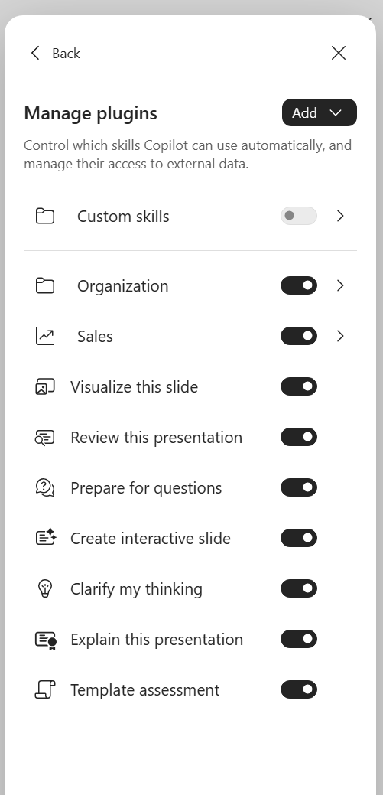

<p style="font-size: 0.85em; color: #606c71; border-left: 3px solid #dce6f0; padding: 0.4em 0 0.4em 0.9em; margin: 0 0 1.8em 0;">
  <strong>Personal blog.</strong> This site reflects my own testing and my own
  opinions. It is not an official Microsoft statement and it is not official
  Microsoft documentation in any way. For authoritative guidance always refer to
  <a href="https://learn.microsoft.com/">Microsoft Learn</a>.
</p>

> **TL;DR** — A Copilot Brand Kit needs more than a logo and a palette. The template's sample slides,
> theme values, placeholders and speaker notes do most of the work. We built the assets and a kit for a
> fictional telco, then recorded the setup traps.
>
> On **8 November 2026**, our kit also accepted Word and Excel templates. That proves upload acceptance;
> it does not prove Copilot uses those templates. The generated-output tests remain pending.

> **What this article is.** A practical walkthrough combining Microsoft's public documentation with
> dated observations from a lab tenant. Setup observations were last checked on **8 November 2026**.
> Recommendations and test expectations are labelled; pending tests are not reported as results.

Ask Copilot in PowerPoint for a board deck and you may get a tidy deck in nobody's colours. A Brand Kit gives it your brand's resources, but what you feed it needs to be built for Copilot. A logo, a hex code and last year's template won't get you there.

We built one from nothing for **Nimbus Telecom**, a Czech B2B telco in our lab tenant, and planned a second for its fibre sub-brand **FiberMax**. Both brands are fictional. This post is the whole route, in order: who does each step, where they click, and what went wrong for us.

## What a Brand Kit is now

A Brand Kit is a named bundle of templates, logos, colours, fonts, images and icons, a brand voice and skills. You create it in the Copilot app. Users pick it in PowerPoint from the Copilot pane under **+ → Select brand**, and Microsoft says Copilot in Excel uses it too.

| Kit type | Who creates it | Who sees it |
|---|---|---|
| **User** | Anyone with an eligible Copilot licence, unless your organization restricts creation | The creator, plus the editors and viewers they share it with |
| **Official** | Brand managers, enabled by a Cloud Policy | Everyone in the tenant. Only brand managers can edit it |

Microsoft's [Brand Kit guide](https://support.microsoft.com/en-us/microsoft-365-copilot/create-and-manage-official-brand-kits-in-the-microsoft-365-copilot-app) calls the two tabs **Official** and **User**. In October our tenant labelled the official tab **Organization**, so use whichever name your tenant shows.

Four features do most of the work:

- **Strict brand adherence** is a per-kit toggle on the kit's Templates page, set by the owner or a brand manager. Its label says it all: *"Use only approved template layouts. Copilot will not create new layouts."* Off, Copilot may get more creative with layouts, while still applying colours, fonts and assets.
- **Notes steering** means plain-language instructions in the speaker notes of each sample slide.
- **Brand skills** are Agent Skills attached to the kit, available to everyone with access to it.
- **`brandkit`** is Microsoft's built-in Excel skill that applies the brand's colours and fonts.

One recent change: **Brand Guidelines and Style were absent from our kit editor**. On **8 November 2026**, neither the article nor our kit editor listed them: its pages are Templates, Colors, Images, Icons, Fonts, Logos, Brand Voice and Skills. We do not rely on a guidelines PDF being read for us. Ours is for people.

The consequence is that **the template now carries most of the brand**, which is why Step 3 is the longest step here.

## Prerequisites and roles

| What | Who | Where | Lead time |
|---|---|---|---|
| Eligible Copilot licence | Licence admin | Admin center | |
| Mail-enabled security group | Your administrator | Admin center → **Teams & groups → Active teams & groups → Security groups** | |
| Cloud Policy **Elevated role for Brand Managers** | Office Apps Admin | config.office.com → **Customization → Policy Management** | Up to 24 h |
| Organization asset libraries | SharePoint Administrator | SharePoint Online Management Shell | Up to 24 h |
| Assets and kit | Brand manager | Copilot app | |

Start the group and the policy the day before you build the kit. They depend on nothing else, and they carry a wait.

**Create the group.** Choose the type **Mail-enabled security**. Ours is `Nimbus Brand Managers`. Add brand managers as **members**, because owners only manage the group and can't publish official kits.

**Create the policy.** Following Microsoft's [brand manager policy guide](https://learn.microsoft.com/en-us/microsoft-365/copilot/configure-brand-kit-governance-organizational-assets), create a policy with the scope **Apply to all users**. On the **Policies** tab, search for "Brand Manager" and set **Elevated role for Brand Managers** to **Enabled**. Enter the group's email address, then **Apply → Review and Publish**. Confirm the scope reads **Tenant**, and use **Reorder priority** to set it to 0.

**What can go wrong:** a group that isn't mail-enabled won't work, because the policy asks for an email address. Microsoft also documents a separate **Restrict brand kit creation** policy: if creation is restricted, a brand manager must satisfy that creator policy as well.

**You are done when** the brand manager can create a kit, publish it and access its official-brand actions. Expect **Official** in current documentation and **Organization** in our older lab UI.

## Step 1: Brand foundations

**Who:** brand manager or designer. **Where:** your design tools. We built ours from code.

**Logo.** Our brief was a "nimbus": a halo drawn as an open ring of three concentric arcs, heavier toward the outside like signal strength. We drew four options from geometric primitives and compared them on light, on dark and at 16 px.

We chose **option B "Fan"** with **wordmark W1** (`nimbus`, with `TELECOM` tracked below to the same width). Its radiating signal and amber node dot carry both brand colours, and its round ends match the icon set. The others read wrong: A was static, C looked like a copyright mark or G, and D looked like generic Wi-Fi.

Three details are worth copying:

- **A micro cut.** Three arcs can't hold at 16 px, so at 24 px and below we drop the inner arc.
- **Every colourway up front:** full colour, reversed, mono Ink and mono white, in horizontal, stacked, symbol and wordmark lock-ups.
- **Written rules.** Clear space is twice the dot diameter. Minimum size is 24 px of symbol height on screen and 8 mm in print.

FiberMax gets a single heavy arc with an amber-to-teal trail and the endorsement "by Nimbus Telecom".

**Palette.** Hex values are authoritative, and we checked every text pair against WCAG before anyone used them.

| Colour | Hex | Role | On white |
|---|---|---|---:|
| Nimbus Ink | `#10222E` | Text, dark backgrounds | 16.28:1 |
| Signal Teal | `#0E7C86` | Primary accent, actual values | 4.95:1 |
| Fiber Amber | `#E0A13A` | Secondary accent, plan or target | 2.25:1 |
| Steel | `#5B6A76` | Secondary text | 5.57:1 |
| Glacier | `#DCEFEF` | Light panels | |
| Mist | `#F3F5F6` | Light background | |

The numbers produced rules, not just a report:

- Amber is **never text on a light background**.
- On light slides, the amber plan series can't rely on colour alone, so plan is a dashed line with a label.
- Buttons on amber use Ink text.
- Steel on Ink fails at 2.92:1, so text on Ink is white or Glacier.

We also fixed one chart convention: **actual is always Teal and plan is always Amber**, even in FiberMax, where amber leads the design.

**Fonts.** Prefer **Office cloud fonts**, checking that each chosen font is available on your target clients. Ours are **Grandview Display** for headings, **Aptos** for body and **Aptos Mono** for data.

Grandview Display's rendering of Czech characters is **not yet confirmed in our tenant**. Before approving it, type the line below in desktop PowerPoint and check for glyphs that fall back to another face. Aptos Display is our planned fallback.

`Příliš žluťoučký kůň úpěl ďábelské ódy — ĚŠČŘŽÝÁÍÉŮÚ ďťň`

**Icons.** We took 43 icons from **Lucide** (ISC licence, shipped with the set), on a 24 px grid with a 2 px stroke, in Teal on light and white on Ink.

**What can go wrong:** choosing a font first and testing your language's characters last. Check before you build any template.

## Step 2: Photography with AI

**Who:** brand manager as art director, with someone comfortable running a script. **Where:** an image-generation service available to your organization.

We wanted a consistent set of Czech network operations scenes, so we generated ours from a **prompt manifest**: a YAML file with one entry per subject, plus a shared style file appended to every prompt. Each image records its model, prompt, size and SHA-256. The set is 34 subjects: 12 heroes at 16:9, 12 insets at 4:5, 6 abstract textures and 4 Teams backgrounds.

What made them look on-brand:

- **One art direction block:** documentary realism, natural light and a restrained teal-and-amber grade.
- **Daylight first.** Dusk only for skylines. We ended at 65 % daylight.
- **Composition for slides.** Heroes keep the left third quiet, so a title has somewhere to sit.
- **Explicit bans:** logos, readable text, holograms, glowing brains, posed handshakes, headsets, pointing at screens.
- **A cast, not a type.** Every person is different, candid and never looking at the camera.

Two prompt traps showed up in our trials. **Never put hex codes or brand names in a prompt**, because the models draw them as text. And **don't say "slide", "title" or "headline"**: one model read that as a request for a layout and rendered panels with Czech words on them.

**Review.** We reviewed the generated variants as contact sheets, checking for fake text, hands and faces, and credible Czech context. We recorded one pick per subject in a committed file. One happy accident: a texture came out as three arcs and an amber node, very close to the logo, and became our signature cover background.

**What can go wrong:** images can't be regenerated byte for byte, so keep the picks in SharePoint and the prompts in version control.

## Step 3: The template Copilot actually uses

**Who:** brand manager or template designer. **Where:** PowerPoint desktop, for at least the final save.

This step decides your results. **Microsoft documents that Copilot uses the sample slides first and the layouts second.** A master with beautiful layouts and three sample slides gives Copilot three things to copy.

**Build the sample set first.** Ours has 23 named slides on 26 layouts: Cover, Agenda, Section divider, KPI / big number, Chart, Table, Content (light, medium, heavy), Icons, Image full-bleed, Image inset, Timeline, Process, Quote, Q&A, Summary, Next steps, Case study, Team / bios, Contacts, Map and Thank you.

**Make it structurally clean.** Our automated check enforces these rules on every build:

- Colours come from theme slots and fonts from theme fonts, with no hard-coded RGB in text.
- Every sample uses **real placeholders**, not text boxes.
- No objects overlap.
- Placeholder text is styling only. It is *not* instructions.

**Write notes steering on every sample.** These are real notes from our template:

| Sample | Speaker notes (excerpt) |
|---|---|
| Cover | "Always include this cover slide as the first slide. Do not change the logo, colours, background image or layout on this slide." |
| Chart | "Always use a bar or line chart, never a pie chart, 3D chart or dual axis. Actual values in Signal Teal (solid), plan or target as a dashed Fiber Amber line…" |
| Content (light) | "Keep the text minimal: one message and at most three short lines." |
| Quote | "Use only a quote that the user's sources confirm as approved, word for word… Never invent or polish a quote." |

Microsoft's [template-settings article](https://support.microsoft.com/en-us/powerpoint/copilot/manage-brand-kit-template-settings-in-powerpoint) says notes work with no extra setup and are checked for appropriateness at upload. In our lab on **8 November 2026**, there was no separate note-instructions toggle: the Templates page has only the strict adherence toggle.

**Make the sample content true.** Our first samples had names and figures that contradicted the fictional company story. We replaced them with the agreed fictional cast and finance figures, and used reserved example domains for contact details. We don't know how much sample text can leak into a generated deck, so we assume some can.

**Finish in desktop PowerPoint.** We generate the template from Python, so it stays in step with the design values. Microsoft says templates should be created in PowerPoint for Windows or Mac. Our recommendation is to open and save a generated file there before upload, checking the fonts at the same time. **We have not yet confirmed that desktop round-trip for every lab template, or that one save resolves every compatibility issue.**

**`.potx` or `.pptx`?** This confused us in practice.

- Double-click a **`.potx`** and PowerPoint opens a *new, untitled deck based on it*. That is correct, but it looks as if the template "opened as a deck", and saving gives you a `.pptx` while the template stays unchanged.
- To **edit the template itself**, our planned desktop route is **File → Open**, then **File → Save As → PowerPoint Template (.potx)**. This exact click path, including opening a template from a library, is **not yet confirmed in our tenant**.
- A Brand Kit accepts **both** formats. An organization asset library needs **`.potx`**, so that is our master. Word and Excel templates are a story of their own, in Step 5b.

**What can go wrong:** text in loose text boxes, sample slides that repeat one layout, or instructions typed into placeholder text.

## Step 4: Organization asset libraries

**Who:** SharePoint Administrator for registration, brand manager for the content. **Where:** a SharePoint site, plus SharePoint Online Management Shell.

These libraries make your images and templates appear inside Office for everyone. Up to 30 are allowed, all on one site. Our site has three libraries:

| Library | Registered as | Holds |
|---|---|---|
| **Brand Images** | `ImageDocumentLibrary` | Picked photography, logos, icons |
| **Brand Templates** | `OfficeTemplateLibrary` | `.potx`, `.dotx` and `.xltx` files |
| **Brand Assets** | Not registered | Sources, guidelines, skills, Teams backgrounds |

Users need read access, so **Everyone except external users** must be in the site's Visitors group.

Here we hit a wall. We used a *private* group site, because on a public group site that claim lands in Members with Edit rights. During our setup, the lab tenant blocked that claim on the private site, and `Add-SPOUser` failed until the administrator changed `AllowEveryoneExceptExternalUsersClaimInPrivateSite`. It applies to the whole tenant, so decide on it with your SharePoint admin.

Have the SharePoint administrator register the two libraries with `Add-SPOOrgAssetsLibrary`, using `ImageDocumentLibrary` for images and `OfficeTemplateLibrary` for templates, then check the registrations with `Get-SPOOrgAssetsLibrary`. Microsoft documents the registration procedure in [Create an organization assets library](https://learn.microsoft.com/en-us/sharepoint/organization-assets-library).

**What can go wrong:**

- The thumbnail must be an image **on the same site**.
- If the cmdlet asks to enable the private CDN, answer yes.
- Libraries take **up to 24 hours** to appear in Office. Don't debug before then.
- Users also need read access to the tenant root site for the desktop apps.

**You are done when** an ordinary user can find the images in the Office picture picker and the templates in the organization template picker. The exact **Brand** and **New from template** labels are **not yet confirmed in our tenant**.

## Step 5: Create the Brand Kit

**Who:** brand manager. **Where:** Copilot app → **Apps and more** → **Create** → **More** → **Brand Kits** → **Create Brand Kit**, or straight to `office.com/create/brandkit`. That is Microsoft's path as of 8 November. In October our tenant showed **Create → More… → Brand kits → Organization → + Add Brand Kit**, and labels are moving with the plugin registry rollout, so expect small differences.

Prepare a fill-in sheet first, with exact text and file names. Create and test one kit before you start a second.

| Field | What we entered for Nimbus Telecom | Notes |
|---|---|---|
| **Name, description** | `Nimbus Telecom`, plus when to use it | |
| **Logos** | Horizontal, reversed, stacked, symbol, two mono | PNG at 1024 px is the safe default. No micro cut or app tile |
| **Colours** | Teal and Ink first, then Amber, Glacier, Steel, Mist, White, chart colours | Status colours are not brand colours |
| **Fonts** | Grandview Display, Aptos, Aptos Mono | Pick by name, nothing to upload |
| **Images** | Folders `Photography/Hero`, `Inset`, `Textures` | Pick **folders**, approved images only |
| **Template** | `Nimbus-Telecom-2026.potx` | **Templates → Add template**, from the library or an upload. Add tags, see below |
| **Strict brand adherence** | **ON** | Templates section → toggle → **Turn on** |
| **Brand voice** | About 1,100 characters, pasted | See below |
| **Skills** | Four brand skills prepared | Per-skill availability check pending; Step 6 |

Our **brand voice** is a set of hard rules. An excerpt:

```text
Nimbus Telecom speaks like a good network engineer briefing a customer: calm, factual, numbers first.
Write short sentences with active verbs. One message per slide. Slide titles are takeaways
that state the conclusion, never topics like "Finance".
Never use hype: revoluční, unikátní, best-in-class, leverage, seamless, game-changing.
Formats (English): CZK 1,240,000, 12 June 2026, 99.7%.
Names: Nimbus Telecom (never Nimbus Telco), FiberMax (one word, capital M).
Charts: actual = Signal Teal, plan/target = Fiber Amber. Put a source line under every figure.
```

**Tag your templates.** In our lab on **8 November 2026**, **Add template** opens a dialog called **Save as brand templates**, with the target kit and an optional **Tags** field. Copilot then generates its own tags and a description for each template, and you can edit both later. Don't rely on the generated ones alone. Microsoft doesn't say how Copilot uses tags, but they are the only text you control next to a template, so make them say what the file is for and who it's for. Our scheme: one document-type tag and one audience tag, in Czech and in English, because our users ask in both.

| Template | Type tags | Audience tags |
|---|---|---|
| `Nimbus-Telecom-2026.potx` | `prezentace`, `presentation` | `board`, `zákazník`, `customer` |
| `Nimbus-Telecom-Letter-2026.dotx` | `dopis`, `letter` | `zákazník`, `customer` |
| `Nimbus-Telecom-Report-2026.dotx` | `zpráva`, `report` | `interní`, `internal` |
| `Nimbus-Telecom-Report-2026.xltx` | `tabulka`, `report`, `spreadsheet` | `finance`, `interní`, `internal` |

Keep the list short and fixed. Ten tags used consistently beat thirty used once.

Then **Publish**, top right. Microsoft now documents **Make Official** as a separate brand manager action after review; the official kit is organization-owned. Our older lab UI used the **Organization** tab. The current [Brand Kit guide](https://support.microsoft.com/en-us/microsoft-365-copilot/create-and-manage-official-brand-kits-in-the-microsoft-365-copilot-app) describes draft changes that need publishing before viewers see them, while the template-settings guide still describes automatic saving for its toggle. Confirm which behaviour your tenant has before editing a live kit.

**The second kit (planned).** FiberMax will follow the same procedure with its own logos, amber first in the colours, `FiberMax-2026.potx` and a voice with "a little more energy". We intend **strict adherence OFF** for it, against ON for Nimbus, so the two kits can be compared on the same prompt. We haven't created it yet.

**What can go wrong:** if the add button or **Publish** is missing, the policy hasn't arrived, or you are only an owner of the group.

## Step 5b: Word and Excel templates in the kit

**Who:** brand manager. **Where:** kit → **Templates** → **Add template**.

Microsoft's template guidance focuses on PowerPoint. We tried Word and Excel files too. On 8 November we picked three files from our Brand Templates organization asset library in one go: the Word letter (`.dotx`), the Word report (`.dotx`) and the Excel report (`.xltx`). **The kit accepted all three.** Each tile shows its app's icon, so the Templates page now holds PowerPoint, Word and Excel side by side.

Be clear about what that proves. **The kit accepted them on 8 November 2026. We have no evidence yet that Copilot in Word or Excel uses them** when it generates a document or a workbook.

- **Word:** Microsoft documents no Brand Kit support. In Word, our users have an organization template picker that reads the organization asset library. We have not confirmed a kit-based route.
- **Excel:** Microsoft's Brand Kit FAQ says the kit is used in Copilot in Excel, through the built-in **`brandkit`** skill, which applies the brand's colours and fonts. Nothing documents Excel using a kit template. And `brandkit` hasn't reached our tenant yet, so we couldn't test it at all.

Keeping them in the kit can give you one inventory per brand. But keep the Word and Excel templates in the organization asset library too: that's the route people actually use today.

One small trap: our `.xltx` tile is almost blank. The file was built in code with no embedded thumbnail. Our proposed fix is to open it in desktop Excel, save it, and add it again; we have not yet confirmed that this restores the thumbnail.

**What can go wrong:** expecting the kit to make Word documents on-brand. Today it doesn't, as far as we can show. Put house rules for documents into a skill instead (see the box below).

> **Kit or organization skill? Selected versus available.**
> A user must select a Brand Kit for each presentation (**+ → Select brand**). An organization skill, once an admin deploys it, is available to everyone in its scope, subject to their skill toggles. Availability does not guarantee that Copilot will invoke it or enforce its rules. Our proposed split is:
>
> - **Shared company rules go into an organization skill:** deck structure, accessibility (alt text, contrast), number and date formats, the confidentiality label in the footer.
> - **The look goes into the kit:** template, colours, fonts, images and brand-specific skills.
>
> Our `nimbus-presentation-standards` organization skill is built this way. Its description says, in so many words, that with a Brand Kit selected, the kit decides the look. How to package and deploy it is in [the skills post](/copilot-skills/).

In our lab on **8 November 2026**, we could see the split in PowerPoint itself. Copilot pane → **…** → **Manage plugins** lists **Custom skills** and **Organization** as folders with on/off toggles, then Microsoft's own skills, including **Template assessment**. Kit skills aren't listed there: they arrive with the selected brand.



## Step 6: Brand skills inside the kit

**Who:** brand manager. **Where:** kit editor → **Skills** → **+** → **Upload**.

A brand skill turns "our board deck" into a procedure: which sample slides, in what order, with which rules. We built `nimbus-board-update`, `nimbus-customer-proposal`, `nimbus-data-slide` and `nimbus-voice-cs` for Nimbus. Their current availability is **not yet confirmed in our tenant**, so the next check is to open the selected kit and inspect its skill list. After selecting the brand, users can select a skill through **+ → Choose skills**. How to write them belongs in the [Skills deep dive](/copilot-skills/). Three upload facts belong here:

- **`SKILL.md` must sit at the zip root.** A zip containing `<name>/SKILL.md`, the usual Agent Skills folder layout, fails with *"This skill is missing a SKILL.md file."* Use one skill per zip, with `references/` beside `SKILL.md`.
- **Only some file types are allowed:** md, txt, csv, json, xml, html, svg, py and js. PNG, PDF and nested zips are not.
- **To replace a skill, delete the old one first.** A same-name re-upload can leave a stale copy.

In **Excel**, Microsoft's skills article lists the built-in **`brandkit`** skill for applying brand guidelines. On **8 November 2026** it was not available in our tenant. Whether it also invokes our custom `nimbus-excel-brand` skill, chooses the intended kit when several are available, or uses the kit's Excel template is **not yet confirmed in our tenant**.

## Step 7: Test it

**Who:** an end user with a Copilot licence, not just the brand manager. **Where:** PowerPoint → new blank presentation → Copilot pane → **+ → Select brand**.

Use prompts with real numbers, because you are also checking that Copilot keeps them intact. Most of ours are in Czech because the brand is. Select the named skill in the app picker before sending a prompt that calls for it. The right-hand column is a test plan, **not a measured result**: none of these results is yet confirmed in our tenant. Tests 5 and 6 wait for the FiberMax kit and test 7 for Excel's `brandkit` skill.

| # | Kit | Prompt | What good looks like |
|---|---|---|---|
| 1 | Nimbus | `Vytvoř podklady pro zářijový board Business Solutions: tržby leden–červenec 214 500 000 Kč (plán 206 300 000 Kč), EBITDA 45 700 000 Kč (plán 43 100 000 Kč), jednorázové kredity 1 240 000 Kč.` | *Board pack.* Cover first, template layouts only, takeaway titles with numbers, actual Teal, plan Amber, source lines |
| 2 | Nimbus | `nimbus-data-slide Udělej jeden slide: firemní segment 148 900 000 Kč (plán 142 000 000 Kč), SMB 65 600 000 Kč (plán 64 300 000 Kč).` | *One chart.* Exactly one slide, a title saying both segments beat plan, data labels, a source line |
| 3 | Nimbus | Paste `Revoluční síť Nimbus Telco přináší bezkonkurenční synergii!`, then `nimbus-voice-cs přepiš tento slide` | *Rewrite in voice.* "Nimbus Telecom" corrected, hype gone, layout unchanged |
| 4 | Nimbus | `Create a 5-slide English overview of the June 12 outage: 4 h 18 min, 11,400 customers affected, credits CZK 1,240,000.` | English formats, takeaway titles, template layouts only |
| 5 | FiberMax | `Udělej slide s týdenními čísly FiberMax: týden 38 = 112 aktivací, týden 39 = 96 aktivací.` | *Weekly figures.* Relabelled as pre-orders, because the launch was 1 October. Amber leads, charts stay Teal and Amber |
| 6 | FiberMax | Same prompt as test 2 | *The contrast test.* A new layout may appear, while colours and fonts stay on brand |
| 7 | Excel | In a cloud workbook: `brandkit apply our brand to this table and chart` | Brand colours and fonts applied, every value unchanged |

**Reading the contrast.** Once FiberMax exists, tests 2 and 6 will be the most useful demo here. Strict on means predictability, for official and customer-facing decks. Strict off lets Copilot invent a layout while the identity holds, which suits a launch or internal deck. Notes steering applies either way.

## Troubleshooting

| Symptom | Cause | Fix |
|---|---|---|
| No official tab or **Publish** | Policy not active, or you are a group owner and not a member | Wait up to 24 h. Add yourself as a member |
| Policy won't accept the group | Group isn't mail-enabled | Create a **mail-enabled security** group |
| *"This skill is missing a SKILL.md file."* | `SKILL.md` is inside a folder in the zip | Re-zip with `SKILL.md` at the root |
| Old skill behaviour after re-upload | Stale copy | Delete the skill, then upload it |
| `Add-SPOUser` for Everyone except external users is blocked | Tenant default on private group sites | Set `AllowEveryoneExceptExternalUsersClaimInPrivateSite` |
| Libraries don't appear in Office | Not propagated, or no read access | Wait up to 24 h. Check Visitors and root site access |
| The template "opens as a deck" | Double-clicking a `.potx` creates a new deck | Try **File → Open** to edit the template; our exact library click path remains unconfirmed |
| Template built outside PowerPoint misbehaves | Unproven file | Try a desktop re-save and retest; not yet confirmed for our generated files |
| Copilot ignores colours or fonts | Hard-coded values or text boxes | Use theme slots and real placeholders |
| Same few layouts every time | Too few sample slides | Add samples |
| Odd figures or names in decks | Sample content disagrees with your facts | Align samples with approved content |
| Word or Excel template in the kit, but Copilot output isn't on-brand | No evidence that Word or Excel Copilot use kit templates | Keep them in the organization asset library; put document rules in a skill |
| Template tile almost blank | File built in code, no thumbnail | Try a desktop re-save and re-upload; thumbnail fix not yet confirmed |
| `brandkit` not offered in Excel | Still rolling out | Wait; check Microsoft's Excel skills article |
| Company rules unavailable when no brand is selected | Rules live only in the kit | Make them available through an organization skill, then test invocation |

## One-page checklist

**The day before**

- [ ] Copilot licences for brand managers and testers
- [ ] Mail-enabled security group, brand managers as members
- [ ] Cloud Policy enabled, tenant scope, priority 0
- [ ] Site created, Everyone except external users in Visitors
- [ ] Both libraries registered

**Foundations**

- [ ] Logo in all colourways, small-size cut, written rules
- [ ] Palette with contrast checks
- [ ] Cloud fonts tested with your language's characters
- [ ] Icons with their licence, approved photography

**Template**

- [ ] Full sample set on real placeholders, theme colours and fonts only
- [ ] Notes steering on every sample
- [ ] Sample content agrees with your real facts
- [ ] Saved once in desktop PowerPoint as `.potx`

**Kit**

- [ ] All fields entered from a fill-in sheet
- [ ] Templates tagged: document type and audience, in each language your users write in
- [ ] Word and Excel templates also in the organization asset library, not only in the kit
- [ ] Strict adherence chosen deliberately, per kit
- [ ] Skills uploaded with `SKILL.md` at the zip root
- [ ] Shared company rules in an organization skill, the look in the kit
- [ ] Published and tested by an ordinary user in PowerPoint, and in Excel once `brandkit` arrives

## What's next

Four items remain on our list. **The FiberMax kit**, with strict adherence off, and the contrast test. **`brandkit` in Excel**, once it reaches our tenant, including whether it touches a kit's Excel template at all. **Meeting backgrounds:** six branded images go into Teams admin center → **Meetings → Customize meetings**, which needs Teams Premium. **The organization skill:** `nimbus-presentation-standards` handles footer labels, alt text and number formats with any kit, and is deployed in the Microsoft 365 admin center under **Agents → All agents → Add agent**. Its deployment and first live results remain unconfirmed; updates belong in [the skills post](/copilot-skills/).

## Microsoft sources

- [Create and manage official Brand kits](https://support.microsoft.com/en-us/microsoft-365-copilot/create-and-manage-official-brand-kits-in-the-microsoft-365-copilot-app)
- [Keep your presentation on-brand with Copilot](https://support.microsoft.com/en-us/powerpoint/copilot/keep-your-presentation-on-brand-with-copilot)
- [Copilot in Excel skills](https://support.microsoft.com/en-us/excel/copilot/copilot-in-excel-skills) (`brandkit`)
- [Deploy organization skills for Copilot in PowerPoint](https://support.microsoft.com/en-us/powerpoint/copilot/deploy-organization-skills-for-copilot-in-powerpoint)
- [Brand Skill support for Copilot in PowerPoint](https://support.microsoft.com/en-us/powerpoint/copilot/brand-skill-support-copilot-powerpoint)

- [Manage template settings in a Brand Kit](https://support.microsoft.com/en-us/powerpoint/copilot/manage-brand-kit-template-settings-in-powerpoint)
- [Configure Brand Kit access and governance](https://support.microsoft.com/en-us/microsoft-365-copilot/configure-brand-kit-access-and-governance)
- [Configure brand kit governance and organizational assets](https://learn.microsoft.com/en-us/microsoft-365/copilot/configure-brand-kit-governance-organizational-assets)
- [Create an organization assets library](https://learn.microsoft.com/en-us/sharepoint/organization-assets-library)

---

<p style="font-size: 0.95em; margin-top: 2.5em; color: #606c71;">
  Written by <strong>Ondrej Stefka</strong> &middot;
  <a href="https://www.linkedin.com/in/ondrej-stefka-71a7a821">LinkedIn</a>
</p>

<p style="font-size: 0.95em; margin-top: 2em;">
  <a href="{{ '/about' | relative_url }}">About this blog &rarr;</a>
</p>
