<p style="font-size: 0.85em; color: #606c71; border-left: 3px solid #dce6f0; padding: 0.4em 0 0.4em 0.9em; margin: 0 0 1.8em 0;">
  <strong>Personal blog.</strong> This site reflects my own testing and my own
  opinions. It is not an official Microsoft statement and it is not official
  Microsoft documentation in any way. For authoritative guidance always refer to
  <a href="https://learn.microsoft.com/">Microsoft Learn</a>.
</p>

> **TL;DR** — Choose ownership before packaging. A user manages personal skills, a SharePoint site owner
> manages site skills, a brand manager manages Brand Kit skills, and IT deploys organization skills/plugins.
> Start with one repeatable task, install it for a pilot and verify discovery, invocation and output separately.
>
> **Observed on 8–9 November 2026:** our organization packages appeared in PowerPoint, Excel and Cowork,
> including Word-output skills in the other apps. Word showed no organization skills as of **9 November**. There is
> **no per-app targeting** for these organization packages: deployment scope is users and groups.
>
> A Brand Kit requires user selection. An organization skill is available throughout its deployment
> scope without selecting a brand. “Available” does not mean mandatory, automatically used or successfully tested.

> **What this article is.** A practical enterprise setup guide combining public Microsoft documentation,
> local packaging checks and dated lab observations, last checked **9 November 2026**. Installation and
> visibility are distinguished from successful execution. Recommendations and pending checks are labelled.

A skill captures a procedure your team already repeats: improve presentation titles, review a document
against a checklist, or prepare a summary from selected files. The common format is `SKILL.md`. The
setup differs by who owns the procedure, where employees use it and how widely it should be distributed.

The **9 November 2026** screenshots document our lab administrator/brand-manager sessions.
They show the controls available in that session; ordinary-user access and execution remain separate tests.

## Who does what

**A** means accountable, **R** does the work, **C** is consulted and **V** verifies the result.

| Activity | 👤 IT admin | 👤 Site owner | 🎨 Brand manager | 🙋 User |
|---|---|---|---|---|
| Licensing, allowed publishers and user access | A/R | C | C | V |
| Personal skill creation and maintenance | C | — | — | A/R |
| Site skill lifecycle and site permissions | C | A/R | — | V |
| Brand Kit skill review and publication | C | — | A/R | V |
| Organization package deployment and scope | A/R | C for site processes | C for brand content | V |
| Business acceptance and maintenance | C | A for site process | A for brand process | R for pilot tests |

Use an **AI Administrator** for organization deployment. Site owners manage site skills without tenant
admin rights; the **Admin** marker identifies the responsible role below.

| Route | Best fit | Availability | Setup owner |
|---|---|---|---|
| Personal | Individual habit or experiment | Owner's supported experiences | 🙋 User |
| SharePoint site | Process tied to one site's content | Associated site, subject to user permissions | 👤 Site owner |
| Brand Kit | Procedure that belongs to a selected brand | People with kit access after selecting it | 🎨 Brand manager |
| Organization plugin | Approved procedure for a department or wider audience | Supporting apps for assigned users/groups | 👤 IT admin |

## Step 1 — 👤 Admin: confirm access and the pilot scope

Choose a business owner and a small pilot group. Include an ordinary employee in scope and a comparison
account outside the deployment. Record the intended hosts and the result each person should see.

| Prerequisite | Check before authoring |
|---|---|
| Copilot entitlement | Pilot users can open Copilot in each intended app; Cowork plugins require an eligible Copilot licence |
| Feature availability | The skill/plugin controls actually appear; record absent features separately |
| OneDrive | Personal-skill owner has a working OneDrive |
| SharePoint route | Copilot in SharePoint is available on the pilot site; owner has appropriate site permissions |
| Brand route | Brand-manager delegation and kit access already work |
| Organization route | Admin has package-management access and the pilot group is eligible under tenant policy |
| Test material | Small synthetic deck, workbook or document with known expected results |

**👤 IT admin:** Review **Agents → Settings → Agent and plugin access** and **User access**. Ensure that
the intended publisher category and pilot users are allowed. Package assignment and tenant-wide user
access are separate checks. Microsoft describes these controls in [Agent settings](https://learn.microsoft.com/en-us/microsoft-agent-365/admin/agent-settings).

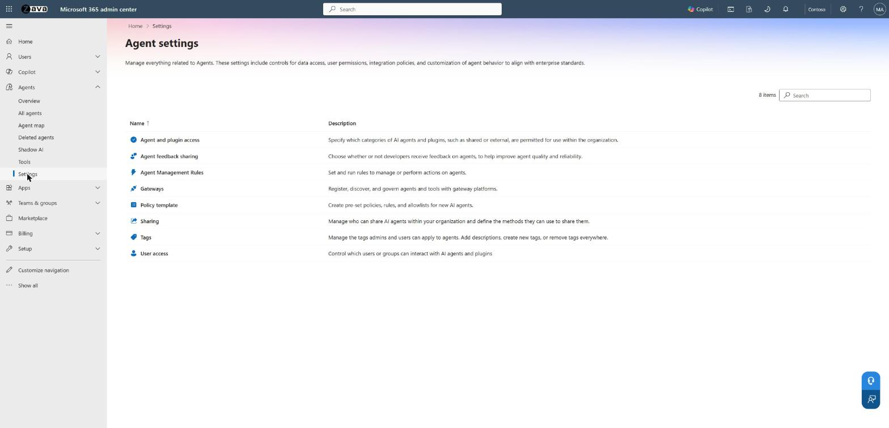

*Admin · Microsoft 365 admin center › Agents › Settings (web, 9 November 2026).*

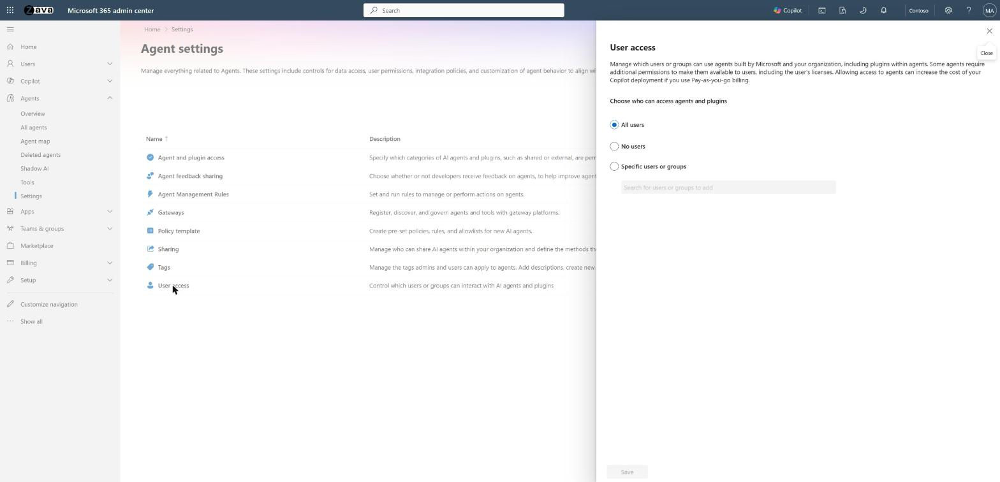

*Admin · Microsoft 365 admin center › Agents › Settings › User access (web, 9 November 2026).*

**Lab observation, 9 November 2026:** this tenant-wide **User access** pane showed **All users**
selected. It does not show who receives a particular package automatically; check that package's
**Users** tab in Step 6 as well.

**👤 IT admin:** Review **Copilot → Settings → All settings → Advanced package uploads** if users will
upload packages. This AI Administrator control distinguishes advanced packages containing actions or an
MCP server from basic packages. It is not a universal skills off switch. The [public setting guide](https://learn.microsoft.com/en-us/copilot/manage/configure-copilot-advanced-package-uploads)
describes its scope. Our expectation that a skills-only package remains basic is an **inference**; its
behaviour with scripts has not been tested in our tenant.

## Step 2 — 🙋 User: prepare one useful skill

Start with an existing approved checklist or repeated prompt. For the first pilot, keep the skill to
instructions and a small reference file. Add scripts only when the intended host's execution behaviour
is documented and tested.

| Prepare | Decision to write down |
|---|---|
| Purpose | One recognizable task and its business owner |
| Input | Selected slide, workbook range, document or explicitly supplied source |
| Trigger | Phrases employees use, including supported languages |
| Procedure | Ordered steps, stopping conditions and permitted edits |
| Output | Required structure and a short completion report |
| Missing information | What stays unchanged or is marked for review |
| References | Approved material that may travel with the skill |
| Acceptance | A matching prompt, an unrelated prompt and a deliberately incomplete source |

Here is a complete small example to adapt. Save it as **UTF-8 `SKILL.md`**, inside a folder named
**`improve-slide-titles`**.

```markdown
---
name: improve-slide-titles
description: Use in PowerPoint when asked to rewrite slide titles as factual takeaways from the current slide. Preserve body content and layout. Use only evidence already on the slide. Do not use for creating a new deck or changing workbook headings.
---

# Improve slide titles

1. Read the selected slides and identify each slide's main supported conclusion.
2. Propose a concise title using only facts on that slide.
3. Keep a neutral title if the evidence does not support a conclusion.
4. Change titles only; preserve figures, body text and layout.
5. Return a table: slide, previous title, new title, unresolved issue.
```

The `description` is the routing signal. Name the intended app, required input and result; distinguish
neighbouring tasks so a title skill does not compete with a deck-building skill. Naming an app in the
description steers use. It does **not** restrict where an organization skill appears.

| Format check | Required action |
|---|---|
| Name | Lowercase kebab-case; containing folder matches `name` exactly |
| Front matter | Valid YAML with `name` and a specific single-line `description` |
| Content | Clear instructions; quote YAML values containing a colon |
| Companions | Relative references to approved files; verify each path exists |
| Host compatibility | Use only file types and capabilities accepted by the chosen route |

Move detail into `references/` after verifying the host reads it. Have the business owner review shared procedures.

## Step 3 — 🙋 User: install a personal skill

### PowerPoint and Excel

In PowerPoint's Copilot pane, open **… → Manage plugins**; some documented versions say **Manage skills**.
The live pane distinguishes **Custom skills**, **Organization**, **Sales** and Microsoft's built-in skills.


*Lab admin/brand manager · PowerPoint › Copilot › … › Manage plugins (9 November 2026).*

**🙋 User:** Open **Custom skills → Create OneDrive folder → Open skills folder**. Copy the
`improve-slide-titles` folder containing `SKILL.md` into that location. Use the app-created location;
do not assume an arbitrary folder called Skills will be discovered.

**🙋 User:** Return to the pane, refresh the custom list if necessary, then open **+ → Choose skills**
and select the skill. Test it on a copy of a deck with three simple slides. Compare titles, body content,
figures and layout before and after. Microsoft's [PowerPoint personal-skills guide](https://support.microsoft.com/en-us/powerpoint/copilot/copilot-in-powerpoint-skills)
also describes upload and paste routes.

**🙋 User:** For an Excel-specific skill, use **… → Manage plugins & skills → Custom skills** to create
or open its OneDrive folder, then refresh after adding the skill. Invoke it through **+ → Choose plugins
and skills**. Begin with a copy of a small workbook and a task whose expected edits are easy to inspect.

Microsoft's [Excel skills guide](https://support.microsoft.com/en-us/excel/copilot/copilot-in-excel-skills)
documents the controls. Switching a skill off stops automatic use; Excel still allows a direct mention.
Treat the toggle as an invocation preference rather than an access boundary.

### Cowork

**🙋 User:** In our current web UI, open **Copilot app → Plugins → Cowork**. The **Added (12)**
collection mixes personal skills discovered from OneDrive and organization plugins, including our
fictional **Nimbus Office Skills** and **Nimbus Presentation Standards** packages.

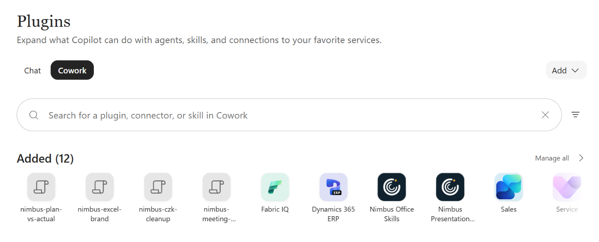

*Admin/brand manager · Copilot app › Plugins › Cowork › Added (web, 9 November 2026).*

Open **Add → New skill** to create a skill, or **Add → Upload** for an existing file. These are the
labels captured on **9 November 2026**, replacing the earlier **Customize → Skills** route in this guide.
Cowork accepts a `.md`, or a `.zip`/`.skill` archive containing `SKILL.md` at the root. Keep `references/`
beside it. Review the imported instructions and validation result before treating the import as complete.

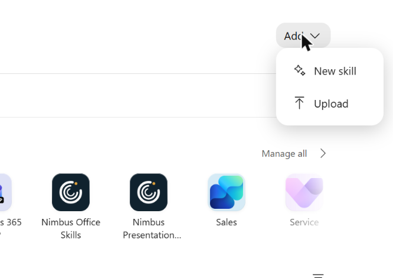

*Admin/brand manager · Copilot app › Plugins › Cowork › Add › New skill / Upload (web, 9 November 2026).*

**🙋 User:** Alternatively, place one named folder per skill under **`Documents/Cowork/skills/`** in
your OneDrive. **Lab observation, 9 November 2026:** the breadcrumb was **My files → Documents →
Cowork → skills**. This is the observed Cowork location; use the app-created folder for PowerPoint or Excel.

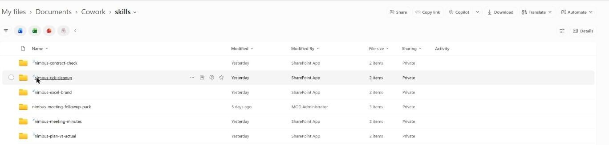

*Lab admin/brand manager · OneDrive › My files › Documents › Cowork › skills (web, 9 November 2026).*

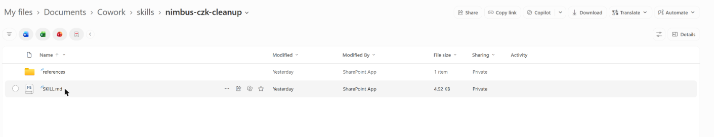

*Lab admin/brand manager · OneDrive › My files › Documents › Cowork › skills › nimbus-czk-cleanup (web, 9 November 2026).*

Start a **new conversation** after changes. The [Cowork usage guide](https://learn.microsoft.com/en-us/copilot/cowork/use-cowork)
documents this folder-based route.

**Owner-observed, reported 9 November 2026:** Cowork picked up skills placed in its OneDrive skills folder
automatically. This resolves our earlier discovery question for Cowork; it does not establish that Office
apps use the same folder or that every installed skill executes correctly.

**🙋 User:** Select the skill or request its matching task in a new session. Inspect the side panel's
loaded-skill chips and the actual result. Use the quality report when available, then run your own acceptance
checks. We have not recorded execution results for the full prepared lab skill set.

The [Customize guide](https://learn.microsoft.com/en-us/copilot/cowork/cowork-customize) describes sharing
and **Re-share** for updates. Re-uploading an existing name can create a numbered duplicate; inspect before replacing.

## Step 4 — 👤 Admin, site owner: create a SharePoint site skill

Choose this route when the procedure belongs to a site's content and people. A site skill is managed
by the site owner; by default, users with **Edit** can create skills and users with **View** can run them.
It uses existing SharePoint capabilities and user permissions, with no custom-code or external-system access.

**👤 Site owner:** Open the SharePoint **Settings** gear, then **Site skills (new)**.

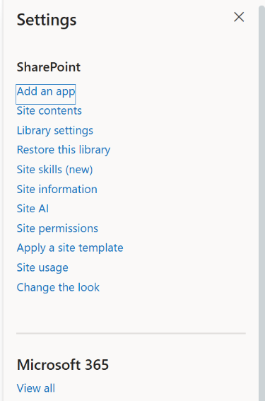

*Lab admin/brand manager · SharePoint pilot site › Settings › Site skills (new) (web, 9 November 2026; site-owner task).*

The **Site skills** page offers **Create with Copilot**, **Upload** and **Refresh**. Our **9 November
2026** capture shows the empty list and an actual **Upload** button; it does not establish successful
import or execution. Create the procedure with Copilot or upload the reviewed skill through this UI.

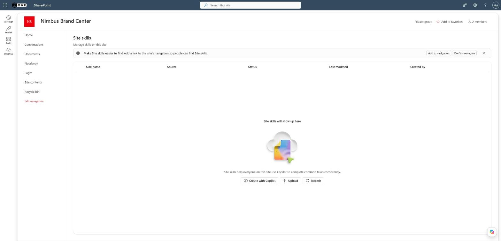

*Lab admin/brand manager · SharePoint pilot site › Settings › Site skills (new) › Site skills (web, 9 November 2026).*

For a first pilot, use a read-only task such as producing a review table from selected documents.
Inspect the saved instructions and enabled state.

Storage is **`Agent Assets/Skills/<skill-name>/SKILL.md`**. Use the management UI for setup and versions;
the [SharePoint guide](https://learn.microsoft.com/en-us/sharepoint/copilot-in-sharepoint-skills) covers replacement, copying and restoration.

**🙋 User:** On the associated site, select a few synthetic documents and ask Copilot to run the skill
by name. Look for the skill indicator card and compare its table with the files. Repeat with a View-only
user. Any proposed write operation still depends on that user's existing permissions and the host's tools.

A successful summary does not prove library-column updates. If your later workflow writes metadata,
reopen the library and verify the actual cells before marking that capability passed.

## Step 5 — 🎨 Brand manager: add a Brand Kit skill

Use a kit for procedures that belong to a particular identity: a branded proposal sequence, a board-update
structure or a voice rewrite. Open **Copilot app → Create → More… → Manage brand kits → Brand kits →
selected kit → Plugins → Skills → Add skill**.


*Admin/brand manager · Copilot app › Create › More… › Brand kits › selected kit › Plugins › Skills (web, 9 November 2026).*

The **Create a new skill** form has **Name**, **Description** (“Tell Copilot when to use this skill”)
and **Instructions**, plus **Or import a skill file**. Enter the reviewed content or import the reviewed
file, inspect the saved entry and complete the kit's publication process.


*Admin/brand manager · Brand kits › selected kit › Plugins › Skills › Add skill (web, 9 November 2026).*

**Lab observation, 6 October 2026:** the kit rejected a zip with a containing skill folder. It required
**`SKILL.md` at the archive root**. The [Brand Kit guide](/copilot-brand-kit/) covers templates, publishing
and the kit's per-kit strict-adherence setting.

**🙋 User:** In PowerPoint, select **+ → Select brand**, choose the kit, then **+ → Choose skills**.
Check that the expected brand skill appears and run its acceptance prompt. Microsoft documents the
selection sequence in [Brand Skill support](https://support.microsoft.com/en-us/powerpoint/copilot/brand-skill-support-copilot-powerpoint).

**Observed, 9 November 2026:** without a brand selected, PowerPoint listed our three deployed skills
with an **organization** badge, alongside Dynamics 365 sales skills. They were available without choosing
a kit, subject to deployment scope and user controls.

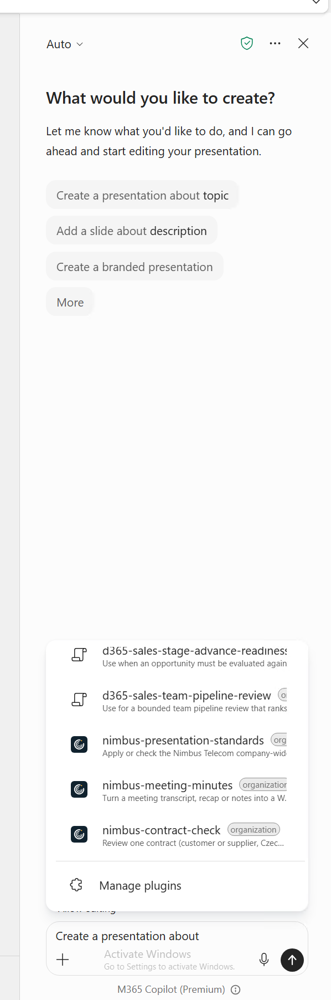

*Lab admin/brand manager · PowerPoint desktop › Copilot › + › Choose plugins › skills list, without a selected brand (9 November 2026).*

After **Select brand → Nimbus Telecom**, the kit's five skills appeared with a **Brand** badge:
`nimbus-board-update`, `nimbus-customer-proposal`, `nimbus-data-slide`, `nimbus-excel-brand` and
`nimbus-voice-cs`. Our desktop menu calls the entry **Choose plugins**, while Microsoft's guide calls
it **Choose skills**. **Manage plugins** is at the bottom of the list.

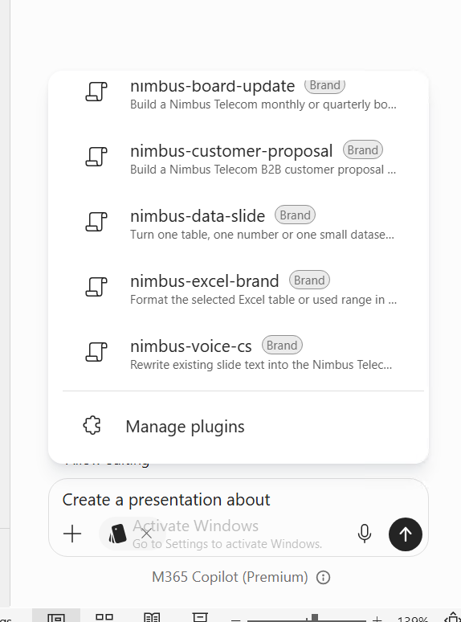

*Lab admin/brand manager · PowerPoint desktop › Copilot › + › Select brand › Nimbus Telecom › + › Choose plugins › skills list (9 November 2026).*

This pair shows the difference between deployment and brand selection. Skill visibility does not prove
execution, and the Excel-oriented kit skill appearing in PowerPoint does not establish cross-app execution.

| Question | Brand Kit | Organization skill |
|---|---|---|
| Activation | User selects the brand for the presentation | Available without brand selection to users in deployment scope |
| Picker badge | **Brand** after selecting the kit | **organization**, without selecting a kit |
| Content owner | Delegated brand manager | Business owner, with IT deployment |
| Typical content | Brand look, template-specific workflow and voice | Shared structure, formats, accessibility checks and repeatable procedures |
| Enforcement | Generated output still needs inspection | Availability and automatic routing are not mandatory compliance |
| App scope | Test supported brand experiences | No per-app deployment targeting for these packages |

**Observed 8 November 2026:** Excel's documented **`brandkit`** entry point was absent in our tenant. We have not
proved that it invokes custom kit skills or uses a kit's Excel template. Keep that test separate from
organization-package visibility in Excel.

## Step 6 — 👤 Admin: package and deploy an organization skill

Have the business owner supply reviewed instructions and tests. Start with a skills-only Microsoft 365
app package; connectors require additional configuration.

```text
presentation-procedures.zip
├── manifest.json
├── color.png
├── outline.png
└── skills/
    └── improve-slide-titles/
        └── SKILL.md
```

The manifest needs package identity/version, publisher details and policy links, names/descriptions,
accent colour, icons and `agentSkills`. Microsoft's organization-skill example uses manifest **1.30**.
This is only the skill-path excerpt, not a complete manifest:

```json
{
  "agentSkills": [
    { "folder": "./skills/improve-slide-titles" }
  ]
}
```

Keep actual archive paths consistent with the manifest. Microsoft's article currently mixes a root-folder
illustration with a `./skills/` example. Inspect the **built archive** rather than assuming a successful
zip command proves it is correct. Organization package layout differs from single-skill root archives.

**👤 IT admin:** Microsoft's [PowerPoint organization-skill procedure](https://support.microsoft.com/en-us/powerpoint/copilot/deploy-organization-skills-for-copilot-in-powerpoint)
uses **Agents → All agents → Add agent**. Our **9 November 2026** registry showed **Add agent** directly
on the command bar. It opened **Upload agent to publish**, with **Upload agent → Publish to users →
Review & finish**. Upload the reviewed package, read validation results and correct any reported errors.
Assign **specific users and groups** for the pilot before completing publication.

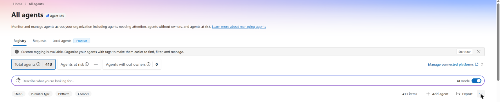

*Admin · Microsoft 365 admin center › Agents › All agents › Registry › Add agent (web, 9 November 2026).*

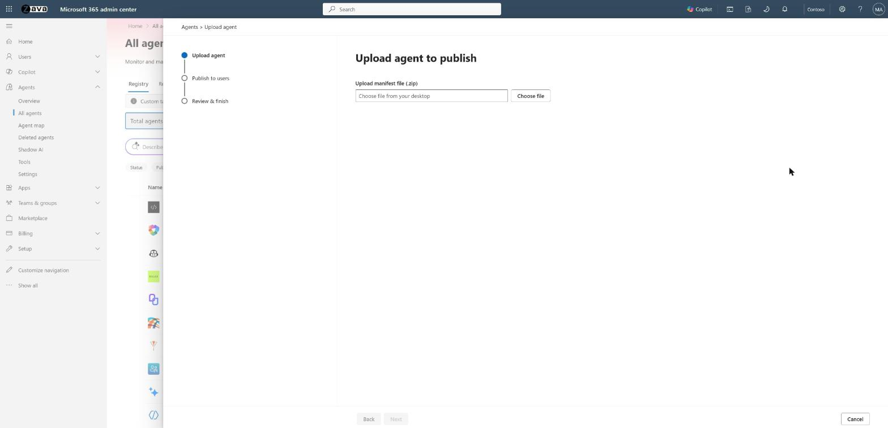

*Admin · Microsoft 365 admin center › Agents › All agents › Add agent › Upload agent to publish (web, 9 November 2026).*

For a general Chat/Cowork plugin, Microsoft's separate [plugin management procedure](https://learn.microsoft.com/en-us/microsoft-agent-365/admin/manage-plugins-skills-mcp-servers)
uses **Agents → Tools → Registry → Upload**, then user assignment and installation. Follow the route
documented for the package being deployed. **Lab observation, 9 November 2026:** Tools offered
**Plugins**, **Skills**, **MCP servers** and **Connectors**. Both Nimbus organization packages appeared
under Plugins and under Skills; the latter also listed Microsoft's Cowork role skills.

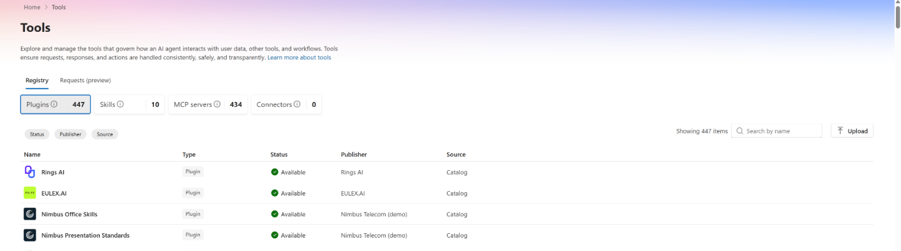

*Admin · Microsoft 365 admin center › Agents › Tools › Registry › Plugins (web, 9 November 2026).*

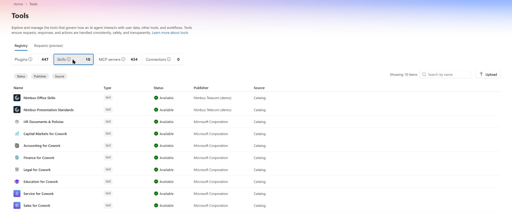

*Admin · Microsoft 365 admin center › Agents › Tools › Registry › Skills (web, 9 November 2026).*

**Lab observation, 9 November 2026:** Tools' upload wizard used **Upload → Users → Review & finish**
and asked for an **Upload manifest file (.zip)**. Selecting our skills-only package produced **Upload
complete**, with the name and description read from its manifest. This confirms the upload step; the
capture does not establish completed installation, assignment or successful execution.

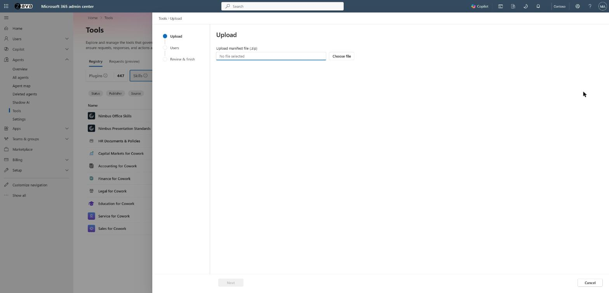

*Admin · Microsoft 365 admin center › Agents › Tools › Registry › Upload (web, 9 November 2026).*

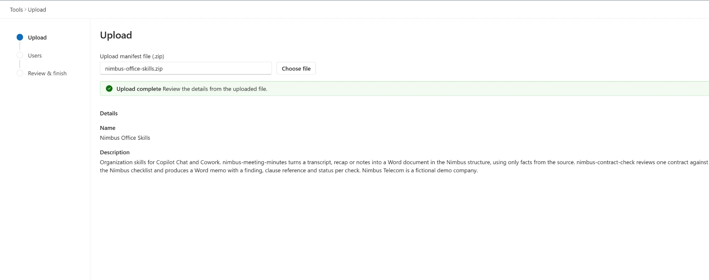

*Admin · Microsoft 365 admin center › Agents › Tools › Registry › Upload › Choose file (web, 9 November 2026).*

After installation, open the package under **Tools → Registry → Skills**. Check its version and included
skills on **Overview**, then open **Users** to inspect deployment scope.

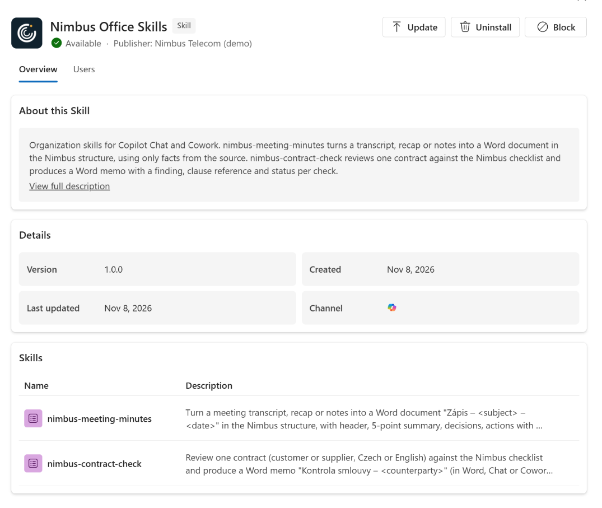

*Admin · Microsoft 365 admin center › Agents › Tools › Registry › Skills › Nimbus Office Skills › Overview (web, 9 November 2026).*

**Lab observation, 9 November 2026:** our installed packages still showed **Status: Available** and
**Source: Catalog**. To check whether a package is pushed to people, use its **Users → Installed for**
control: **All users**, **No users**, or **Specific users and groups**. The pane describes this as
“who will get this plugin automatically” and has a separate **Available to** section. Check both sections
on the **Users** tab; the status column does not establish automatic installation scope. Our captured
package had **Installed for: All users**, which is a lab setting, not a recommendation for your pilot.

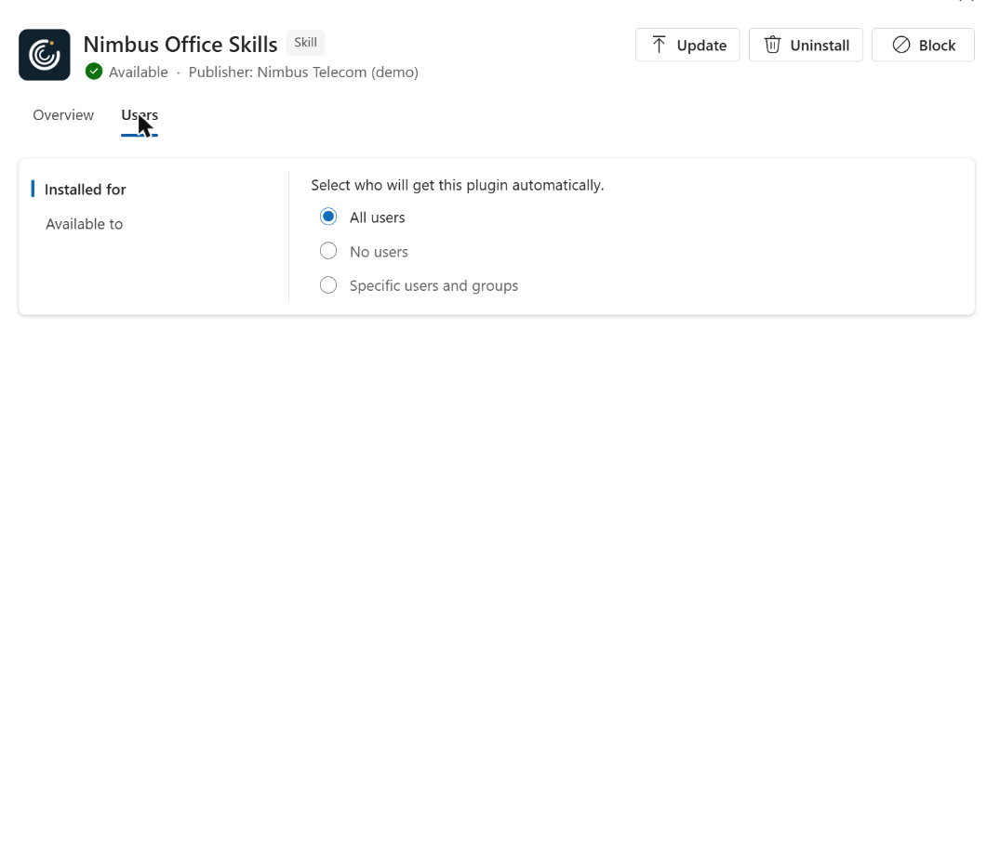

*Admin · Microsoft 365 admin center › Agents › Tools › Registry › Skills › Nimbus Office Skills › Users › Installed for (web, 9 November 2026).*

A declarative agent with embedded skills is another distribution model; these observations cover
skills-only organization packages. **Nimbus Telecom** is a fictional demo company.

## Step 7 — 🙋 User: verify discovery in every intended app

Sign in as the in-scope pilot. In PowerPoint, open **+ → Choose skills** and inspect the organization
entries. Check **Manage plugins → Organization** is enabled. In Excel, inspect **+ → Plugins** or
**Choose plugins and skills**. In the Copilot app, use **Plugins → Cowork → Added**, shown above.


*Lab admin/brand manager · PowerPoint desktop › Copilot › + › Choose plugins › skills list, without a selected brand (9 November 2026).*

Compare the **organization** badges here with the **Brand** badges after **Select brand** in Step 5.
The organization skills remain available without choosing the kit; their visibility does not depend on it.

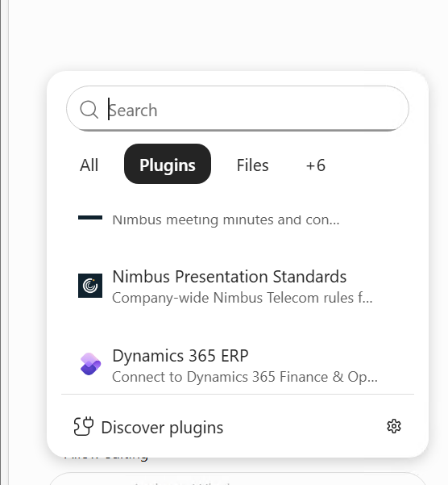

*Lab admin/brand manager · Excel › Copilot › + › Plugins (9 November 2026).*

In the Cowork **Added** collection, open an organization plugin. Our **9 November 2026** detail page
shows **Created by Nimbus Telecom (demo)**, the included skills, **Version 1.0.0** and a **per-user on/off
toggle**, shown **Off**. Admin deployment therefore does not mean every user's plugin is switched on.

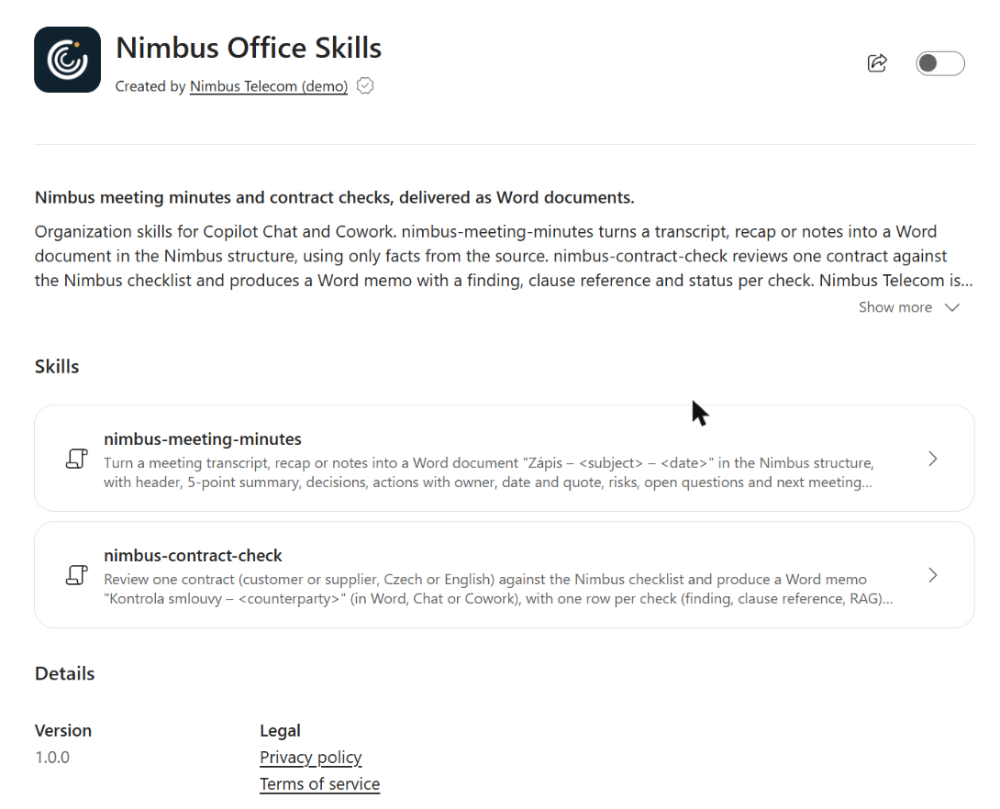

*Admin/brand manager · Copilot app › Plugins › Cowork › Added › Nimbus Office Skills (web, 9 November 2026).*

**Manage all** lists personal skills alongside the organization plugins; the organization entries have
per-user toggles there too. Check these states during the pilot and verify invocation separately.

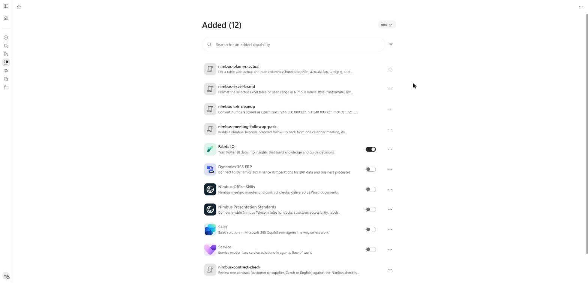

*Admin/brand manager · Copilot app › Plugins › Cowork › Added › Manage all (web, 9 November 2026).*

| App | Latest lab observation | Date | What it proves |
|---|---|---|---|
| PowerPoint | All three Nimbus skills listed with organization badges, including Word-oriented skills | 9 November 2026 | Skill visibility |
| Excel | Organization packages under Plugins; the Office Skills entry is partly clipped in the capture | 9 November 2026 | Package visibility |
| Cowork | Both packages under Plugins → Cowork → Added | 9 November 2026 | Package availability |
| Word | No organization skills shown in our tenant | 9 November 2026 | Tenant visibility observation; no execution result |

On **7 November 2026**, Word had shown **Discover plugins → Add → Create manually / Record a skill**
entry points. That earlier screen does not establish deployment support or successful execution. The
reason for Word's later absence remains unconfirmed. **As of 9 November 2026, Word showed no organization
skills in our tenant.** Record that observation and repeat the check before a wider rollout.

### No per-app targeting

Our Word-output skills also appeared in PowerPoint and Excel. **There is no per-app targeting** in the
organization deployment we tested. Neither its manifest nor `SKILL.md` supplies an app restriction; user
and group assignment controls reach. A `metadata.surface` label or `metadata.tags` value does not hide
the skill from another app.

The PowerPoint screenshot above makes the consequence visible: `nimbus-meeting-minutes` and
`nimbus-contract-check` appear with **organization** badges even though their intended outputs are Word
documents. Selecting a Brand Kit is a separate action, illustrated by the **Brand** badges in Step 5.

**Recommendation:** split packages by audience and business ownership, write precise routing descriptions,
use recognizable names and test matching and unrelated requests in every intended host. Show users the
automatic-use toggles. A Word-oriented description can steer routing; it is not an access boundary.

## Step 8 — 🙋 User: verify invocation and output before wider release

Run an explicit selection test first, then a natural matching prompt and an unrelated prompt in fresh
sessions. Keep the source fixture and expected result beside the acceptance record. Check the output
file directly, including formulas, figures and layout where relevant.

| Test | Owner | Required evidence |
|---|---|---|
| Discovery | 🙋 User | Intended skill/package appears for the pilot |
| Scope | 👤 IT admin | Comparison account has the expected deployment availability |
| Explicit invocation | 🙋 User | Skill selected/loaded and requested operation inspected |
| Automatic routing | 🙋 User | Matching prompt loads intended procedure; unrelated task avoids it |
| Missing data | 🙋 User | Unknown facts remain identified rather than invented |
| Preservation | 🙋 User | Title-only task leaves body/layout unchanged; styling task preserves workbook values |
| Permissions | 👤 Site owner | Site process respects existing read/edit rights |
| Release acceptance | 🎨 Brand manager or process owner | Expected business result checked against the original source |

For the example title skill, use one slide with an explicit conclusion, one with an ambiguous table and
one with no supporting data. A pass requires a justified title, a neutral fallback where needed and no
unrequested edits. Save the actual result and unresolved issues, including failures.

Runtime matters when expanding the pilot. Cowork documents isolated script execution; SharePoint skills
cannot execute custom code. Excel uses existing Copilot tools, and its Office.js skill development has
separate preview requirements. PowerPoint script execution is not established by accepting a `.py` file.
Recheck the host documentation before treating a portable folder as a portable runtime.

## Troubleshooting

| Symptom | Owner | Check and action |
|---|---|---|
| Personal skill absent | 🙋 User | Exact folder/name match, `SKILL.md`, valid YAML, app-created OneDrive location, refresh |
| Cowork misses latest edit | 🙋 User | Sync state, named folder under Cowork skills, new conversation, duplicate copies |
| Missing SKILL.md upload error | 🎨 Brand manager or 🙋 User | Brand Kit/Cowork archive requires the file at root |
| Organization package fails validation | 👤 IT admin | Manifest paths match archive; required metadata and both icon files present |
| Validated package absent in app | 👤 IT admin | Package Users → Installed for and Available to, included skills, tenant User access, feature availability |
| Listed but not automatically used | 🙋 User | Toggle, precise description and task input; compare explicit invocation |
| Word-output skill appears in Excel | 👤 IT admin | Expected cross-app visibility; scope by audience and test routing |
| No Word skills | 👤 IT admin | Record current availability; creation buttons alone do not prove deployment support |
| Site skill unavailable | 👤 Site owner | Correct site, enabled state, View permission to run, Edit to create |
| Skill reports a write that did not happen | 🙋 User | Inspect actual content; require a result table when tools cannot complete the edit |
| Old or duplicate procedure runs | Relevant route owner | Inspect saved versions, retire obsolete copy through its management UI and retest |
| Advanced uploads restricted but skills still upload | 👤 IT admin | Review basic/advanced distinction; inspect package components and applicable access controls |

## Release checklist and maintenance

- [ ] **👤 IT admin:** licence, user access, publisher policy and pilot assignment verified.
- [ ] **🙋 User:** purpose, trigger, inputs, outputs and stopping conditions written down.
- [ ] **Relevant owner:** instructions and bundled references approved for recipients.
- [ ] **🙋 User:** personal skill installed in the location created by its host.
- [ ] **👤 Site owner:** site skill reviewed, enabled and tested with ordinary site permissions.
- [ ] **🎨 Brand manager:** brand skill published and discoverable after brand selection.
- [ ] **👤 IT admin:** organization archive inspected, validation passed, package Users → Installed for and Available to checked for the pilot scope.
- [ ] **🙋 User:** explicit use, automatic routing, unrelated prompts and incomplete inputs tested.
- [ ] **Process owner:** actual output accepted; absent features and pending tests recorded separately.
- [ ] **Relevant owner:** review date, update path and retirement procedure assigned.

For updates, rebuild from the maintained source and repeat acceptance checks. Keep package identity stable
while updating its version. Use Cowork's Re-share and SharePoint's version controls. Assign a deputy
before broad deployment.

## Further reading

- [PowerPoint personal skills](https://support.microsoft.com/en-us/powerpoint/copilot/copilot-in-powerpoint-skills) and [organization deployment](https://support.microsoft.com/en-us/powerpoint/copilot/deploy-organization-skills-for-copilot-in-powerpoint).
- [Excel skills](https://support.microsoft.com/en-us/excel/copilot/copilot-in-excel-skills) and [Office.js skill development preview](https://learn.microsoft.com/en-us/office/dev/add-ins/excel/excel-skills).
- [Customize Cowork](https://learn.microsoft.com/en-us/copilot/cowork/cowork-customize) and [use Cowork](https://learn.microsoft.com/en-us/copilot/cowork/use-cowork).
- [SharePoint site and personal skills](https://learn.microsoft.com/en-us/sharepoint/copilot-in-sharepoint-skills).
- [Manage plugins, skills and MCP servers](https://learn.microsoft.com/en-us/microsoft-agent-365/admin/manage-plugins-skills-mcp-servers) and [agent settings](https://learn.microsoft.com/en-us/microsoft-agent-365/admin/agent-settings).
- [Brand Kit skill support](https://support.microsoft.com/en-us/powerpoint/copilot/brand-skill-support-copilot-powerpoint) and [the companion Brand Kit setup guide](/copilot-brand-kit/).

---

<p style="font-size: 0.95em; margin-top: 2.5em; color: #606c71;">
  Written by <strong>Ondrej Stefka</strong> &middot;
  <a href="https://www.linkedin.com/in/ondrej-stefka-71a7a821">LinkedIn</a>
</p>

<p style="font-size: 0.95em; margin-top: 2em;">
  <a href="{{ '/about' | relative_url }}">About this blog &rarr;</a>
</p>
