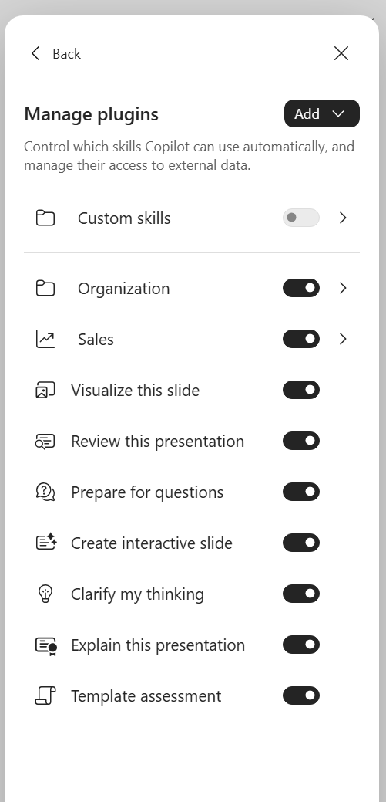
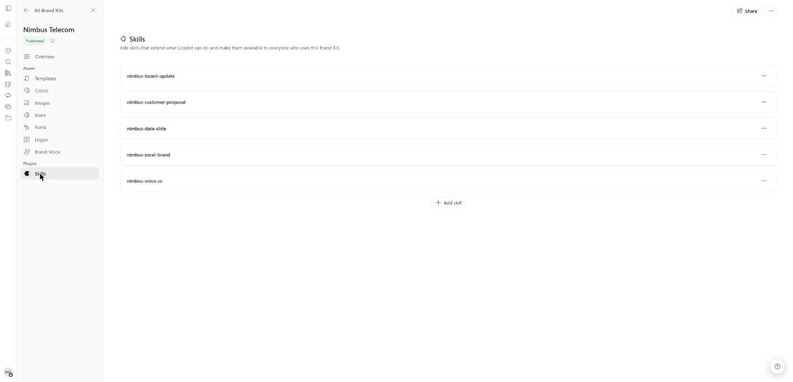
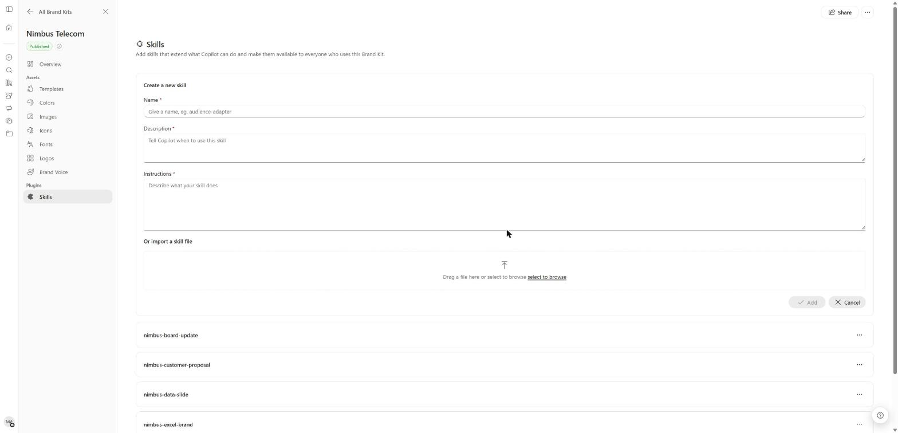
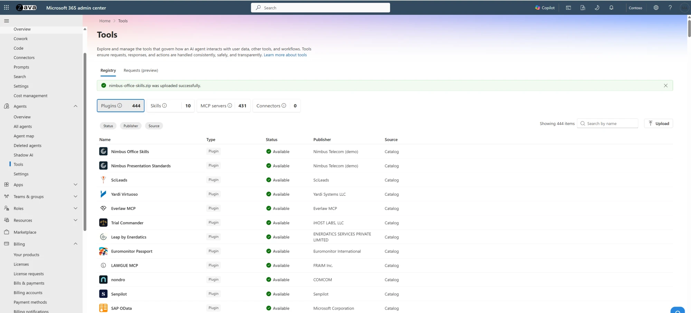

<p style="font-size: 0.85em; color: #606c71; border-left: 3px solid #dce6f0; padding: 0.4em 0 0.4em 0.9em; margin: 0 0 1.8em 0;">
  <strong>Personal blog.</strong> This site reflects my own testing and my own
  opinions. It is not an official Microsoft statement and it is not official
  Microsoft documentation in any way. For authoritative guidance always refer to
  <a href="https://learn.microsoft.com/">Microsoft Learn</a>.
</p>

> **TL;DR** — Choose ownership before packaging. A user manages personal skills, a SharePoint site owner
> manages site skills, a brand manager manages Brand Kit skills, and IT publishes organization skills/plugins
> in **Microsoft 365 admin center › Agents › Tools**.
> Start with one repeatable task, install it for a pilot and verify discovery, invocation and output separately.
>
> In our tenant, organization packages appeared in PowerPoint, Excel and Copilot Chat/Cowork Plugins,
> including Word-output skills in the other apps. Word showed no organization skills. There is
> **no per-app targeting** for these organization packages: deployment scope is users and groups.
>
> A Brand Kit requires user selection. An organization skill is available throughout its deployment
> scope without selecting a brand. “Available” does not mean mandatory, automatically used or successfully tested.

> **What this article is.** A practical guide to **where skills work and how to distribute them**, combining
> public Microsoft documentation, local packaging checks and lab observations. Installation and visibility
> are distinguished from successful execution.

A skill captures a procedure your team already repeats: improve presentation titles, review a document
against a checklist, or prepare a summary from selected files. The common format is `SKILL.md`. The
setup differs by who owns the procedure, where employees use it and how widely it should be distributed.

The observations and screenshots below are from **our lab tenant as of 9 November 2026**, using an
administrator/brand-manager account. Ordinary-user access and execution remain separate tests.

## Who does what

**A** means accountable, **R** does the work, **C** is consulted and **V** verifies the result.

| Activity | 👤 IT admin | 👤 Site owner | 🎨 Brand manager | 🙋 User |
|---|---|---|---|---|
| Licensing and pilot eligibility | A/R | C | C | V |
| Personal skill creation and maintenance | C | — | — | A/R |
| Site skill lifecycle and site permissions | C | A/R | — | V |
| Brand Kit skill review and publication | C | — | A/R | V |
| Organization publication and scope in Agents › Tools | A/R | C for site processes | C for brand content | V |
| Business acceptance and maintenance | C | A for site process | A for brand process | R for pilot tests |

Use an **AI Administrator** for organization deployment. Site owners manage site skills without tenant
admin rights; the **Admin** marker identifies the responsible role below.

| Route | Best fit | Availability | Setup owner |
|---|---|---|---|
| Personal | Individual habit or experiment | Owner's supported experiences | 🙋 User |
| SharePoint site | Process tied to one site's content | Associated site, subject to user permissions | 👤 Site owner |
| Brand Kit | Procedure that belongs to a selected brand | People with kit access after selecting it | 🎨 Brand manager |
| Organization plugin | Approved procedure for a department or wider audience | Supporting apps for assigned users/groups | 👤 IT admin |

## Step 1 — 👤 Admin: confirm access and the pilot scope

Choose a business owner and a small pilot group. Include an ordinary employee in scope and a comparison
account outside the deployment. Record the intended hosts and the result each person should see.

| Prerequisite | Check before setup |
|---|---|
| Copilot entitlement | Pilot users can open Copilot in each intended app; Cowork plugins require an eligible Copilot licence |
| Feature availability | The skill/plugin controls actually appear; record absent features separately |
| OneDrive | Personal-skill owner has a working OneDrive |
| SharePoint route | Copilot in SharePoint is available on the pilot site; owner has appropriate site permissions |
| Brand route | Brand-manager delegation and kit access already work |
| Organization route | Admin has package-management access and the pilot group is eligible under tenant policy |
| Test material | Small synthetic deck, workbook or document with known expected results |

Plugins with skills are managed in **Microsoft 365 admin center › Agents › Tools**.

**👤 IT admin:** Review **Copilot → Settings → All settings → Advanced package uploads** if users will
upload packages. This AI Administrator control distinguishes advanced packages containing actions or an
MCP server from basic packages. The [public setting guide](https://learn.microsoft.com/en-us/copilot/manage/configure-copilot-advanced-package-uploads)
describes its scope.

## Step 2 — 🙋 User: prepare one useful skill

You can write a skill by hand, but in practice the best way to create one is to let **Copilot Cowork**
or **Copilot in the apps** build it. Cowork offers **new-skill** / **Plugins → Add → New skill**;
Word has **Discover plugins → Add → Create manually / Record a skill**. PowerPoint and Excel also
offer skill-creation controls, and Brand Kit has a **Create a new skill** form (Step 5).

Start with an approved checklist or repeated prompt. Describe the input and expected result, then review
and test what Copilot saves. **A separate post on creating skills will follow.** Here, only the file
anatomy matters for packaging: save **UTF-8 `SKILL.md`** in a folder whose name matches `name`, such as
**`improve-slide-titles`**.

```markdown
---
name: improve-slide-titles
description: Use in PowerPoint when asked to rewrite slide titles as factual takeaways from the current slide. Preserve body content and layout. Use only evidence already on the slide. Do not use for creating a new deck or changing workbook headings.
---

# Improve slide titles

1. Read the selected slides and identify each slide's main supported conclusion.
2. Propose a concise title using only facts on that slide.
3. Keep a neutral title if the evidence does not support a conclusion.
4. Change titles only; preserve figures, body text and layout.
5. Return a table: slide, previous title, new title, unresolved issue.
```

The YAML header needs `name` and `description`. The **description is the routing signal**: name the
intended app, input and result. Naming an app steers use; it does **not** restrict where an organization
skill appears. Keep any companion-file paths relative and verify them in the built package.

## Step 3 — 🙋 User: install a personal skill

### PowerPoint and Excel

In PowerPoint's Copilot pane, open **… → Manage plugins**; some documented versions say **Manage skills**.
The live pane distinguishes **Custom skills**, **Organization**, **Sales** and Microsoft's built-in skills.



*Lab admin/brand manager · PowerPoint › Copilot › … › Manage plugins.*

**🙋 User:** Open **Custom skills → Create OneDrive folder → Open skills folder**. Copy the
`improve-slide-titles` folder containing `SKILL.md` into that location. Use the app-created location;
do not assume an arbitrary folder called Skills will be discovered.

**🙋 User:** Return to the pane, refresh the custom list if necessary, then open **+ → Choose skills**
and select the skill. Test it on a copy of a deck with three simple slides. Compare titles, body content,
figures and layout before and after. Microsoft's [PowerPoint personal-skills guide](https://support.microsoft.com/en-us/powerpoint/copilot/copilot-in-powerpoint-skills)
also describes upload and paste routes.

**🙋 User:** For an Excel-specific skill, use **… → Manage plugins & skills → Custom skills** to create
or open its OneDrive folder, then refresh after adding the skill. Invoke it through **+ → Choose plugins
and skills**. Begin with a copy of a small workbook and a task whose expected edits are easy to inspect.

Microsoft's [Excel skills guide](https://support.microsoft.com/en-us/excel/copilot/copilot-in-excel-skills)
documents the controls. Switching a skill off stops automatic use; Excel still allows a direct mention.
Treat the toggle as an invocation preference rather than an access boundary.

### Cowork

**🙋 User:** In our current web UI, open **Copilot app → Plugins → Cowork**. The **Added (12)**
collection mixes personal skills discovered from OneDrive and organization plugins, including our
fictional **Nimbus Office Skills** and **Nimbus Presentation Standards** packages.


*Admin/brand manager · Copilot app › Plugins › Cowork › Added (web).*

Open **Add → New skill** to create a skill, or **Add → Upload** for an existing file. These labels
replace the earlier **Customize → Skills** route in this guide.
Cowork accepts a `.md`, or a `.zip`/`.skill` archive containing `SKILL.md` at the root. Keep `references/`
beside it. Review the imported instructions and validation result before treating the import as complete.


*Admin/brand manager · Copilot app › Plugins › Cowork › Add › New skill / Upload (web).*

**🙋 User:** Alternatively, place one named folder per skill under **`Documents/Cowork/skills/`** in
your OneDrive. In our tenant, the breadcrumb was **My files → Documents →
Cowork → skills**. This is the observed Cowork location; use the app-created folder for PowerPoint or Excel.


*Lab admin/brand manager · OneDrive › My files › Documents › Cowork › skills (web).*


*Lab admin/brand manager · OneDrive › My files › Documents › Cowork › skills › nimbus-czk-cleanup (web).*

Start a **new conversation** after changes. The [Cowork usage guide](https://learn.microsoft.com/en-us/copilot/cowork/use-cowork)
documents this folder-based route.

In our tenant, Cowork picked up skills placed in its OneDrive skills folder
automatically. This resolves our earlier discovery question for Cowork; it does not establish that Office
apps use the same folder or that every installed skill executes correctly.

**🙋 User:** Select the skill or request its matching task in a new session. Inspect the side panel's
loaded-skill chips and the actual result. Use the quality report when available, then run your own acceptance
checks. We have not recorded execution results for the full prepared lab skill set.

The [Customize guide](https://learn.microsoft.com/en-us/copilot/cowork/cowork-customize) describes sharing
and **Re-share** for updates. Re-uploading an existing name can create a numbered duplicate; inspect before replacing.

## Step 4 — 👤 Admin, site owner: create a SharePoint site skill

Choose this route when the procedure belongs to a site's content and people. A site skill is managed
by the site owner; by default, users with **Edit** can create skills and users with **View** can run them.
It uses existing SharePoint capabilities and user permissions, with no custom-code or external-system access.

**👤 Site owner:** Open the SharePoint **Settings** gear, then **Site skills (new)**.


*Lab admin/brand manager · SharePoint pilot site › Settings › Site skills (new) (web; site-owner task).*

The **Site skills** page offers **Create with Copilot**, **Upload** and **Refresh**. In our tenant,
the list was empty; successful import and execution remain untested. Create the procedure with Copilot
or upload the reviewed skill through this UI.


*Lab admin/brand manager · SharePoint pilot site › Settings › Site skills (new) › Site skills (web).*

For a first pilot, use a read-only task such as producing a review table from selected documents.
Inspect the saved instructions and enabled state.

Storage is **`Agent Assets/Skills/<skill-name>/SKILL.md`**. Use the management UI for setup and versions;
the [SharePoint guide](https://learn.microsoft.com/en-us/sharepoint/copilot-in-sharepoint-skills) covers replacement, copying and restoration.

**🙋 User:** On the associated site, select a few synthetic documents and ask Copilot to run the skill
by name. Look for the skill indicator card and compare its table with the files. Repeat with a View-only
user. Any proposed write operation still depends on that user's existing permissions and the host's tools.

A successful summary does not prove library-column updates. If your later workflow writes metadata,
reopen the library and verify the actual cells before marking that capability passed.

## Step 5 — 🎨 Brand manager: add a Brand Kit skill

Use a kit for procedures that belong to a particular identity: a branded proposal sequence, a board-update
structure or a voice rewrite. Open **Copilot app → Create → More… → Manage brand kits → Brand kits →
selected kit → Plugins → Skills → Add skill**.



*Admin/brand manager · Copilot app › Create › More… › Brand kits › selected kit › Plugins › Skills (web).*

The **Create a new skill** form has **Name**, **Description** (“Tell Copilot when to use this skill”)
and **Instructions**, plus **Or import a skill file**. Enter the reviewed content or import the reviewed
file, inspect the saved entry and complete the kit's publication process.



*Admin/brand manager · Brand kits › selected kit › Plugins › Skills › Add skill (web).*

In our tenant, the kit rejected a zip with a containing skill folder. It required
**`SKILL.md` at the archive root**. The [Brand Kit guide](/copilot-brand-kit/) covers templates, publishing
and the kit's per-kit strict-adherence setting.

**🙋 User:** In PowerPoint, select **+ → Select brand**, choose the kit, then **+ → Choose skills**.
Check that the expected brand skill appears and run its acceptance prompt. Microsoft documents the
selection sequence in [Brand Skill support](https://support.microsoft.com/en-us/powerpoint/copilot/brand-skill-support-copilot-powerpoint).

Compare the **Brand** and **organization** badges in Step 6. In our tenant, Excel's documented
**`brandkit`** entry point was absent; custom kit-skill execution and Excel-template use remain pending checks.

## Step 6 — 👤 Admin: publish and manage organization skills

**Microsoft 365 admin center › Agents › Tools** is the central place to publish and manage plugins
with skills. Have the business owner supply reviewed instructions and tests, then build a Microsoft 365
app package:

```text
presentation-procedures.zip
├── manifest.json
├── color.png
├── outline.png
└── skills/
    └── improve-slide-titles/
        └── SKILL.md
```

The manifest needs package identity/version, publisher details and policy links, names/descriptions,
icons, accent colour and `agentSkills`. The skill-path excerpt below is part of a complete manifest;
its paths must match the **built archive**. This layout differs from a single-skill root archive.

```json
{
  "agentSkills": [
    { "folder": "./skills/improve-slide-titles" }
  ]
}
```

**👤 IT admin:** Open **Agents › Tools › Registry › Upload**:

1. Upload the reviewed **manifest `.zip`**, inspect the included components and resolve validation errors.
2. In **Users**, select the pilot's **specific users and groups**.
3. Complete **Review & finish** and **Install**.

Microsoft's [plugin and skill management guide](https://learn.microsoft.com/en-us/microsoft-agent-365/admin/manage-plugins-skills-mcp-servers)
describes this publishing route.


*Admin · Microsoft 365 admin center › Agents › Tools › Registry › Upload (web).*

In our tenant, the registry confirmed **“nimbus-office-skills.zip was uploaded successfully”**. It has
**Plugins**, **Skills**, **MCP servers** and **Connectors** tiles; both Nimbus packages appeared under
Plugins and Skills. **Nimbus Telecom** is a fictional demo company.



*Admin · Microsoft 365 admin center › Agents › Tools › Registry, after upload (web).*

Open the package's details under **Registry › Skills**. **Overview** shows its version and included
skills, with **Update**, **Uninstall** and **Block** controls.


*Admin · Microsoft 365 admin center › Agents › Tools › Registry › Skills › Nimbus Office Skills › Overview (web).*

On **Users**, check both **Installed for** (who gets the plugin automatically) and **Available to**
(who can use it). Scope deployment by **users/groups**. Our capture shows **Installed for: All users**;
choose a smaller scope for a pilot. The registry's **Available** status alone does not establish that scope.


*Admin · Microsoft 365 admin center › Agents › Tools › Registry › Skills › Nimbus Office Skills › Users (web).*

### Where installed skills appear

In our tenant, the packages appeared in **Copilot Chat/Cowork Plugins** and in **PowerPoint** and
**Excel** skill/plugin lists with an **organization** badge. **Word did not yet show organization skills.**
There is **no per-app targeting**: our Word-output skills also appeared in PowerPoint and Excel.
Scope packages by audience, write precise descriptions to steer routing, and test each intended app.


*Lab admin/brand manager · PowerPoint desktop › Copilot › + › Choose plugins, without a selected brand.*

Brand Kit skills appear only after **Select brand** and carry a **Brand** badge. After selecting
**Nimbus Telecom**, our kit's five skills appeared below. The desktop menu calls this **Choose plugins**;
Microsoft's guide calls it **Choose skills**.


*Lab admin/brand manager · PowerPoint desktop › Copilot › + › Select brand › Nimbus Telecom › + › Choose plugins.*


*Lab admin/brand manager · Excel › Copilot › + › Plugins.*

Users can **switch a plugin off**. In Copilot Chat/Cowork, **Plugins › Cowork › Added › Manage all**
lists personal skills and organization plugins with per-user toggles. Include these settings in the pilot;
availability still needs a separate invocation and output check.


*Admin/brand manager · Copilot app › Plugins › Cowork › Added › Manage all (web).*

## Step 7 — 🙋 User: verify discovery in every intended app

Sign in as the in-scope pilot. In PowerPoint, open **+ → Choose skills** (or **Choose plugins**) and
check **Manage plugins → Organization** is enabled. In Excel, inspect **+ → Plugins** or
**Choose plugins and skills**. In Copilot Chat/Cowork, use **Plugins → Cowork → Added**.

Use the lists in Step 6 to compare organization entries with brand-selected skills. Repeat with the
comparison account outside the pilot, and record any missing features, including Word. Discovery
confirms visibility; run the next checks before accepting the result.

## Step 8 — 🙋 User: verify invocation and output before wider release

Run an explicit selection test first, then a natural matching prompt and an unrelated prompt in fresh
sessions. Keep the source fixture and expected result beside the acceptance record. Check the output
file directly, including formulas, figures and layout where relevant.

| Test | Owner | Required evidence |
|---|---|---|
| Discovery | 🙋 User | Intended skill/package appears for the pilot |
| Scope | 👤 IT admin | Comparison account has the expected deployment availability |
| Explicit invocation | 🙋 User | Skill selected/loaded and requested operation inspected |
| Automatic routing | 🙋 User | Matching prompt loads intended procedure; unrelated task avoids it |
| Missing data | 🙋 User | Unknown facts remain identified rather than invented |
| Preservation | 🙋 User | Title-only task leaves body/layout unchanged; styling task preserves workbook values |
| Permissions | 👤 Site owner | Site process respects existing read/edit rights |
| Release acceptance | 🎨 Brand manager or process owner | Expected business result checked against the original source |

For the example title skill, use one slide with an explicit conclusion, one with an ambiguous table and
one with no supporting data. A pass requires a justified title, a neutral fallback where needed and no
unrequested edits. Save the actual result and unresolved issues, including failures.

Runtime matters when expanding the pilot. Cowork documents isolated script execution; SharePoint skills
cannot execute custom code. Excel uses existing Copilot tools, and its Office.js skill development has
separate preview requirements. PowerPoint script execution is not established by accepting a `.py` file.
Recheck the host documentation before treating a portable folder as a portable runtime.

## Troubleshooting

| Symptom | Owner | Check and action |
|---|---|---|
| Personal skill absent | 🙋 User | Exact folder/name match, `SKILL.md`, valid YAML, app-created OneDrive location, refresh |
| Cowork misses latest edit | 🙋 User | Sync state, named folder under Cowork skills, new conversation, duplicate copies |
| Missing SKILL.md upload error | 🎨 Brand manager or 🙋 User | Brand Kit/Cowork archive requires the file at root |
| Organization package fails validation | 👤 IT admin | Manifest paths match archive; required metadata and both icon files present |
| Validated package absent in app | 👤 IT admin | Agents › Tools › Registry › package Users → Installed for and Available to, included skills, feature availability |
| Listed but not automatically used | 🙋 User | Toggle, precise description and task input; compare explicit invocation |
| Word-output skill appears in Excel | 👤 IT admin | Expected cross-app visibility; scope by audience and test routing |
| No Word skills | 👤 IT admin | Record current availability; creation buttons alone do not prove deployment support |
| Site skill unavailable | 👤 Site owner | Correct site, enabled state, View permission to run, Edit to create |
| Skill reports a write that did not happen | 🙋 User | Inspect actual content; require a result table when tools cannot complete the edit |
| Old or duplicate procedure runs | Relevant route owner | Inspect saved versions, retire obsolete copy through its management UI and retest |
| Package upload restricted | 👤 IT admin | Review the advanced-upload setting against the package components and the uploader's permissions |

## Release checklist and maintenance

- [ ] **👤 IT admin:** licences, pilot eligibility and package-management access verified.
- [ ] **🙋 User:** purpose, trigger, inputs, outputs and stopping conditions written down.
- [ ] **Relevant owner:** instructions and bundled references approved for recipients.
- [ ] **🙋 User:** personal skill installed in the location created by its host.
- [ ] **👤 Site owner:** site skill reviewed, enabled and tested with ordinary site permissions.
- [ ] **🎨 Brand manager:** brand skill published and discoverable after brand selection.
- [ ] **👤 IT admin:** organization archive inspected, published through Agents › Tools, validation passed, and package Users → Installed for and Available to checked for the pilot scope.
- [ ] **🙋 User:** explicit use, automatic routing, unrelated prompts and incomplete inputs tested.
- [ ] **Process owner:** actual output accepted; absent features and pending tests recorded separately.
- [ ] **Relevant owner:** review date, update path and retirement procedure assigned.

For updates, rebuild from the maintained source and repeat acceptance checks. Keep package identity stable
while updating its version. For organization packages, use **Update** in the package's **Agents › Tools**
details panel; use Cowork's Re-share and SharePoint's version controls for those routes. Assign a deputy
before broad deployment.

## Further reading

- [PowerPoint personal skills](https://support.microsoft.com/en-us/powerpoint/copilot/copilot-in-powerpoint-skills).
- [Excel skills](https://support.microsoft.com/en-us/excel/copilot/copilot-in-excel-skills) and [Office.js skill development preview](https://learn.microsoft.com/en-us/office/dev/add-ins/excel/excel-skills).
- [Customize Cowork](https://learn.microsoft.com/en-us/copilot/cowork/cowork-customize) and [use Cowork](https://learn.microsoft.com/en-us/copilot/cowork/use-cowork).
- [SharePoint site and personal skills](https://learn.microsoft.com/en-us/sharepoint/copilot-in-sharepoint-skills).
- [Manage plugins, skills and MCP servers in Agents › Tools](https://learn.microsoft.com/en-us/microsoft-agent-365/admin/manage-plugins-skills-mcp-servers).
- [Brand Kit skill support](https://support.microsoft.com/en-us/powerpoint/copilot/brand-skill-support-copilot-powerpoint) and [the companion Brand Kit setup guide](/copilot-brand-kit/).

---

<p style="font-size: 0.95em; margin-top: 2.5em; color: #606c71;">
  Written by <strong>Ondrej Stefka</strong> &middot;
  <a href="https://www.linkedin.com/in/ondrej-stefka-71a7a821">LinkedIn</a>
</p>

<p style="font-size: 0.95em; margin-top: 2em;">
  <a href="{{ '/about' | relative_url }}">About this blog &rarr;</a>
</p>
