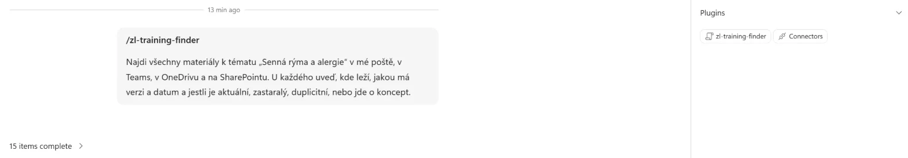
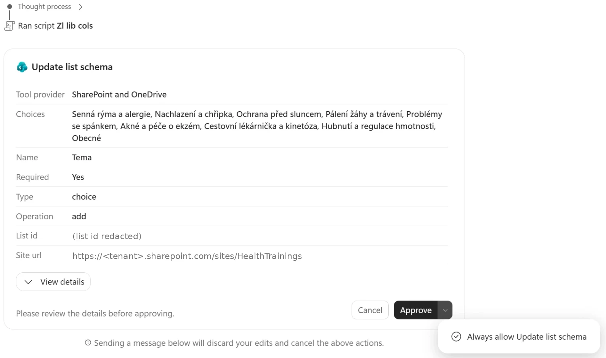
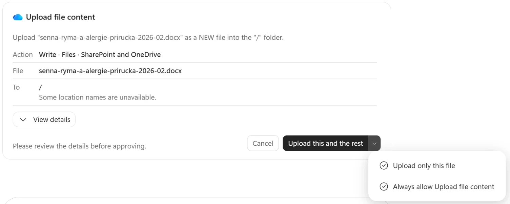
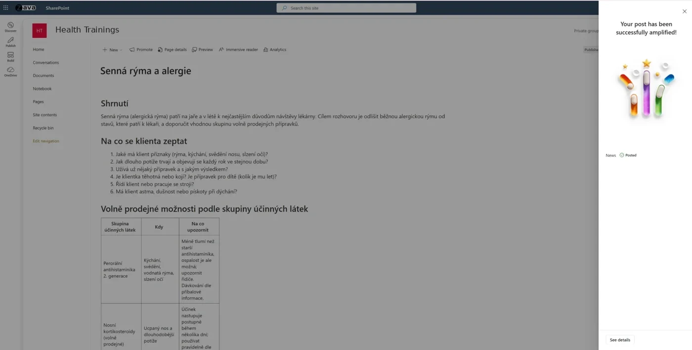

<p style="font-size: 0.85em; color: #606c71; border-left: 3px solid #dce6f0; padding: 0.4em 0 0.4em 0.9em; margin: 0 0 1.8em 0;">
  <strong>Personal blog.</strong> This guide reflects my own testing and opinions. It is not an official Microsoft statement or official Microsoft documentation. For authoritative guidance, refer to <a href="https://learn.microsoft.com/">Microsoft Learn</a>.
</p>

> **TL;DR** — Download the pack, scatter the source files in your own OneDrive and a Teams team, install two Cowork skills, then find and publish approved knowledge to your team's SharePoint site. Next, configure eight autofill columns and test 17 curated files. We build reader agents together with the facilitator later.
>
> **Evidence and scope.** Product claims below link to public Microsoft documentation. UI routes and the Cowork creation fallback were **observed in our test tenant, November 2026**; availability can differ. Exercise results are acceptance targets, not a claim that every card has passed. Screenshots are being added.

**Lékárny Zelený list** is a fictional pharmacy chain. Every person, course and training document in this exercise is synthetic. The medical text is a content-quality fixture, not medical advice. Treat “current” as the latest approved version in this scenario; a dated campaign is not necessarily running today.

**[Download the starter pack (ZIP)](/assets/hackathon-healthtrainings/zl-hackathon-pack.zip)** · Work alone or in a team of 2–4. Use your own organization's work accounts and tenant. No scripts, administrator tokens or mailbox imports are needed by participants.

## 1. What you will build today

The trainers have a familiar problem: a handbook in Teams, a newer checklist in a colleague's files, an old “FINAL” presentation, duplicate downloads and an unapproved service proposal. Search finds words; someone still has to decide which knowledge deserves publication.

| Act | You build | Completion evidence |
|---|---|---|
| **1 — Find, judge, publish** | Cowork uses `zl-training-finder` to inspect sources and `zl-training-publisher` to propose a clean SharePoint knowledge site | Discovery tables, approved topic pages, source provenance and a cleaned course catalogue |
| **2 — Keep metadata right** | SharePoint autofill classifies a batch of curated files | Eight configured prompts, 17 processed files and a comparison with the expected CSV |
| **3 — Answer from the site** | Agent Builder and two Copilot Studio approaches, together with the facilitator | Five grounded smoke tests, including “the sources do not say” |

Optional **act 2b** builds a content-owner dashboard with Copilot Code. It is harder and has separate runtime requirements. Finish the core route first.

Suggested checkpoints: setup first; cards 1–2 before branching into other topics; cards 3–7 through the morning; autofill after the library exists; reader agents after approved pages have been indexed. Keep a short team record: card, pass/fail/pending, source links, what needs fixing.

## 2. Before the day — 👤 IT admin

Complete this with a representative participant account before people arrive. Participants should receive working access and the two workspace locations; they do not need tenant administrator roles.

| Admin check | What IT must prepare | Participant proof / public documentation |
|---|---|---|
| Microsoft 365 Copilot | Assign the required Microsoft 365 Copilot licence and underlying services to people running Cowork and configuring autofill | Work account opens Copilot and its Cowork experience. [Cowork prerequisites](https://learn.microsoft.com/en-us/copilot/cowork/get-started) |
| Cowork access and billing | Include participants in a spending policy selecting Cowork, with appropriate usage-based billing and available credits. Current docs describe Cowork as generally available; the old Frontier agent allow-list is no longer its access control | Cowork opens and a small task runs. [Cowork admin governance](https://learn.microsoft.com/en-us/copilot/cowork/cowork-admin-governance), [access controls](https://learn.microsoft.com/en-us/copilot/cowork/cowork-access) |
| Personal skills | Confirm organizational policy allows the reviewed starter skills to be uploaded and used. Test the actual upload with the participant account | **Customize › Skills › Upload** accepts a root `SKILL.md` archive. No organization-wide plugin deployment is required for this route. [Customize Cowork](https://learn.microsoft.com/en-us/copilot/cowork/cowork-customize) |
| SharePoint Copilot | Verify Copilot in SharePoint and autofill are available on the exercise site. Everyday features are included with the Copilot licence without preview opt-in | Participant sees the library's Copilot/autofill controls. [Get started](https://learn.microsoft.com/en-us/sharepoint/copilot-in-sharepoint-get-started) |
| Advanced Autofill, if wanted | Prepare the separate SharePoint advanced-work spending policy and credits. A site admin enables **Settings › Site AI › Share credits for advanced autofill columns** using their own credits | Advanced processing uses Copilot Credits; ordinary new-file autofill is covered by the documented Copilot benefit. This exercise does not require choosing the older Syntex Azure pay-as-you-go route. [Autofill and billing](https://learn.microsoft.com/en-us/sharepoint/copilot-in-sharepoint-create-autofill-columns) |
| Clean destination site | Permit self-service site creation, or pre-create **one private site per team**, named `HealthTrainings-<team>`. Give the team's trainers owner/edit rights; prepare a reader account for later | Participants can open their own site and create/edit content. [Manage site creation](https://learn.microsoft.com/en-us/sharepoint/manage-site-creation), [admin site creation](https://learn.microsoft.com/en-us/sharepoint/create-site-collection) |
| Separate source team | Permit team creation, or pre-create one Teams team per hackathon team, e.g. `Školitelé Zelený list – <team>`. Add all teammates and permit file uploads | The default standard channel's files open for everyone. Group/team creation policy is separate from SharePoint's Create site switch. [Manage Microsoft 365 group creation](https://learn.microsoft.com/en-us/microsoft-365/solutions/manage-creation-of-groups) |
| Search and reader readiness | Check normal source access and site search. Review any Restricted Content Discovery setting that would hide the exercise site from Copilot | Open a source as the participant and a published page as the reader. [Restricted Content Discovery](https://learn.microsoft.com/en-us/sharepoint/restricted-content-discovery) |

**IT hands over:** the source team, the clean `HealthTrainings-<team>` site or permission to create it, and a successful Cowork/skill/autofill preflight. **Participants do:** upload fixtures, install personal skills, review outputs, approve publication, configure column prompts and score the results. Optional Code and Copilot Studio access are separate preparations; they need not block acts 1–2.

<!-- SHOT 01-admin-preflight: participant-scoped Cowork spending policy and service enabled; IT admin; Microsoft 365 admin center. Crop all tenant/user identifiers. -->
*Screenshot coming soon.*

## 3. Setup — 👤 Participant, about 20 minutes

### Download and place the files

Extract the downloaded ZIP on your computer. Pick one **driver** to run Cowork; teammates can review and configure SharePoint. For the fastest route, keep the driver’s files in that person's OneDrive and put all shared fixtures in the source team.

| Pack folder | Where to put its contents | Who / keep these details |
|---|---|---|
| `01-OneDrive/` | Driver's OneDrive **My files** | Driver uploads its `Školení` and `Stažené` folders, preserving all children and filenames: **7 files** |
| `02-Team-Skoleni/` | Source team → default standard channel → **Shared / Files** → **Open in SharePoint**, then that channel's file folder | One teammate uploads the `Školení` folder: **29 files**. Keep `Alergie`, `Staré`, `Trávení`, `Ke schválení`, etc. |
| `…/Školení/Kolegové/` inside the source team | Keep the folders for Serena Ribeiro, Andre Lawson, Carlos Slattery and Daisy Phillips | These **8 files** replace colleagues' separate OneDrives. Fictional names identify document authors, not accounts you must create |
| `…/Školení/Přílohy z pošty/` inside the source team | Keep both files here for the core exercise | **HF-04** and **SKN-03** were mail attachments in the story; both are discoverable without a seeded mailbox |
| `skills/` | Keep ZIPs local; upload each into Cowork below | Finder **v0.2**, publisher **v0.3**. These copies use the destination URL supplied in your prompt |
| `autofill/` | Keep local until act 2; then upload to **Školicí materiály** on the clean site | Exactly **17 curated files**, including the active-only catalogue derivative |
| `catalogue/` | Keep local for comparison only | Raw XL-01 and old XL-02 are already in their correct source folders. Uploading these extra copies would create unintended duplicates |
| `checks/`, `optional/`, `optional-code/`, `README.txt` | Keep local | Answer keys, setup scripts and optional app prompts are instructions, not searchable training sources |

No separate `03-SharePoint` upload is needed: the source team's channel files already live in SharePoint. Microsoft documents that [Teams channel files use the team's SharePoint site](https://learn.microsoft.com/en-us/sharepoint/teams-connected-sites).

**Keep the two places distinct:** the **source team** contains the mess; the **HealthTrainings destination site** contains only reviewed, current, approved knowledge. Never bulk-upload `01-OneDrive`, `02-Team-Skoleni` or raw `catalogue` into the destination.

<!-- SHOT 02-source-folders: Školení with Staré, Ke schválení, Kolegové and Přílohy z pošty; participant; default channel folder opened in SharePoint. -->
*Screenshot coming soon.*

### Optional: add mail and Teams realism

Skip this step if you want the files-only route. You can complete all core cards without it.

Open `optional/mail-to-send.txt` locally. In Outlook, create a message **to yourself** (or exchange messages with a teammate), copy the original **subject** and body, and attach the indicated pack files. Recreate any replies in order in the same thread. Put the fictional author and original source date in the body; your own From address and today's delivery time remain genuine. No impersonation, import tooling or mail-admin rights are needed. [Microsoft's Outlook composition and attachment instructions](https://support.microsoft.com/en-us/outlook/officeweb/create-and-reply-to-email) describe this ordinary route.

Open `optional/teams-to-post.txt`. In the source team, create standard channels **Sezónní kampaně** and **E-learning**. Post the supplied messages and replies, labelling fictional speakers in the text. Replace every link placeholder with **your own file's Copy link** result. For the two optional chats, use a teammate; solo participants can omit them. Posting does not recreate historical sender identities or timestamps. [Teams channels](https://support.microsoft.com/en-us/office/create-a-channel-in-microsoft-teams-fda0b75e-5b90-4fb8-8857-7e102b014525) explain the channel route.

This adds **8 mail threads, 6 channel threads and 2 chats**. Only count the optional layers you actually recreated. A file attached again to mail is the same underlying source item, not a new authoritative version. Keep the scripts themselves out of searched locations.

### Open your destination site

Open the site IT supplied. If self-service creation is enabled, go to SharePoint → **Create site → Team site**, choose a private site and name it `HealthTrainings-<team>`. Add your teammates as owners/members as agreed with IT. [Create a site](https://support.microsoft.com/en-gb/sharepoint/sharepoint-training/create-a-site-in-sharepoint) documents the steps.

Copy the site root address from the browser, without a page or library suffix. Throughout this guide replace **`<URL webu>`** with that address. Also copy the source team's SharePoint folder address for **`<URL zdrojové složky>`**. These are two different locations.

<!-- SHOT 03-destination-site: empty HealthTrainings team site and Site contents; participant/site owner; SharePoint. Crop address and account details. -->
*Screenshot coming soon.*

### Upload the two skills — Card 0

1. Open the Microsoft 365 Copilot web app and select **Cowork**.
2. Open **Customize › Skills › Upload** (the arrow beside **Add** may say **Upload skill**).
3. Upload `skills/zl-training-finder.zip`, then `skills/zl-training-publisher.zip` separately. Do not upload the whole starter pack as a skill. Each skill ZIP has `SKILL.md` at its root.
4. Inspect the imported instructions and references. Confirm both appear in **Your skills**, then start a **new conversation**. The [upload guide](https://learn.microsoft.com/en-us/copilot/cowork/cowork-customize) documents validation, OneDrive saving and same-name duplicates.

<!-- SHOT 04-upload-skills: Customize › Skills › Upload with finder v0.2 and publisher v0.3 installed; participant; Cowork. -->
*Screenshot coming soon.*

Paste this context once in that conversation, replacing both placeholders. If you added optional messages, change the final sentence accordingly.

```text
/zl-training-finder
Pracujeme na fiktivním scénáři Lékárny Zelený list. Cílový web pro schválené znalosti je <URL webu>.
Zdrojová složka týmu je <URL zdrojové složky>; moje další podklady jsou v OneDrivu ve složkách Školení a Stažené.
Složky Kolegové nahrazují soukromé OneDrivy fiktivních autorů. Přílohy z pošty jsou pro toto cvičení soubory týmu.
Používej zl-training-finder pro hledání a zl-training-publisher pro publikaci. Před vytvořením struktury a před publikací se zeptej.
Zatím jsem nenasadil/a nepovinnou poštu ani zprávy Teams. Chybějící zprávy nepředstírej; základ cvičení tvoří soubory.
```

*English gloss: set the clean destination, source scope, relocated colleagues' files and approval gates; declare whether optional messages exist.*

**Card 0 passes** when both skills are installed and their instructions open. Actual invocation is tested next. Keep `checks/files-only-answer-key.csv` local: it maps every original item ID to its pack path and expected status.

### How to make sure a skill is used

1. **Select it with `/`:** in the Cowork prompt box type `/`, pick the skill from the list (`zl-training-finder` for discovery, `zl-training-publisher` for publication), then write the task. Every Cowork exercise below starts this way.
2. **Check it loaded:** open the **Workspace** panel: the skill appears as a chip under **Plugins** (next to Connectors). [Microsoft's Use Cowork guide](https://learn.microsoft.com/en-us/copilot/cowork/use-cowork#cowork-skills) documents those messages and chips. A plausible answer alone does not prove the skill ran.
3. **Find, then publish:** cards that find and publish start with `/zl-training-finder`. When you have checked the source table, continue in the same conversation with `/zl-training-publisher` and the publishing request.
4. **After updating a skill**, start a new conversation so Cowork loads the new version.


*👤 Participant — Cowork: the prompt starts with `/zl-training-finder`; Workspace › Plugins confirms the skill was used.*

## 4. Act 1 — Cowork exercises, cards 1–7

In each card, inspect the actual **loaded skills and tool steps** in Cowork's side panel. [Use Cowork](https://learn.microsoft.com/en-us/copilot/cowork/use-cowork) documents the skill chips. A plausible answer alone does not prove the intended procedure ran.

When the finder asks whether to continue publishing, continue only when its table is correct. For every write, the publisher must first show what it plans to create and ask. Answer **`ano`** only after checking the proposed structure or draft. If the app adds its own permission/approval dialog, review that too.

**One publication rule for every card:** drafts, rejected proposals, withdrawn versions and duplicate copies must never reach the clean site. This includes attachments, page text, FAQ and searchable metadata. Record discarded items with their name/link and status reason; do not repeat their old numeric guidance or proposed service details. Keep unapproved output in the conversation.

### Card 1 — Find every version of hay-fever training

**Goal:** find the sources, open their contents and distinguish the current handbook from a renamed duplicate and a withdrawn version.

```text
/zl-training-finder
Najdi všechny materiály k tématu „Senná rýma a alergie“ v mé poště, v Teams, v OneDrivu a na SharePointu.
U každého uveď, kde leží, jakou má verzi a datum a jestli je aktuální, zastaralý, duplicitní, nebo jde o koncept.
Prohledej i zdrojovou složku týmu včetně Kolegové a Přílohy z pošty. Zatím nic nepublikuj na <URL webu>.
```

*English gloss: inventory and classify all hay-fever sources, including relocated files; do not publish yet.*

Cowork should load **zl-training-finder**, list the OneDrive source folders and the team's Školení tree recursively (including Partner, Staré, Ke schválení, Kolegové and Přílohy z pošty), search filenames and content with Czech/English topic synonyms, open hits and show their **internal version and date**, status, reason and conflicting facts. It should finish with a publication handoff, without writing.

<!-- SHOT 05-finder-table: loaded finder chip, source table and conflict explanation; participant; Cowork Card 1 result. Source links/account details cropped. -->
*Screenshot coming soon.*

<details markdown="1">
<summary>Check your result — Card 1</summary>

| Core file ID | Filename | Status |
|---|---|---|
| HF-01 | `Senna-ryma-prirucka-v2.1.docx` | **aktuální**, v2.1, 10 February 2026 |
| HF-02 | `Senna-ryma-prirucka-v1.docx` | **zastaralé**, v1.0, 3 March 2025 |
| HF-03 | `Alergie_prirucka_kopie.docx` in Serena's mapped folder | **duplikát** of HF-01 |
| HF-04 | `Jaro-bez-alergie-2026-skoleni.pptx` in Přílohy z pošty | **aktuální**, 12 February 2026 |
| HF-05 | `Allergic-rhinitis-quick-card-EN.pdf` in OneDrive/Školení/Partner | **aktuální**, supplementary English quick card |

**Files-only:** 5 source items. **Optional extra:** HF-M1, mail *Jaro bez alergie 2026 — školení a nová příručka*, **odkaz**; HF-T1, Sezónní kampaně post linking to HF-03, **odkaz**. With both: 7 distinct source items. The attachment may appear as another location for HF-04.

**Do not miss HF-05:** it lives in the driver's OneDrive **Školení/Partner** and is **English**. The finder must list it; English mail search alone is insufficient. **XL-04 `OTC-matice-temata.xlsx`** is acceptable as current supplementary material; XL-01/XL-02 may appear as catalogue references. These extras do not replace any of the five core files.

The discovery comparison must identify **14 days versus 4 weeks**, and campaign **15 February–30 April 2026 versus 1 March–31 May 2025**, with the current and withdrawn evidence distinguished. These old values belong in this local evaluation, never on the published site.

**Fail:** a file is judged from its name alone; HF-03 becomes another authoritative source; English material is missed; or the optional *Teambuilding 9. 10. — menu a alergeny* mail is treated as training knowledge. Off-topic hits may be mentioned separately as excluded.

</details>

### Card 2 — Create the structure and publish hay fever

**Goal:** turn settled sources into one reviewed topic page, with provenance and metadata. Stay in the same conversation.

```text
/zl-training-publisher
Publikuj téma Senná rýma a alergie na web Health Trainings (<URL webu>) jako stránku podle šablony a nastav všechna metadata.
Nejprve ověř strukturu webu podle zl-training-publisher. Ukaž chybějící objekty a zeptej se před jejich vytvořením.
Pak ukaž návrh stránky a metadata a zeptej se zvlášť před zveřejněním. Koncepty a zastaralé údaje na web nesmí.
```

*English gloss: inspect and propose the site structure, then separately draft and request approval to publish the hay-fever page.*

The publisher should propose **Školicí materiály** (document library), **Časté dotazy** and **Katalog školení** (lists), plus page properties. Review the schema in the next section and approve only the missing objects. If library creation fails, create it manually using the fallback below and tell Cowork to recheck.

**Cowork asks before every write.** Each change on the site (one column, one list, the page) comes as an approval card from **SharePoint and OneDrive**, such as *Update list schema*, showing the exact name, type, choices and target site. Check it, then **Approve**. The arrow next to Approve offers *Always allow* for that action type: with 12+ columns it saves many clicks, so use it only for schema changes on your own hackathon site and never for publishing. Typing a new message while a card is open cancels the pending actions, so answer the card first.


*👤 Participant — Cowork, Card 2: approval card before the first column is added (tenant and list id redacted).*

File uploads use a similar card, *Upload file content*, with **Upload this and the rest**, **Upload only this file** or *Always allow*. Its target may read just `/` with "Some location names are unavailable": in our test that was the root of the **Školicí materiály** library, and the file landed there. Check the library afterwards.


*👤 Participant — Cowork, Card 2: approval before the derived Word file is uploaded to the library.*

Metadata writes come as *Update list item?*, marked **Medium risk**, listing every value (Cílová role, Jazyk, Platné od, Revize do, Původní zdroj, Shrnutí …). This is the card to read carefully: dates, owner, and that *Nepoužito* names discarded files without their old numbers. Its *Always allow* option is **Call graph**, which covers any Microsoft Graph call Cowork makes, not just this one. Do not choose it; approve these one by one.

<!-- SHOT 16-cowork-metadata-approval: Update list item? card (Medium risk) with metadata values; participant; Cowork Card 2. -->

Next inspect the full page draft and metadata. Approve content and publication together only when correct; otherwise request a correction. After writing, Cowork should reopen the page and FAQ items and report actual links and values. Open those links yourself.

**You publish the page — Cowork cannot.** Cowork saves the new page as a **draft (version 0.1) checked out to you**; nobody else, and no agent, can see it yet. Open the link Cowork gives you, check the content and the page properties (Téma, Stav, Platné od, Revize do, Vlastník obsahu, Původní zdroj), then click **Publish** (*Publikovat*). The publish panel also lets you post the page as **News**, to announce it to the site's readers. That is your choice; a reference page does not need it. Then tell Cowork it is published so it can check version 1.0.


*👤 Participant — SharePoint: the topic page after Publish; here the author also chose to post it as News.*

<!-- SHOT 06-publisher-approval: draft and metadata before publication, with explicit approval question; participant; Cowork Card 2. -->
*Screenshot coming soon.*

<details markdown="1">
<summary>Check your result — Card 2</summary>

The page `senna-ryma-a-alergie.aspx` has the seven sections below, the disclaimer, complete referral warnings and the exact **14-day** rule and **15 February–30 April 2026** campaign. Breathlessness/wheezing leads to a doctor referral. No withdrawn numeric guidance appears in body, notes, metadata or attachments.

Sources used: **HF-01, HF-04, HF-05**; optional HF-M1/HF-T1 can confirm provenance. HF-02 is excluded as outdated; HF-03 is excluded as a duplicate. `Původní zdroj` records those exclusions without repeating their obsolete content.

Expected page metadata: **Téma = Senná rýma a alergie; Platné od = 2026-02-12** (2026-02-10 is acceptable if the handbook is the chosen date basis); **Revize do = 12 calendar months later; Vlastník obsahu = Serena Ribeiro; Stav = Schváleno** only after your explicit approval. For a derived file, also check type Příručka, language cs, role from sources or Všichni, version, summary, keywords and provenance.

FAQ items exist in **Časté dotazy**. The page and all reported metadata were read back. **Fail:** writing without the two distinct approvals, invented facts, obsolete guidance in “unused sources”, missing metadata, or reporting success when the real page/list is absent.

</details>

### The site contract and manual creation fallback

**👤 Participant/site owner:** if Cowork cannot create a document library, open **Settings › Site contents › New › Document library**. Create it initially as **SkoliciMaterialy** so its URL uses that name; then change its display name to **Školicí materiály** in library settings. Confirm the actual path before continuing. [Create a document library](https://support.microsoft.com/en-us/sharepoint/documents-and-library/create-a-document-library-in-sharepoint) covers the native creation route.

For each column below use **Add column**, choosing its type. To preserve the internal names used by the optional app, create each under its **internal name first**, then rename its display label in column settings. Use **Date only** for dates. Make only `Tema` and `Stav` required; default `Stav` to **Ke schválení**. Leave autofill off until act 2.

| Internal name → display label | Type | Choices / rule |
|---|---|---|
| `Tema` → Téma | Choice | The nine topic values below |
| `TypObsahu` → Typ obsahu | Choice | Příručka; Checklist; Prezentace; Leták; E-learning; Časté dotazy; Dotazník; Rychlá karta; Poznámky z webináře; Katalog; Přehled |
| `CilovaRole` → Cílová role | Choice, multiple selections | Farmaceut; Farmaceutický asistent; Vedoucí lékárny; Všichni |
| `Stav` → Stav | Choice | Schváleno; Ke schválení; Archiv — **human decision** |
| `PlatneOd` → Platné od | Date only | Issue/approval date written inside the source |
| `RevizeDo` → Revize do | Date only | Initially Platné od +12 calendar months |
| `VlastnikObsahu` → Vlastník obsahu | Single line of text | Full fictional author/owner name, **not a Person column** |
| `VerzeObsahu` → Verze | Single line of text | Source version |
| `PuvodniZdroj` → Původní zdroj | Multiple lines of text | Used sources and excluded source names/status reasons |
| `Jazyk` → Jazyk | Choice | cs; en |
| `Shrnuti` → Shrnutí | Multiple lines of text | Two Czech sentences |
| `KlicovaSlova` → Klíčová slova | Single line of text | 5–8 semicolon-separated terms |

**Nine exact topic choices:** Senná rýma a alergie; Nachlazení a chřipka; Ochrana před sluncem; Pálení žáhy a trávení; Problémy se spánkem; Akné a péče o ekzém; Cestovní lékárnička a kinetóza; Hubnutí a regulace hmotnosti; Obecné.

The following are also part of the contract; ask Cowork to create what it can, then inspect **Site contents**. For a manual list fallback use **New › List › Blank list**, initially name it `CasteDotazy` or `KatalogSkoleni`, then change the display label. Create internal column names before renaming labels, as above.

| Object | Fields to verify |
|---|---|
| **Časté dotazy**, `Lists/CasteDotazy` | Title = client question; `Odpoved` = multiple lines; `Tema` = topic Choice; `Zdroj` = text; `PlatneOd` = date |
| **Katalog školení**, `Lists/KatalogSkoleni` | Title = course title; `KurzID` = text; `Tema` = topic Choice; `CilovaRole` = multiple Choice as above; `DelkaMin` = number; `Format` = Choice Prezenčně/E-learning/Webinář; `VlastnikObsahu` = text; `PosledniRevize` = date; `Stav` = Choice Aktivní/Návrh/Archiv |
| **Site Pages** topic properties | `Tema` = topic Choice; `Stav` = Schváleno/Ke schválení/Archiv Choice; `PlatneOd`, `RevizeDo` = dates; `VlastnikObsahu` = text; `PuvodniZdroj` = multiple lines |

For the manual Site Pages fallback, open **Settings › Site contents › Site Pages** and use **Add column** for the six properties above, creating each under its internal name first, then renaming its display label.

**Topic page headings, in order:** Shrnutí → Na co se klienta zeptat → Volně prodejné možnosti podle skupiny účinných látek → Varovné signály — kdy doporučit lékaře → Doplňkový prodej a služby → Časté dotazy → Zdroje a platnost.

Footer on every published topic: **Fiktivní školicí materiál pro demo — nejde o odbornou zdravotní radu.**

Cowork's lists/columns/pages route can still help after you create the library yourself. If it points to a provisioning script, use this manual checklist; the pack does not require that script. Full schema and lifecycle rules are also in `checks/site-structure.md`. A later genuine human review may extend `RevizeDo`; preserve a previously confirmed later deadline during republication. Changing metadata does not update the text or publish a page.

<!-- SHOT 07-library-schema: Školicí materiály columns and Site contents with both lists; participant/site owner; SharePoint. -->
*Screenshot coming soon.*

### Card 3 — Corroborate the cold/flu guidance

**Goal:** combine slides and FAQ, with optional mail confirmation, without mistaking corroboration for an exclusive source.

```text
/zl-training-finder
Najdi materiály k tématu „Nachlazení a chřipka“ a pak je publikuj na Health Trainings (<URL webu>).
Nejprve ukaž tabulku zdrojů a rozpory. Až ji zkontroluji, připrav návrh podle zl-training-publisher a před zveřejněním se zeptej.
```

*English gloss: find and reconcile cold/flu materials, then request approval for a clean publication.*

Cowork should first use the finder, then the publisher after you check its sources. Check the paracetamol warning against the actual files. Inspect the draft, approve only if correct, and open the published page.

<details markdown="1">
<summary>Check your result — Card 3</summary>

**Core files:** CF-01 `Nachlazeni-a-chripka-skoleni-2025-26.pptx` **aktuální**; CF-02 `Chripka_2023.pptx` **zastaralé**; CF-03 `Nachlazeni-FAQ.docx` in Andre's mapped folder **aktuální**; CF-04 `Nachlazeni-FAQ (1).docx` in Ke schválení **duplikát of CF-03**. That is 4 distinct files.

**Optional extra:** CF-M1, mail *Chřipková sezóna — 3 rychlé tipy pro tárování*, **aktuální**; CF-C1, version-confirming chat, **odkaz**. With both: 6 items. The source CSV classifies CF-M1 as current guidance rather than just a pointer.

Published guidance includes **fever above 38.5 °C lasting more than 3 days**, booking through **ZL Rezervace**, and checking for concurrent paracetamol in combination medicines to avoid overdose. The paracetamol warning already occurs in the slides and FAQ. Do not claim that mail is its sole source.

**Fail:** 5 days or telephone booking is carried into any published field; “Ke schválení” in a folder name alone makes CF-04 a new draft; or the source table omits the shared current FAQ.

</details>

### Card 4 — Keep an unapproved sleep service out

**Goal:** publish the approved sleep module while refusing a newer draft service proposal.

```text
/zl-training-finder
Najdi podklady a připrav téma Problémy se spánkem pro web <URL webu>.
Ukaž návrh a metadata před publikací.
Koncepty ani jejich obsah nesmí na web, do FAQ, metadat ani příloh. Před zveřejněním se zeptej.
```

*English gloss: discover and draft approved sleep guidance, excluding draft content everywhere, then request publication approval.*

Cowork should classify the proposal as a draft even without Teams confirmation. Review the proposed page and unused-source notes carefully; an exclusion note must not leak the proposed launch date or service description. Approve only the current guidance.

<details markdown="1">
<summary>Check your result — Card 4</summary>

**Core files:** SLP-01 `Spanek-e-learning-modul-2026.docx` **aktuální**; SLP-02 `Spanek-modul-2024.docx` in Carlos's mapped Archiv folder **zastaralé**; SLP-03 `Spankova-poradna-online-KONCEPT.docx` **koncept**; SLP-04 `Spankovy-dotaznik-ZL-7.xlsx` **aktuální**. Four files. **Optional extra:** SLP-T1 “Zatím NEPUBLIKOVAT” channel thread, **odkaz**; total 5.

Published text says **more than 3 weeks**, **Spánkový dotazník ZL-7 with 7 questions**, and that sedating antihistamines are not recommended for seniors or people driving the next morning. **Fail:** the site introduces an online sleep clinic, its proposed date **1 January 2027**, the old three-month threshold or ten-question questionnaire. A discarded source name with a status reason is acceptable; its proposed service details are not.

</details>

### Card 5 — The obvious shared folder has the old checklist

**Goal:** identify the current heartburn checklist even though the topic folder contains the withdrawn version.

```text
/zl-training-finder
Co máme k pálení žáhy a která verze checklistu platí?
Prohledej i Kolegové a můj OneDrive/Stažené. Ukaž verzi a datum zevnitř souborů, duplikáty a důvod výběru.
Zatím nic nepublikuj na <URL webu>.
```

*English gloss: find the valid heartburn checklist across misleading locations and filenames; discovery only.*

Cowork should open the documents rather than infer authority from their folders. This card ends with a recommendation; publishing is optional and requires the same review gates.

<details markdown="1">
<summary>Check your result — Card 5</summary>

**Core files:** GI-01 `Paleni-zahy-checklist-v3.docx` in **Kolegové/Andre Lawson/Školení** **aktuální**, v3 dated **20 January 2026**; GI-02 `Paleni-zahy-checklist-v2.docx` in **Trávení** **zastaralé**; GI-03 `Novy dokument (3).docx` in the driver's **Stažené** **duplikát of GI-01**. Its internal author/date remain Andre/20 January, regardless of the copy's later storage date. Three files.

**Optional extra:** GI-M1 *Pálení žáhy — nový checklist v3* mail and GI-T1 E-learning post, both **odkaz**; total 5. Attachments are additional locations of the same checklist.

The current persistence threshold is **more than 2 weeks despite self-care**; the withdrawn version says 4. **Fail:** v2 wins because it sits in the shared topic folder, or the misleadingly named download becomes a different authoritative version.

</details>

### Card 6 — “final_FINAL” is not a validity signal

**Goal:** use the current weight-management handbook rather than the old presentation.

```text
/zl-training-finder
Najdi materiály k programu Lehčí krok a řekni, jak dlouho program trvá a kolik má konzultací.
Otevři i Prezentace_final_FINAL.pptx a anglické podklady. Rozhodnutí dolož zdroji.
Zatím nic nepublikuj na <URL webu>.
```

*English gloss: verify programme duration and consultations against current sources, including the misleading FINAL deck and English material.*

Cowork should compare versions and cite the chosen facts. You can publish this topic afterwards using the same publisher review process.

<details markdown="1">
<summary>Check your result — Card 6</summary>

**Core files:** WGT-01 `Program-Lehci-krok-2026-prirucka.docx` **aktuální**; WGT-02 `Prezentace_final_FINAL.pptx` **zastaralé**, from 2024; WGT-03 `Weight-management-counselling-guide-EN.pdf` **aktuální**, supplementary. Three files. **Optional extra:** WGT-M1 *Lehčí krok 2026 — co se mění* mail **odkaz**; total 4.

Answer: **12 weeks and 4 consultations with body-composition measurement**. The old programme has 8 weeks and 3 consultations. **Fail:** the filename overrides dates/content, the English guide is ignored, or the response combines old and current counts.

</details>

### Card 7 — Clean structured data before publication

**Goal:** distinguish the raw current catalogue, its old copy and the attendance tracker, then publish only active courses with honest missing values.

```text
/zl-training-finder
Najdi katalog školení a evidenci docházky. Která verze katalogu platí a jaké mají datové chyby?
Porovnej zdroje a publikuj vyčištěný katalog do seznamu Katalog školení na <URL webu>.
Nejprve ukaž plán čištění a navržené řádky. Publikuj pouze Aktivní; Návrh ani Archiv na znalostní web nesmí.
Chybějící vlastníky nevymýšlej. Před zápisem se zeptej a po něm načti výsledek zpět.
```

*English gloss: inspect catalogue/attendance data quality, propose cleaning, then request approval to publish active courses only.*

Cowork should compare the workbooks, flag issues and propose a normalized list. Review all rows before answering **ano**. The attendance tracker is useful for the analysis; it is not the catalogue and should not be copied to the knowledge site.

<!-- SHOT 08-clean-catalogue: Katalog školení with normalized topics, active rows and visible missing owners; participant; SharePoint list. -->
*Screenshot coming soon.*

<details markdown="1">
<summary>Check your result — Card 7</summary>

| ID | Core workbook | Status / use |
|---|---|---|
| XL-01 | `Katalog-skoleni-2026.xlsx`, source team root Školení | **aktuální**, 30 September 2026; raw input for cleaning |
| XL-02 | `Katalog skoleni (1).xlsx`, OneDrive/Školení | **zastaralé**, March 2026 |
| XL-03 | `Certifikace-dochazka-2026.xlsx`, Kolegové/Daisy Phillips/Region | **aktuální** attendance tracker, not a catalogue replacement |
| XL-04 | `OTC-matice-temata.xlsx`, OneDrive/Školení | **aktuální** related topic/OTC matrix, not the course list |

Four relevant workbooks, with no extra mail/Teams items for this topic. Do not classify `Dovolena-2026-plan.xlsx` or `Inventura-postup-2025.docx` as training knowledge.

The raw XL-01 has **16 rows: 14 Aktivní, KUR-11 Archiv, KUR-12 Návrh**. The destination list has **14 active courses**, with neither KUR-11 nor KUR-12. Normalize synonyms to the nine exact topic values; use one date format. Leave owners empty for **KUR-04, KUR-09, KUR-14, KUR-16** and report them. A topic's document author does not establish ownership of its course.

Include these topic mappings when cleaning the catalogue:

| Course | Source topic → destination Téma |
|---|---|
| KUR-08 | Kožní problémy → Akné a péče o ekzém |
| KUR-09 | Cestování → Cestovní lékárnička a kinetóza |
| KUR-15 | GDPR → Obecné |
| KUR-16 | Vitamíny → Obecné |

Keep KUR-15 and KUR-16 among the 14 active rows: preserve Alan Steiner as KUR-15's owner and leave KUR-16's owner empty.

XL-03 deliberately contains a duplicated row, course-name variants, mixed dates and missing test results. Compare the local `checks/data-quality.csv`; do not silently invent results or attendance. **Fail:** a draft/archive course reaches the site, missing owners are guessed, the March catalogue is chosen, or the raw workbook is uploaded as reader knowledge.

</details>

**More topics if you finish early:** run the same find → review → publish sequence for **Ochrana před sluncem**, **Akné a péče o ekzém** and **Cestovní lékárnička a kinetóza**. Exact files-only and optional source rows for all eight topics are in `checks/answer-key.md` and `checks/files-only-answer-key.csv`. If the image-only sun scan cannot be read, report that limitation rather than infer its contents. The travel mail adds a child-age caution; the driver/drowsiness warning already exists in the checklist.

## 5. Act 2 — SharePoint autofill, Card 8

**Goal:** configure metadata once, upload 17 current files, and measure the results. This complements the careful publication of a topic page.

**👤 Participant/site owner:** open **Školicí materiály** on your clean site. Confirm all twelve columns exist. For each of the eight columns below open its column settings/edit panel, enable **Autofill**, paste its prompt, test and save. If your UI starts with the library's Copilot icon → **Create autofill columns**, ask it to use the existing columns, review suggestions and keep the contract names/types. See [Create autofill columns](https://learn.microsoft.com/en-us/sharepoint/copilot-in-sharepoint-create-autofill-columns) and [the column setup route](https://learn.microsoft.com/en-us/microsoft-365/syntex/autofill).

### Paste these prompts verbatim

**Téma**

```text
Vyber téma, kterému se dokument věnuje. Pokud jde o katalog nebo obecná pravidla, vyber Obecné.
```

*English gloss: choose the topic; use Obecné for catalogues/general rules.*

**Typ obsahu**

```text
Urči typ dokumentu podle jeho formy: příručka, checklist, prezentace, leták, e-learning, časté dotazy, dotazník, rychlá karta, poznámky z webináře, katalog nebo přehled.
```

*English gloss: classify the document's form using the listed content types.*

**Cílová role**

```text
Pro koho je materiál určen? Pokud dokument roli neuvádí, vyber Všichni.
```

*English gloss: extract the intended role, defaulting to Všichni only when unspecified.*

**Platné od**

```text
Datum vydání nebo schválení uvedené v dokumentu (řádek Datum). Pokud chybí, nech prázdné.
```

*English gloss: extract the issue/approval date inside the document; leave absent dates blank.*

**Vlastník obsahu**

```text
Jméno autora uvedené v dokumentu (řádek Autor).
```

*English gloss: extract the named document author.*

**Jazyk**

```text
Jazyk dokumentu: cs pro češtinu, en pro angličtinu.
```

*English gloss: classify Czech as cs, English as en.*

**Shrnutí**

```text
Shrň dokument ve 2 větách česky: čemu se věnuje a kdy klienta poslat k lékaři.
```

*English gloss: write two Czech sentences covering the topic and referral conditions.*

**Klíčová slova**

```text
5 až 8 klíčových slov česky oddělených středníkem (příznaky, skupiny účinných látek).
```

*English gloss: produce 5–8 Czech, semicolon-separated keywords.*

These are the exercise's authored prompts. **Stav is never autofilled**: a person approves it. `RevizeDo`, `VerzeObsahu` and `PuvodniZdroj` also stay outside autofill and must be completed through the reviewed publication/maintenance process. Use Text for owner names; Person columns are [unsupported by autofill](https://learn.microsoft.com/en-us/microsoft-365/documentprocessing/autofill-overview).

<!-- SHOT 09-autofill-prompt: one existing column's autofill settings showing the exact Czech prompt; participant/site owner; Školicí materiály. -->
*Screenshot coming soon.*

### Upload and compare

1. Try one Czech file first and record its result. Then upload the remaining files from **`autofill/`** to **Školicí materiály**. This folder contains **17** files; the CSV/instructions live under `checks/`, so they will not become extra uploads.
2. If a current file was already published into the library, compare it first; reuse that item rather than create a second copy. Select existing items and run **Autofill columns › Autofill** as needed.
3. Open **Autofill columns › View autofill activity** and wait for completion. New uploads are processed after the column prompts are saved; [Microsoft documents both routes](https://learn.microsoft.com/en-us/sharepoint/copilot-in-sharepoint-create-autofill-columns).
4. Compare the actual metadata with the table and **`checks/autofill-expected.csv`** in the ZIP. Its `local_file` values point to the exact pack upload files. Correct mistakes only after recording the original result.
5. Complete the four non-autofill fields and inspect all eight AI results. For this synthetic set, approve content explicitly before setting **Stav = Schváleno**. A custom status choice does not itself publish a page, enforce access or perform native SharePoint approval.

**Language experiment:** the current Copilot autofill article says file processing is **English only**, while the document-processing overview describes broader language support. Record what happens for Czech versus English rather than promise Czech support. If Czech fails, demonstrate with the three English files, enter reviewed Czech metadata manually and leave Czech processing **pending/unsupported**, not passed. [Copilot limitations](https://learn.microsoft.com/en-us/sharepoint/copilot-in-sharepoint-create-autofill-columns), [document-processing overview](https://learn.microsoft.com/en-us/microsoft-365/documentprocessing/autofill-overview).

The table abbreviates topics as **HF** hay fever, **CF** cold/flu, **SUN** sun, **GI** heartburn, **SLP** sleep, **SKN** skin, **TRV** travel, **WGT** weight, **ALL** Obecné. Actual choices must use the full Czech names above. **Cílová role = Všichni** for every row of this fixture.

| ID / upload filename | Topic | Typ obsahu | Platné od | Vlastník obsahu | Jazyk |
|---|---|---|---|---|---|
| HF-01 · Senna-ryma-prirucka-v2.1.docx | HF | Příručka | 2026-02-10 | Serena Ribeiro | cs |
| HF-04 · Jaro-bez-alergie-2026-skoleni.pptx | HF | Prezentace | 2026-02-12 | Serena Ribeiro | cs |
| HF-05 · Allergic-rhinitis-quick-card-EN.pdf | HF | Rychlá karta | 2026-01-15 | Alan Steiner | en |
| CF-01 · Nachlazeni-a-chripka-skoleni-2025-26.pptx | CF | Prezentace | 2025-10-01 | Andre Lawson | cs |
| CF-03 · Nachlazeni-FAQ.docx | CF | Časté dotazy | 2025-10-01 | Andre Lawson | cs |
| SUN-01 · Letak-Bezpecne-leto-2026.pdf | SUN | Leták | 2026-04-15 | Serena Ribeiro | cs |
| SUN-04 · Ochrana-pred-sluncem-prirucka-2026.docx | SUN | Příručka | 2026-04-15 | Serena Ribeiro | cs |
| GI-01 · Paleni-zahy-checklist-v3.docx | GI | Checklist | 2026-01-20 | Andre Lawson | cs |
| SLP-01 · Spanek-e-learning-modul-2026.docx | SLP | E-learning | 2026-03-02 | Carlos Slattery | cs |
| SLP-04 · Spankovy-dotaznik-ZL-7.xlsx | SLP | Dotazník | 2026-03-02 | Carlos Slattery | cs |
| SKN-01 · Akne-a-ekzem-skoleni-2026.pptx | SKN | Prezentace | 2026-06-10 | Carlos Slattery | cs |
| SKN-04 · Eczema-skin-care-partner-webinar-EN.docx | SKN | Poznámky z webináře | 2026-05-20 | Carlos Slattery | en |
| TRV-01 · Cestovni-lekarnicka-checklist-2026.docx | TRV | Checklist | 2026-05-05 | Carlos Slattery | cs |
| WGT-01 · Program-Lehci-krok-2026-prirucka.docx | WGT | Příručka | 2026-01-08 | Andre Lawson | cs |
| WGT-03 · Weight-management-counselling-guide-EN.pdf | WGT | Příručka | 2026-02-02 | Andre Lawson | en |
| XL-01 · Katalog-skoleni-schvalene-2026.xlsx | ALL | Katalog | 2026-09-30 | Alan Steiner | cs |
| XL-04 · OTC-matice-temata.xlsx | ALL | Přehled | 2026-06-30 | Alan Steiner | cs |

**Card 8 passes** when processing is visible, values are checked and the language outcome is recorded. Target **at least 90% exact values across Téma, Typ obsahu, Jazyk and Platné od**: 62 correct cells out of 68. Also inspect owners/roles, judge summaries for factual accuracy and two-sentence form, and keywords for 5–8 relevant terms. The CSV's summary/keyword descriptions are rubrics, not literal expected strings. For general catalogues do not invent a medical referral rule.

The raw messy catalogues **XL-01/XL-02 stay outside the site**; only `Katalog-skoleni-schvalene-2026.xlsx` is the active-only upload derivative. No image-only scan belongs in the 17-file batch. If you want an OCR experiment, use `scan_0042.pdf` in a separate scratch library outside reader-agent knowledge, record the result and remove the scratch copy afterwards.

<!-- SHOT 10-autofill-results: View autofill activity plus completed metadata columns for Czech and English examples; participant; SharePoint library. -->
*Screenshot coming soon.*

## 6. Optional act 2b — Copilot Code for content owners

**Optional and harder.** The app is **Zelený list — Zdraví obsahu**: a repeatable view of approved content, review deadlines, missing metadata and topic coverage. It does not generate clinical advice or replace the publisher.

**👤 IT admin:** verify the participant's Code tab and cloud execution are enabled. Code is a **Frontier preview** for work accounts with the documented Copilot licence; GitHub linking is optional. Review Code access/spend separately from data access. [Code requirements](https://learn.microsoft.com/en-us/copilot/code/code-requirements), [Code admin controls](https://learn.microsoft.com/en-us/copilot/code/code-admin).

Each person **running** the Managed Runtime app needs **Power Apps Premium or Copilot Credits**; seeded Microsoft 365 Power Apps rights are insufficient. Runtime spending is separate from building. Verify the SharePoint connector and personal connections under tenant governance. Sharing an app does not grant SharePoint access. [Runtime licensing FAQ](https://learn.microsoft.com/en-us/microsoft-365/admin/manage/apps/licensing-faq), [connect to data](https://learn.microsoft.com/en-us/microsoft-365/copilot-managed-runtime/developer/apps/connect-to-data), [sharing](https://learn.microsoft.com/en-us/copilot/code/use-code#share-your-app).

**👤 Participant:** open the Copilot app → **Code**, choose a cloud session, then open **`optional-code/PROMPTS.md` locally**. It contains the full v1 → v2 → v3 Czech build prompts. Replace `<URL webu>` in those prompts with your own site root before pasting each fenced block. The fictional names describe authors/roles; connect with your **actual signed-in account**, and choose real teammates only when sharing.

For a smaller first step, paste this v1 brief:

```text
Vytvoř v cloudové relaci Copilot Code aplikaci „Zelený list — Zdraví obsahu“ v Copilot Managed Runtime.
V1 je pouze pro čtení. Připoj existující SharePoint <URL webu> přes spravovaný konektor a vlastní připojení přihlášeného uživatele.
Čti knihovnu Školicí materiály, tematické stránky v Site Pages a seznam Katalog školení. FAQ nepočítej jako materiály.
Nejdřív ověř skutečné schéma. Nevytvářej web, seznamy, sloupce ani ukázková data. Žádné přímé Graph/REST požadavky nebo externí backend.
Z úplných načtených řádků se stránkováním vypočti počty stránek a souborů, problémy metadat, termíny revizí a pokrytí osmi klinických témat aktivními kurzy.
Chybějící či neúplný zdroj ukaž jako Nelze vyhodnotit, ne jako nulu. Obecné posuzuj zvlášť po kurzech.
Použij české rozhraní a tlačítko Obnovit. Nic nezapisuj, nepublikuj ani nesdílej. Vypiš připojené zdroje a skutečně dostupné operace.
```

*English gloss: build a read-only dashboard from complete live SharePoint rows, with honest unavailable-data states and no publication or writes.*

Then use the **full v1 contract** in the pack to refine field mappings and formulas. **v2 gloss:** add confirmed, one-field changes for content owner, review deadline or metadata approval, with version/ETag enforcement. If the connector cannot enforce conditional updates, keep writes disabled and link to native forms. **v3 gloss:** improve accessibility, local charts and error states while preserving the contract. Do not paste the three stages at once.

**Check before sharing:** reconcile counts with the actual site, force pagination, open real page/file links, refresh after another trainer's change, test read-only/no-access users with their own connections and verify cancellation writes nothing. Only after supported tests pass, use Code's **Publish** and **Share** controls for the intended internal teammates. Test the live shared app, not just preview. [Use Code](https://learn.microsoft.com/en-us/copilot/code/use-code) documents build, preview, publication and sharing.

There is no fixed “25 items” target unless you actually have eight approved topic pages plus all 17 approved files. Four catalogue owners may still be unknown. A custom **Schváleno** field is metadata; separately verify native publication and reader visibility. If Code or runtime access is absent, finish acts 1–2 and use native SharePoint views/forms for content maintenance.

<!-- SHOT 11-code-dashboard: read-only content dashboard with actual counts and source-status indicators; participant; Code preview. Optional capture only if built. -->
*Screenshot coming soon.*

## 7. Act 3 — reader agents, together with the facilitator

This block is an outline for the in-person session. We compare **Agent Builder**, **Copilot Studio's GitHub Copilot harness** and its **Customer Conversation harness** on the same clean site. Microsoft's [harness overview](https://learn.microsoft.com/en-us/microsoft-copilot-studio/harnesses-overview) distinguishes these approaches; the conversational harness is separate from the standard harness.

Together we will select the site as knowledge, configure access, use the same Czech answer rules, wait for indexing and compare citations and missing-information behavior. For the Customer Conversation harness, SharePoint requires end-user authentication and works in **chat**, because voice cannot sign the end user in. [Knowledge-source documentation](https://learn.microsoft.com/en-us/microsoft-copilot-studio/agents-experience/knowledge-sources-overview-customer-conversation).

**Early finishers:** open Microsoft 365 Copilot → **Agents → Create agent**, choose a name, and add your own `<URL webu>` as SharePoint knowledge in Agent Builder. Follow [Create an agent](https://learn.microsoft.com/en-us/microsoft-365/copilot/extensibility/agent-builder-build-agents) and [add knowledge](https://learn.microsoft.com/en-us/microsoft-365/copilot/extensibility/agent-builder-add-knowledge). Test with your own permissions. SharePoint-grounded use by unlicensed readers needs the documented metering setup; ask IT to preflight that separately. [Costs and licensing](https://learn.microsoft.com/en-us/microsoft-365/copilot/extensibility/cost-considerations).

Suggested agent instructions:

```text
Odpovídej česky jen podle schválených materiálů webu HealthTrainings, který je připojen jako znalostní zdroj.
Ke známým údajům přidej odkaz na zdroj. Když zdroje informaci nemají, řekni to a nic nevymýšlej.
Nevymýšlej dávkování ani služby. U dávkování odkaž na příbalovou informaci. Zachovej varovné signály a doporučení lékaře přesně podle zdroje.
```

*English gloss: answer in Czech from approved site sources, cite known facts, acknowledge gaps and invent neither doses nor services.*

After at least hay fever, cold/flu and sleep are published, paste these questions **one at a time**:

| Czech question to paste | English gloss | Passing answer |
|---|---|---|
| Klient má sennou rýmu a samoléčba mu nezabírá. Kdy ho mám poslat k lékaři? | When should unsuccessful hay-fever self-care lead to referral? | 14 days, with a published source citation |
| Klient kupuje kombinovaný přípravek proti chřipce. Na co si mám dát pozor? | What matters when selling a combination flu product? | Concurrent paracetamol / overdose risk, cited |
| Nabízíme klientům online spánkovou poradnu? | Do we offer an online sleep clinic? | Approved sources do not confirm this; no invented service/date |
| Jaké je dávkování cetirizinu pro dospělého? | What is the adult cetirizine dose? | Sources give no dose; refer to the package leaflet, no invented quantity |
| Jakou otevírací dobu má lékárna ZL Kolín? | What are ZL Kolín's opening hours? | The site does not contain them; no invented hours |

A “sources only” instruction is an acceptance target to test, not a guarantee against general model knowledge. Never fabricate a citation for an unknown answer. Open each returned citation and inspect its supporting text.

<!-- SHOT 12-reader-citation: a correct smoke-test answer with a citation to a clean published topic page; participant/reader; Agent Builder. -->
*Screenshot coming soon.*

## 8. Troubleshooting and a finish line

| Symptom | Who acts | Next step |
|---|---|---|
| Cowork missing or blocked | 👤 IT admin | Check licence, a spending policy selecting Cowork and participant scope; old Frontier agent settings no longer grant access. [Access controls](https://learn.microsoft.com/en-us/copilot/cowork/cowork-access) |
| Skill installed but not used | 👤 Participant | Follow [How to make sure a skill is used](#how-to-make-sure-a-skill-is-used): select it with `/` at the prompt start and check Workspace › Plugins. Check **Customize › Skills** for disabled/duplicate/stale copies; after updating, start a new conversation. Same-name imports can create numbered copies. [Customize](https://learn.microsoft.com/en-us/copilot/cowork/cowork-customize) |
| Upload says SKILL.md missing | 👤 Participant | Upload `skills/zl-training-finder.zip` or `zl-training-publisher.zip`, not the outer pack or a ZIP with an extra containing folder |
| Cowork cannot create the document library | 👤 Participant/site owner | Create **SkoliciMaterialy → Školicí materiály** manually and add the twelve columns in Card 2. Let Cowork recheck and handle supported lists/columns/pages. Inspect the actual objects; a claimed write is not proof |
| Missing or incomplete source hits | 👤 Participant | Open the file through its real location; verify team membership/OneDrive permissions, both source scopes and the mapped colleague folders. Wait for search indexing, try several filename/topic terms, or attach the relevant cloud files to continue. Record an assisted discovery result rather than a full search pass |
| Skill asks for destination URL | 👤 Participant | Give the root of your team's clean HealthTrainings site; do not supply the source team's folder. Neutral skills deliberately have no fixed destination |
| Autofill absent or failing | 👤 IT admin / site owner | Confirm Copilot eligibility, library type, ordinary edit rights and supported columns. Use Text for owner, and the library rather than Site Pages. Inspect activity and the Czech/English experiment before changing prompts |
| Uploaded before prompts were saved | 👤 Participant | Select the actual existing files, then **Autofill columns › Autofill**; inspect activity and values |
| Reader gives an old answer or misses a new page | 👤 Participant | Check that the page is published and accessible, remove obsolete/draft material from the knowledge scope, allow indexing time and retry. Agent Builder may show **Preparing** for several minutes. A site source does not automatically include its lists; add a list separately if needed. [Agent Builder knowledge](https://learn.microsoft.com/en-us/microsoft-365/copilot/extensibility/agent-builder-add-knowledge) |
| Optional Code cannot connect/write | 👤 Participant / IT admin | Inspect connector and runtime policy/entitlement; keep partial data explicitly unavailable. Use the read-only/native-form fallback and record unsupported conditional writes |

**Before calling your work done:** the core finder tables match the files-only key; structure and publication both had human approval; the published site contains no draft/withdrawn content; active catalogue rows are clean; 17 curated file identities are accounted for; autofill outcomes and manual fixes are recorded; and a reader can open the approved pages. Bring that evidence and your unresolved items to the facilitator for act 3.

<p style="font-size: 0.95em; margin-top: 2.5em; color: #606c71;">Written by <strong>Ondrej Stefka</strong> · HealthTrainings hackathon</p>
