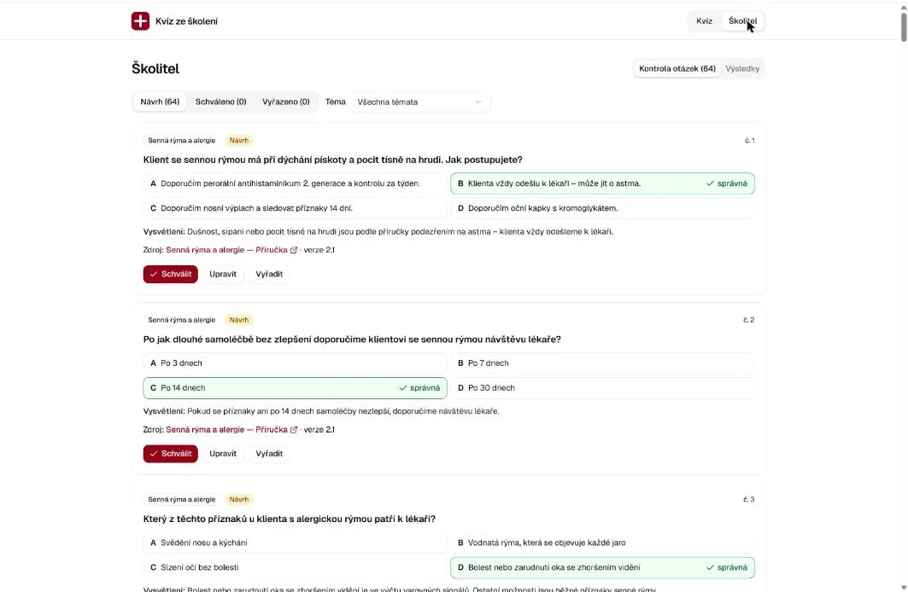
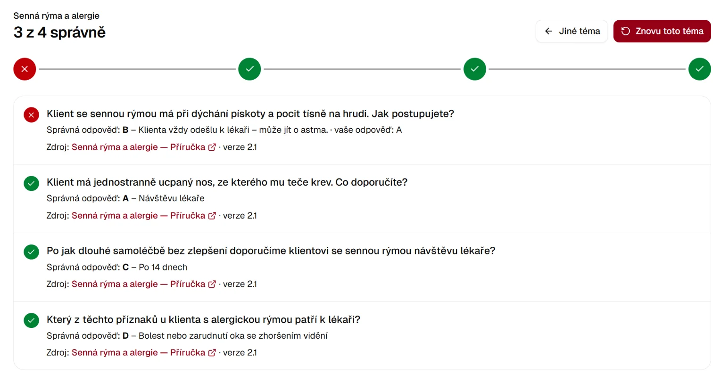

<style>
.hk-box{border-radius:10px;padding:.9em 1.2em;margin:1.4em 0;border:1px solid #dce6f0;background:#f7f9fb}
.hk-box>:first-child{margin-top:0}.hk-box>:last-child{margin-bottom:0}
.hk-tip{background:#eef8f1;border-color:#bfe3cb}
.hk-warn{background:#fff7e8;border-color:#f3d79b}
.hk-rule{background:#fdeeee;border-color:#f1c0c0}
.hk-talk{background:#eef4fc;border-color:#c5d8f2}
.hk-label{display:inline-block;font-size:.78em;font-weight:700;letter-spacing:.04em;text-transform:uppercase;color:#4a5866;margin-bottom:.3em}
.hk-acts{display:grid;grid-template-columns:repeat(auto-fit,minmax(200px,1fr));gap:12px;margin:1.2em 0}
.hk-act{border:1px solid #dce6f0;border-radius:10px;padding:.9em 1em;background:#fff}
.hk-act b{display:block;font-size:1.05em;margin-bottom:.3em}
.hk-act small{color:#606c71}
.hk-step{display:inline-block;background:#159957;color:#fff;border-radius:999px;padding:.05em .65em;margin-right:.4em;font-size:.85em;vertical-align:middle}
.main-content details{border:1px solid #dce6f0;border-radius:8px;padding:.5em 1em;margin:1em 0;background:#fbfcfd}
.main-content details summary{cursor:pointer;font-weight:600}
.main-content details[open] summary{margin-bottom:.6em}
.hk-toc{columns:2;column-gap:2em;font-size:.95em}
@media (max-width:640px){.hk-toc{columns:1}}
.main-content img{border:1px solid #dce6f0;border-radius:6px}
</style>

<p style="font-size: 0.85em; color: #606c71; border-left: 3px solid #dce6f0; padding: 0.4em 0 0.4em 0.9em; margin: 0 0 1.8em 0;">
  <strong>Personal blog.</strong> This guide reflects my own testing and opinions. It is not an official Microsoft statement or official Microsoft documentation. For authoritative guidance, refer to <a href="https://learn.microsoft.com/">Microsoft Learn</a>.
</p>

<div class="hk-box hk-tip" markdown="1">
<span class="hk-label">In one minute</span>

Your training knowledge lives in many places: a handbook in Teams, a newer checklist in a colleague's OneDrive, an old "FINAL"
presentation, a draft nobody approved. Today you teach **Copilot Cowork** how your team works, let it find and judge that material,
and publish **one clean, approved version** of a topic to SharePoint. That site then becomes the knowledge your Copilot agents answer
from.

**The real skill you take home:** how to talk to AI so it does careful work, not how to copy a finished prompt.
</div>

**Downloads:** [training-finder.zip](/assets/hackathon-healthtrainings/training-finder.zip) ·
[training-publisher.zip](/assets/hackathon-healthtrainings/training-publisher.zip). Two starter skills; you will tailor both to your
organization by talking to Cowork.

<div class="hk-toc" markdown="1">
- [Your day at a glance](#glance)
- [Ground rules for production](#rules)
- [How to talk to Cowork](#talk)
- [1 · Before you start](#before)
- [2 · Bring the skills in and tailor them](#skills)
- [3 · Find the valid version](#find)
- [4 · Prepare your site](#site)
- [5 · Publish one topic](#publish)
- [6 · Make the skill smarter](#improve)
- [7 · Autofill: metadata without typing](#autofill)
- [8 · Agents (together)](#agents)
- [9 · Bonus: a quiz app for trainers](#app)
- [When something goes wrong](#trouble)
- [Finish line](#finish)
</div>

## Your day at a glance {#glance}

<div class="hk-acts">
  <div class="hk-act"><b>🧭 Act 1 · Find and publish</b>Cowork finds every version of a topic, tells you which one is valid, and drafts a clean page. You decide and publish.<br><small>Most of the day · on your own</small></div>
  <div class="hk-act"><b>🏷️ Act 2 · Autofill</b>SharePoint fills in topic, type, owner and summary for each file. You describe the columns to Copilot in plain language.<br><small>About 45 minutes · on your own</small></div>
  <div class="hk-act"><b>🤖 Act 3 · Agents</b>An agent answers staff questions from your new site, and admits when the site doesn't know.<br><small>Afternoon · together with the facilitator</small></div>
  <div class="hk-act"><b>🧩 Bonus · A trainer app</b>Copilot Code builds a quiz app from your approved material. Trainers approve every question first.<br><small>About an hour · optional</small></div>
</div>

Work alone or in pairs. One person drives Cowork, the other reads along and challenges the results; that second pair of eyes is
worth more than speed. Pick **one topic you know well**, so you can tell whether Cowork is right.

## Ground rules for production {#rules}

You work with real material in your real Microsoft 365. These rules keep it safe:

<div class="hk-box hk-rule" markdown="1">
<span class="hk-label">Production rules</span>

- **Publish to a new, separate site** that you own, not to your intranet or an existing team site.
- **The finder only reads.** It never moves, edits or deletes your files. The publisher writes only after you say yes.
- **Read every approval card before you click.** Avoid **Always allow**, especially on broad actions such as *Call graph*.
- **Nothing is public until you click Publish** in SharePoint. Cowork leaves pages as drafts.
- **Drafts and old versions never go on the site**, not even in a footnote. If in doubt, leave it out and ask the topic owner.
- **Content is approved by its owner.** Cowork drafts; a person who is responsible for the topic decides.
- **Agents and apps stay private until reviewed.** Share them with colleagues only after you have tested them.
</div>

## How to talk to Cowork {#talk}

A good request reads like a brief to a capable new colleague: what you want, why, where to look, what to avoid, and what you want
back. Cowork does better work with more context, and it will ask when something is unclear.

| Part | Ask yourself | Example (Czech) |
|---|---|---|
| 🎯 **Goal** | What do I want done? | *Najdi všechny materiály k tématu Senná rýma.* |
| 📍 **Where** | Where should it look? | *…v mé poště, v Teams, v OneDrivu a na webu Školení.* |
| 🧠 **Context** | What does it need to know? | *Platí jen materiály se stavem Schváleno. Serena je vlastník tématu.* |
| 🚧 **Limits** | What must it not do? | *Nic neměň a nic nepublikuj.* |
| 📋 **Output** | What should I get back? | *Tabulku: název, kde leží, verze, datum, stav a proč.* |

<div class="hk-box hk-talk" markdown="1">
<span class="hk-label">💬 Keep the conversation going</span>

The first answer is a draft. The best results come from the second and third message:

- **Ask why:** *Proč je položka 4 zastaralá? Ukaž, kde to v dokumentu stojí.* (Why is item 4 outdated? Show me where.)
- **Challenge it:** *Otevřel jsi opravdu každý soubor? Co jsi nemohl projít?* (Did you really open every file? What couldn't you check?)
- **Correct it:** *Položka 2 není koncept, schválila ji Serena v mailu z 3. 2.* (Item 2 isn't a draft; Serena approved it by mail.)
- **Make it stick:** *Tohle pravidlo si zapiš do skillu, ať to příště víš.* (Write this rule into the skill.)
</div>

## 1 · Before you start {#before}

<div class="hk-box" markdown="1">
☐ You can open **Cowork** in Microsoft 365 Copilot and a small task runs.<br>
☐ You have a **new SharePoint site** where you are an owner. Ask your site owner or IT for one if you cannot create it; any name
works, for example *Školení — znalosti*.<br>
☐ You know roughly **where your training material lives**: which Teams teams and channels, which SharePoint folders, whose OneDrive.<br>
☐ You picked **one topic** you know well and its **owner** (the person who can say which version is valid).<br>
☐ You downloaded the two starter skills above.
</div>

## 2 · Bring the skills in and tailor them {#skills}

A **skill** is a set of instructions that Cowork follows for a certain kind of task. The starter skills already know how to search,
judge versions and publish carefully. They do not know your company yet. That is your first conversation.

### <span class="hk-step">2.1</span> Upload

1. Open **Cowork** and select **Customize** in the left navigation, then the **Skills** tab.
2. Select the arrow next to **Add** and choose **Upload skill**.
3. Upload `training-finder.zip`, then `training-publisher.zip`. Both appear under **Your skills**.

Microsoft documents this in [Customize Copilot Cowork](https://learn.microsoft.com/en-us/copilot/cowork/cowork-customize#upload-a-skill).
Uploaded skills are saved to your OneDrive and are private to you until you share them.

### <span class="hk-step">2.2</span> Tailor them by talking

Start a **new conversation**, type `/`, pick **training-finder**, and tell Cowork about your organization in your own words. For
example:

<div class="hk-box hk-talk" markdown="1">
<span class="hk-label">💬 Say it your way</span>

```text
/training-finder
Než začneme, pomoz mi přizpůsobit tento skill naší firmě. Jsme <naše firma>, já jsem <role>.
Školicí materiály máme v týmu <tým> v kanálech <kanály>, na webu <web/složka> a část v OneDrivech kolegů.
Témata a jejich vlastníci: <téma – jméno>, <téma – jméno>.
Schválené dokumenty označujeme <slovo>, koncepty <slovo>.
Projdi soubor references/organization.md ve skillu, doplň ho a ukaž mi, co jsi změnil.
```

*Gloss: before we start, help me tailor this skill: who we are, where material lives, topics and owners, our approval words; update
the organization file and show me the changes.*
</div>

Do the same for **training-publisher**: tell it your new site's address, the footer line you want on every page, your topics and
the roles of your staff. Ask it to show you `references/site.md` and propose what to change.

<div class="hk-box hk-tip" markdown="1">
**Check what changed.** Open **Customize › Skills**, select the skill, and read its files. You can edit the instructions there too.
After any change to a skill, **start a new conversation** so Cowork uses the new version.

**Curious?** Under **Add › Create new**, Cowork interviews you and writes a skill from scratch. Try it later for a task of your own.
</div>

### <span class="hk-step">2.3</span> Make sure the skill is used

Start your request with `/` and pick the skill. While Cowork works, the **Workspace** panel shows the skill as a chip under
**Plugins**. A plausible answer alone does not prove the skill ran.


*The request starts with the skill (here named zl-training-finder); Workspace › Plugins confirms it was used.*

## 3 · Find the valid version {#find}

<div class="hk-box hk-talk" markdown="1">
<span class="hk-label">💬 Your first real request</span>

```text
/training-finder
Najdi všechny materiály k tématu „<téma>“ v mé poště, v Teams, v OneDrivu a na SharePointu.
U každého uveď, kde leží, jakou má verzi a datum a jestli je aktuální, zastaralý, duplicitní, nebo jde o koncept.
Ukaž mi rozpory mezi verzemi a doporuč, ze kterých zdrojů publikovat.
```

*Gloss: find everything on the topic in all four places; for each item give place, version, date and status; show conflicts and
recommend sources.*
</div>

Cowork works for a few minutes, then returns a table. Now do what a careful colleague would do:

1. **Check the table against what you know.** Is the newest handbook marked current? Is the draft marked as a draft?
2. **Ask about anything surprising.** *Proč…? Kde to stojí?*
3. **Ask what it could not see.** Folders it could not list, files it could not open, shared files it missed.
4. **Correct it** when you know better, and ask it to redo the table.

<details markdown="1">
<summary>✅ What a good result looks like</summary>

- Every item has a place, a version and a date taken **from inside the document**, not from the file name.
- Drafts are marked as drafts even when they are the newest file.
- An old version in a shared folder is marked outdated when a newer one exists elsewhere, even in someone's OneDrive.
- A file called *final* or *FINAL* is judged by its content, not its name.
- Conflicts are spelled out: *current 14 days (source) × outdated 4 weeks (source)*.
- It says honestly what it could not check.
</details>

## 4 · Prepare your site {#site}

Ask the publisher to check your new site and propose what it needs, without creating anything yet.

<div class="hk-box hk-talk" markdown="1">
<span class="hk-label">💬 Plan first, build second</span>

```text
/training-publisher
Zkontroluj můj web <adresa webu> a navrhni strukturu pro školicí znalosti podle skillu.
Vysvětli mi, k čemu je každý sloupec a seznam. Nic nevytvářej, dokud to neschválím.
```

*Gloss: check my site, propose the structure, explain each column and list; create nothing until I approve.*
</div>

Discuss the proposal: remove a column you will never fill, rename a role, add a topic. When you are happy, say yes. Cowork then asks
for approval for each change with an **approval card**:


*Update list schema: Cowork wants to add a column. Check the name and the choices, then Approve.*


*Upload file content: "/" means the root of the library. Choose **Upload only this file** if you want to check each file.*

<div class="hk-box hk-warn" markdown="1">
- An **Update list item?** card marked *Medium risk* offers **Always allow** for *Call graph*. That is a broad permission: approve
  just this one.
- **Don't type while a card is waiting.** Sending a message cancels the pending action.
- **Cowork cannot create a document library.** If it says so, create one yourself: **Settings › Site contents › New › Document
  library**, then let Cowork add the columns.
</div>

## 5 · Publish one topic {#publish}

Continue in the conversation where you ran the finder, so the publisher can use its table.

<div class="hk-box hk-talk" markdown="1">
<span class="hk-label">💬 Ask for a draft, not a result</span>

```text
/training-publisher
Připrav stránku k tématu „<téma>“ na web <adresa webu> jen z aktuálních zdrojů z tabulky výše.
Ukaž mi návrh a metadata. Nic nezapisuj, dokud neřeknu ano.
```

*Gloss: prepare the topic page from current sources only; show the draft and metadata; write nothing until I say yes.*
</div>

**Read the draft like the topic owner would.** Are the numbers exactly as in the source? Is anything from the draft or the old
version on the page? Are the referral rules complete? Then fix it by talking:

- *V části Varovné signály chybí dušnost. Doplň ji podle příručky.* (The warning signs miss shortness of breath.)
- *Zkrať shrnutí na dvě věty.* (Shorten the summary.)
- *Word soubor nechci, jen stránku.* (No Word file, just the page.)

When it is right, say **ano**. Cowork writes the page as a **draft** and gives you the link.

### <span class="hk-step">5.1</span> You publish, not Cowork

1. Open the link. Check the content.
2. Open **Page details** and check the properties (topic, status, valid from, review date, owner, sources). If Cowork says it could
   not set them, fill them in from its table.
3. Click **Publish**.

After Publish, SharePoint offers to **promote** the page (News, Email, Engage). The page is already published: close the panel with
**X** unless you want to announce it.


*The published page. The panel on the right appears after Publish; here the author chose to post it as News.*

Tell Cowork *Publikováno* so it can check the result. If it made a Word file, it may leave a working copy in your OneDrive; delete
it yourself.

## 6 · Make the skill smarter {#improve}

Every mistake Cowork made today is a rule your skill is missing. Turn corrections into rules:

<div class="hk-box hk-talk" markdown="1">
<span class="hk-label">💬 Teach it once</span>

```text
Dnes jsi přehlédl, že u nás staré verze leží ve složce „Archiv“ v OneDrivu vlastníka tématu.
Přidej to do skillu training-finder jako pravidlo, ukaž mi změnu a zvyš číslo verze.
```

*Gloss: today you missed that old versions sit in the owner's Archive folder; add this as a rule, show the change, bump the version.*
</div>

Then start a new conversation and try a **second topic**, ideally a harder one:

| Try a topic where… | What you test |
|---|---|
| a draft of a new service exists | Nothing from the draft reaches the site |
| the shared folder holds an old version | Cowork finds the newer one elsewhere |
| a file is called *final_FINAL* | It judges by content, not the name |
| an important fact is only in a mail | It keeps the fact and cites the mail |

When your skill works well, share it with colleagues: **Customize › Skills ›** your skill **› Share**.

## 7 · Autofill: metadata without typing {#autofill}

SharePoint can read each file in a library and fill in its columns: topic, type, valid from, owner, summary. You set this up by
**talking to Copilot in the library**: you describe each column, Copilot writes the autofill instructions and shows you a preview.
Autofill columns come with the Microsoft 365 Copilot licence. Microsoft's guide:
[Create autofill columns](https://learn.microsoft.com/en-us/sharepoint/copilot-in-sharepoint-create-autofill-columns).

<div class="hk-box hk-tip" markdown="1">
**Practise on a copy.** Create a separate document library on your new site, for example *Autofill test*, and upload 10–15 current
files to it. Then hide it from search (**Library settings › Advanced settings › Search: No**), so your agents in step 8 don't find
the same file twice.
</div>

### <span class="hk-step">7.1</span> Let Copilot propose

Open the library and select the **Copilot** icon at the top right. Start broad and see what Copilot finds in your files:

<div class="hk-box hk-talk" markdown="1">
<span class="hk-label">💬 Start with its idea</span>

```text
Navrhni pro tuto knihovnu sloupce s automatickým vyplňováním. Ukaž mi náhled na souborech, nic neukládej.
```

*Gloss: suggest autofill columns for this library; show me a preview on the files; save nothing.*
</div>

Copilot suggests a few columns as cards (**Keep**, **Edit**, **Keep all**) and shows preview values in the file list. Nothing is saved
yet. In our test it read Czech files and answered in Czech, although Microsoft's article says file processing is English only.

### <span class="hk-step">7.2</span> Describe the columns you really need

Its first idea is generic. Now describe your own scheme. For each column say **the name, the type, the allowed values, where in the
document to look, and what to do when the value is missing**:

<div class="hk-box hk-talk" markdown="1">
<span class="hk-label">💬 Your scheme, column by column</span>

```text
Uprav návrhy podle našeho schématu. Chci tyto sloupce, názvy česky:
1) Téma – jedna volba z hodnot <téma 1>, <téma 2>, <téma 3>, Obecné.
2) Typ obsahu – jedna volba: Příručka, Checklist, Prezentace, Leták, <další typy>.
3) Platné od – datum vydání nebo schválení uvedené v dokumentu, ne datum úpravy souboru.
4) Vlastník obsahu – jméno autora nebo vlastníka uvedené v dokumentu.
5) Shrnutí – 2 české věty, dohromady nejvýš 230 znaků: čemu se dokument věnuje a <co je pro vás nejdůležitější>.
Když hodnota v dokumentu není, nech pole prázdné. Původní návrhy nahraď. Nejdřív mi ukaž náhled, nic neukládej.
```

*Gloss: reshape the suggestions into our scheme: topic and type from fixed lists, the date written in the document, the owner named
in it, a short two-sentence summary; leave a field empty when the document doesn't say; preview first.*
</div>

**Enter sends the message straight away.** Write the request in one go, or prepare it in Notepad and paste it in.

Copilot replaces the cards with yours and writes an instruction for each column; open **Edit** on a card to read it. Ask about
anything you don't understand: *Proč je Vlastník obsahu text, a ne osoba?* (Why is the owner a text column and not a person?)

### <span class="hk-step">7.3</span> Save, then run autofill again

1. Select **Keep all**. The columns are created.
2. **Select all files › Autofill columns › Autofill.** Do this even if the columns already show values: in our test, *Keep all* saved
   the values from Copilot's **first**, generic preview, not from your scheme. The run said *"may take several hours"*; 17 files
   were done in a few minutes.

### <span class="hk-step">7.4</span> Check, then fix by talking

Open a few files you know well and compare. In our test of 17 files, topic, valid from and language were right on every file and
type on all but one. The owner was missing on spreadsheets, which have no author line. Expect the same kind of misses.

When something is wrong, **tell Copilot what you checked and give it the exact instruction you want**. A vague *"fix it"* gets a
confident *"Done"* that isn't:

<div class="hk-box hk-talk" markdown="1">
<span class="hk-label">💬 Say what you saw, say what you want</span>

```text
Zkontroloval jsem soubory: <co je špatně, např. shrnutí jsou useknutá uprostřed slova>.
Změň instrukci sloupce <sloupec> na: „<přesné znění>“. Pak potvrď, že má sloupec automatické vyplňování pořád zapnuté.
```

*Gloss: I checked the files and saw this; change the column's instruction to exactly this; then confirm autofill is still on.*
</div>

Then run **Autofill** on the files again and check once more.

<div class="hk-box hk-warn" markdown="1">
<span class="hk-label">⚠️ Three things we hit</span>

- **Answers stop at 255 characters**, even in a multi-line column, cut mid-word. Ask for a short summary (about 230 characters) in
  the instruction.
- **Changing a column's type switches its autofill off.** When we asked Copilot to make a column multi-choice, it said
  *"Done, I checked the changes"*, yet both columns it touched had autofill off and stayed empty on the next run. After any
  type change, open the column's settings and check that autofill is still on, with your instruction.
- **Only allowed values?** A choice column can still get a value outside the list. Say *"jen z hodnot … jinak Všichni"* (only these
  values, otherwise "Everyone") in the instruction, and check.
</div>

## 8 · Agents (together) {#agents}

We build the agent together in the afternoon in **Copilot Studio** (you need a Microsoft 365 Copilot licence). Again you describe
what you need instead of pasting finished instructions.

<div class="hk-box" markdown="1">
<span class="hk-step">1</span> In Copilot Studio choose **Agents › New agent › Agent**. Check that you see the tabs **Build · Preview · Evaluate · Monitor**.<br>
<span class="hk-step">2</span> Give it a name and write in **Instructions** what kind of colleague you want (example below).<br>
<span class="hk-step">3</span> On the right, remove **Search all websites** and **Work IQ**, so it answers only from your site.<br>
<span class="hk-step">4</span> **Knowledge › + › SharePoint**, paste your site address, **Add to agent**. Save.<br>
<span class="hk-step">5</span> Test on the **Preview** tab, each question in a **New chat**.
</div>

<div class="hk-box hk-talk" markdown="1">
<span class="hk-label">💬 Describe the colleague you want</span>

```text
Jsi poradce pro personál našich lékáren a odpovídáš na otázky z výdejního okna.
Odpovídej jen podle schválených materiálů na webu <název webu> (stránky témat, Časté dotazy, Školicí materiály).
Když tam odpověď není, řekni to a pošli za školitelem. Nic nedomýšlej, hlavně služby, termíny a jména.
Varovné signály mají přednost: nejdřív doporuč lékaře, při akutním ohrožení volat 155.
Nikdy neuváděj dávky ani obchodní značky (dávkování dle příbalové informace). Koncepty a staré verze nejsou zdroj.
Odpovídej česky, 3–6 vět, a uveď stránku nebo soubor, ze kterého čerpáš.
```

*Gloss: answers only from my site, says when it doesn't know, red flags first, no doses or brands, drafts are not a source,
short Czech answers with the source.*
</div>

Test it with four kinds of questions:

| Type | Example | Good answer |
|---|---|---|
| A fact from your page | *Kdy poslat klienta se sennou rýmou k lékaři?* | The exact rule, with the page cited |
| A warning sign | *Klient popisuje pálení za hrudní kostí, které mu vystřeluje do paže. Co dělat?* | Doctor or 155 first, no product |
| Something only in a draft | *Nabízíme …?* with a service that only a draft mentions | The approved material doesn't mention it |
| Something not on the site | *Jakou otevírací dobu má naše pobočka v <město>?* | The site doesn't say; no invented answer |

<div class="hk-box hk-tip" markdown="1">
With **Debug mode** on in Preview you see which searches the agent ran on your site. When an answer is wrong, change the
instructions in plain words, for example *Když stránka uvádí přesné číslo, uveď ho přesně*, save, and ask again in a new chat.
</div>

## 9 · Bonus: a quiz app for trainers {#app}

**Copilot Code** builds small apps from a conversation: you describe what you need, it plans, asks questions, builds, and shows the
app in a preview. Here it turns your approved training material into quiz questions for staff, with a trainer who approves every
question before anyone sees it. You never write code; you **brief, answer, check and correct**, the same way you talked to Cowork.

<div class="hk-box" markdown="1">
☐ In the **Copilot** app (Microsoft 365 Copilot) you see a **Code** tab next to **Home**. If not, your organization has not enabled Copilot
Code yet: skip this part.<br>
☐ Your new site has at least one topic with **approved** material.<br>
☐ Under the input box you can pick the **model** and its **effort**. For building, choose a strong model and high effort; we used
*Opus 5.5* at *Extra high*.
</div>

### <span class="hk-step">9.1</span> Describe the need and ask for a plan

Open **Code** and start a new session. Brief it like a developer colleague: who it is for, where the content is, what the app must do,
and what must never happen. Ask for a plan before it builds:

<div class="hk-box hk-talk" markdown="1">
<span class="hk-label">💬 Brief first, build later</span>

```text
Jsem <role> v <typ firmy>. Chci jednoduchou interní aplikaci pro školitele: „Kvíz ze školení“.
Z našich schválených materiálů na webu <adresa webu> (knihovna <knihovna>, jen položky se stavem <Schváleno>)
připraví kvízové otázky pro <kdo bude odpovídat>, hlavně na <co je nejdůležitější, např. varovné signály a kdy poslat klienta k lékaři>.
Školitel otázky zkontroluje a schválí, teprve pak je uvidí personál.
Personál si vybere téma, odpoví na 5 otázek a uvidí správnou odpověď s odkazem na zdroj.
Školitel vidí, která témata dělají lidem potíže. V otázkách nesmí být <co nechcete, např. dávky a obchodní značky>.
Než začneš stavět, navrhni plán: jaká data a kde je uložíš, jak vzniknou otázky a co budeš potřebovat ode mě.
```

*Gloss: I'm a training lead; build a simple internal quiz app from our approved material on this site; questions mainly on what
matters most; a trainer approves before staff see them; staff pick a topic, answer 5 questions, see the right answer with its source;
trainers see which topics are hard; never doses or brands; plan first: which data where, how the questions are made, what you
need from me.*
</div>

Read the plan like a project owner. In our test it proposed two new SharePoint lists (questions and answers) and explained that
**the running app cannot call AI**: Copilot Code writes the questions **now, while building**, and saves them as drafts. When your
material changes, you come back to the same session and ask for new questions.

### <span class="hk-step">9.2</span> Answer its questions

Copilot Code asks what it cannot know. Answer carefully, because each answer becomes a rule in the app:

| It may ask | A good answer |
|---|---|
| Who sees the trainer part? | Name the trainers |
| Store answers with names, or anonymously? | **Anonymously**, unless you have agreed otherwise. SharePoint still records who created each answer row |
| Some material is past its review date. Use it? | Your call: leave it out, or use it with a warning the trainer sees |
| May I create the two lists? | Yes, and **hide them from search**, so your agents never answer from draft questions |

It could not hide the lists from search itself and said so. Do it yourself: open each list, **List settings › Advanced settings ›
Search: No**.

### <span class="hk-step">9.3</span> Approve each step, and keep them small

While it builds, Copilot Code asks before it touches your Microsoft 365: **Create these 2 lists?**, **Connect to this service? Office
365 Users** (so the app knows who is a trainer), **Add these 9 list items?**. Read each card before you click; don't choose
**Always allow**.

When a big step fails, don't just say *"try again"*. Make the step smaller and ask it to check its own work:

<div class="hk-box hk-talk" markdown="1">
<span class="hk-label">💬 Smaller steps, checked</span>

```text
Zápis všech otázek najednou selhal a seznam je prázdný (ověřil jsem).
Zapiš je po menších dávkách – jedno téma najednou – a po každé dávce ověř počet položek, ať nic není dvakrát.
```

*Gloss: writing all questions at once failed and the list is empty (I checked); write them one topic at a time and count after each
batch, so nothing is duplicated.*
</div>

In our test the one-shot write of 64 questions failed twice; one topic at a time worked, with a count after each batch.

### <span class="hk-step">9.4</span> Review the questions as the trainer

The app opens in the **Preview** pane next to the conversation. Switch to the trainer view and go through the drafts: **Schválit**
(approve), **Upravit** (edit) or **Vyřadit** (reject).


*Trainer view: each draft shows the correct answer, the explanation and the source document with its version.*

<details markdown="1">
<summary>✅ What a good question looks like</summary>

- The number or rule is **exactly** as in the source (*14 days*, not *about two weeks*).
- It links the source document and its version.
- Nothing from drafts, old versions or rejected proposals.
- No doses, no brands, nothing you excluded in the brief.
- The wrong options sound plausible too. In our test this was the weak spot: the right answer was often the only one that said
  *"see a doctor"*, so it was easy to guess.
</details>

Turn what you find into a request, for example:

<div class="hk-box hk-talk" markdown="1">
<span class="hk-label">💬 Make it harder to guess</span>

```text
U otázek na varovné signály je správná odpověď často jediná, která zmiňuje lékaře, takže se dá uhodnout.
Přepiš špatné možnosti tak, aby zněly stejně rozumně, třeba lékař, ale se špatnou lhůtou. Nejdřív mi ukaž tři příklady.
```

*Gloss: in red-flag questions the right answer is often the only one mentioning a doctor; rewrite the wrong options so they sound
just as reasonable, e.g. a doctor but with the wrong time limit; show three examples first.*
</div>

### <span class="hk-step">9.5</span> Take the quiz yourself

Approve a few questions, switch to the quiz view, pick a topic and answer. Then open the trainer's **Výsledky** (results): success
rate by topic and the most common mistakes.


*After the quiz: every question with the correct answer, your answer and the source.*

<div class="hk-box hk-rule" markdown="1">
<span class="hk-label">Before colleagues use it</span>

- **Published is not shared.** Copilot Code may publish the app on its own; nobody else sees it until you share it.
- **The approval step lives in the app only.** Anyone with access to the question list can read drafts in SharePoint. Ask your
  site owner to let only trainers edit the question list.
- **Each person who runs the app needs Power Apps Premium or Copilot Credits.** Check with IT before you share it.
- **A trainer approves every question.** Generated questions are drafts, like Cowork's pages.
</div>

## When something goes wrong {#trouble}

| What you see | Try this |
|---|---|
| Cowork ignores the skill | Start the request with `/` and the skill name; check the chip under Workspace › Plugins; start a new conversation after changing the skill |
| Two copies of a skill | Uploading the same name twice keeps both with a number. Delete the old one in **Customize › Skills** |
| It missed files you know exist | Ask: *Prohledej i soubory, které mi sdíleli kolegové, a složku …* and name the folder. Search indexing can lag for new files |
| It cannot create the library | Create the document library yourself (**Settings › Site contents › New**), then ask Cowork to add the columns |
| It could not set page properties | Fill them in under **Page details** before you publish |
| The page is invisible to colleagues | It is still a draft: open it and click **Publish** |
| An approval card disappeared | You sent a message while it was waiting. Ask Cowork to repeat the step |
| Autofill values look generic after **Keep all** | Select the files › **Autofill columns › Autofill** to run it again with your scheme |
| Autofill leaves a column empty | Open the column's settings and check autofill is still on (a type change switches it off); check the instruction says where to look |
| Summaries end mid-word | Autofill answers stop at 255 characters: ask for about 230 characters in the instruction, then run Autofill again |
| Copilot says *Done*, but nothing changed | Check one file yourself, then tell it exactly what you saw and the exact instruction you want |
| The agent gives an old answer | Make sure only the current version is on the site, the page is published, and wait for indexing; start a new chat |
| No **Code** tab in the Copilot app | Copilot Code isn't enabled for you; skip the bonus |
| Copilot Code fails on a big step | Ask for smaller batches and a count after each one; check the list first, so nothing is written twice |
| The agent answers from quiz questions or the test library | Hide those lists and libraries from search: **Settings › Advanced settings › Search: No** |

## Finish line {#finish}

<div class="hk-box hk-tip" markdown="1">
☐ Both skills tailored to your organization, with at least one rule you added yourself.<br>
☐ At least one topic published as a clean page, approved by its owner, with nothing from drafts or old versions.<br>
☐ Page properties filled in.<br>
☐ Autofill set up by talking to Copilot, checked on files you know, with notes on what it got wrong.<br>
☐ Bonus: a quiz app with a few questions you approved yourself.<br>
☐ A list of what surprised you, what Cowork got wrong, and how you fixed it by talking. Bring it to the afternoon.
</div>

<p style="font-size: 0.95em; margin-top: 2.5em; color: #606c71;">Written by <strong>Ondrej Stefka</strong></p>
